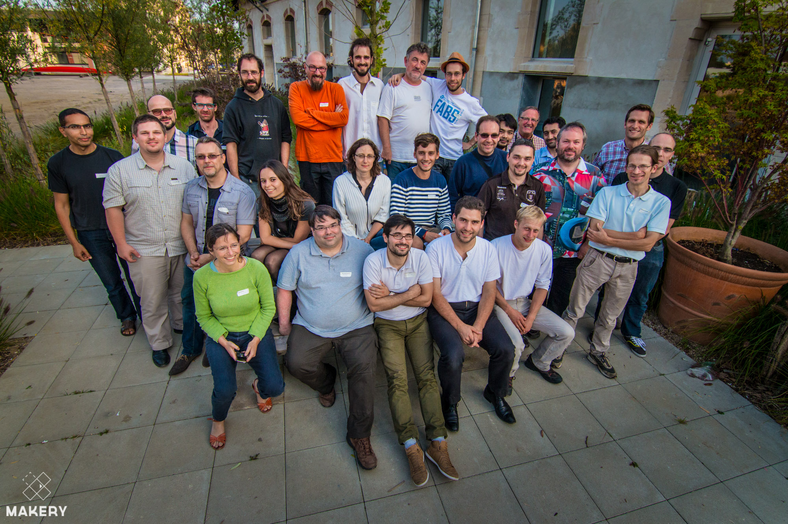

**Première belle initiative de réunir tous les Fablabs et Makerspace du Grand Est.** Le 13 septembre 2014, une trentaine de personne représentant une dizaine de structures se sont retrouvées à NANCY dans les locaux du [Lorraine Fab Living Lab](http://laboratoire-erpi.wikispaces.com/Lorraine+Fab+Living+Lab). François et Julien y étaient pour la Fabrique. En mode [BarCamp](http://fr.wikipedia.org/wiki/BarCamp), de nombreux thèmes cruciaux ont été abordés tel que la fabrication distribuée, les modèles économiques, la sécurité, la mise en commun de compétence...

Pour en savoir plus suivez le lien vers l'article de [MAKERY](http://www.makery.info/2014/09/24/a-la-reunion-de-famille-des-labs-du-grand-est/).
