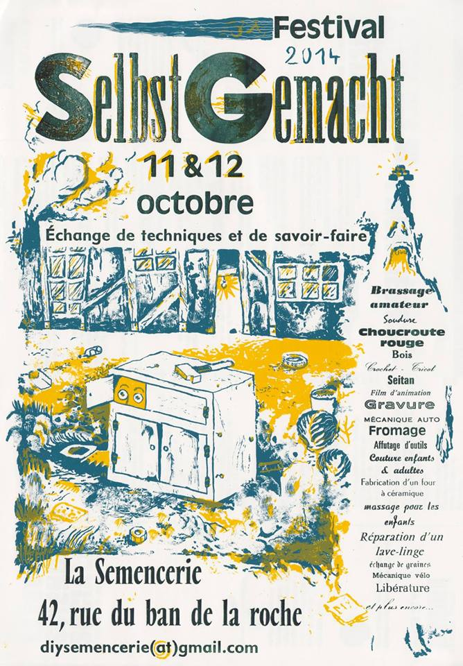
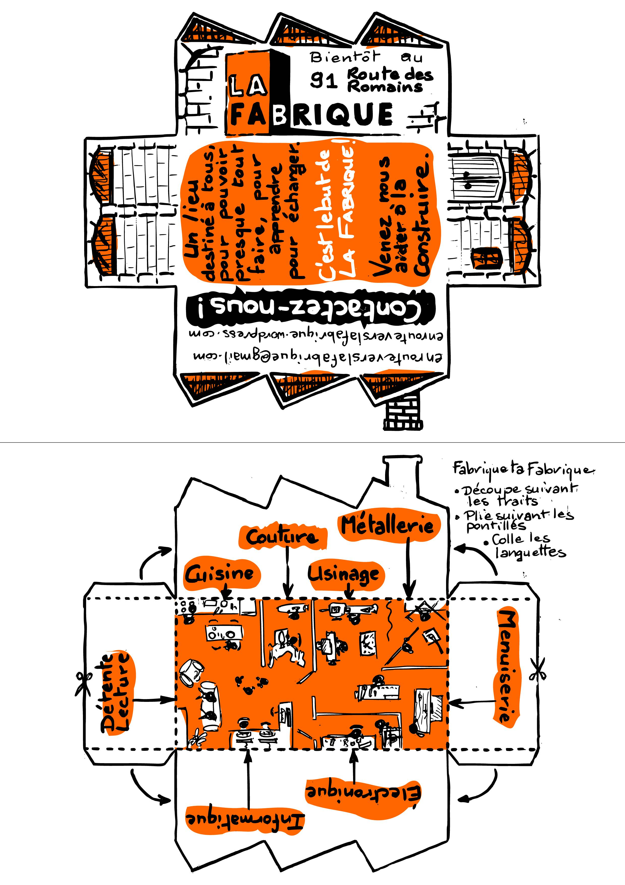

Le 11 et 12 octobre 2014, la Fabrique a animé un atelier au DIY, festival du faire soi même, [SelbstGemacht](https://selbstgemacht-diy.blogspot.com) en alsacien organisé par le collectif d'artiste de la [Semencerie](http://www.lasemencerie.org). Le principe de l'atelier était de fabriquer **une boite inutile** et mystérieuse. Une boite en carton muni d'un seul interrupteur sur le dessus, si cet interrupteur est actionné, la boite se déploie, éteint l'interrupteur puis se referme, toute seule....

L'atelier a permit sur deux jours à une quinzaine de personnes de réaliser leur propre boite à l'aide de carton, bois, moteur, interrupteurs, fils électrique, pile, chambre à air, punaises, élastiques, colle etc... Les personnes ont pu apprendre à scier, percer, souder, découper et mettre au point (la partie la plus longue).

Merci à tous les participants et animateurs pour la réussite de cette animation qui sera assurément reconduit.

D'autres animations ont permis à tous de découvrir les joies de réaliser par eux-même de nombreuses choses.

## A cette occasion la Fabrique distribuait son premier Flyer.

