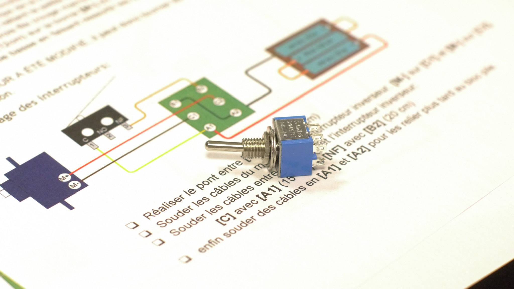
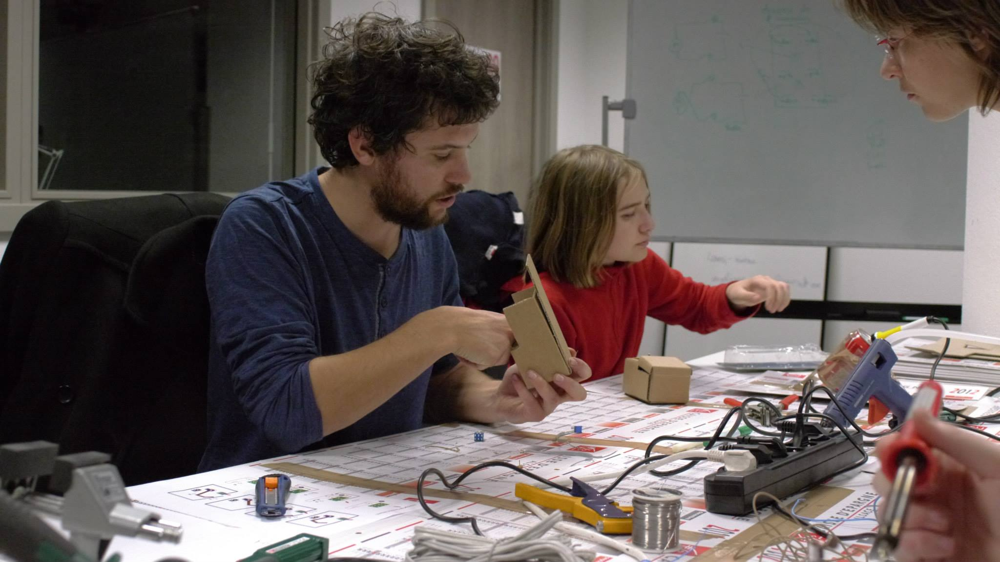
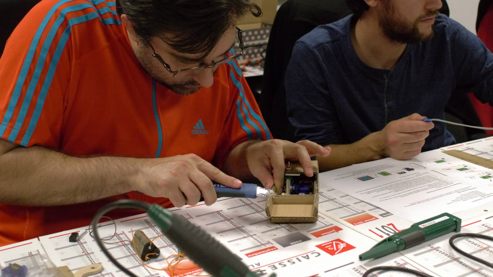
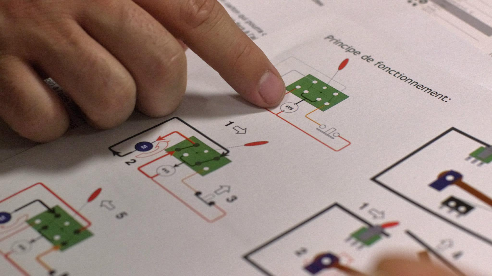

 

Seconde *animation boite inutile* organisée par la Fabrique dans le cadre des soirées [HSXB](https://www.hacksxb.com/) de la [Plage Digital](http://www.laplagedigitale.eu/), une dizaine de personne ont pu fabriquer leur boite en carton. Première partie de soirée, en petit atelier, bois, carton, soudure puis pause Pizza et seconde partie mise au point des boites, pour finir tard après minuit. Tous ont pu repartir avec une boite fonctionnelle, dont un avec une version spéciale catapulte. Un grand merci à la Plage Digital, notre partenaire qui nous accueille tout les mardi soir pour nos réunions hebdomadaires.

 

Toutes les photos --> [**Sur Facebook**](https://www.facebook.com/media/set/?set=a.794552507272799.1073741832.341847229209998&type=1)
