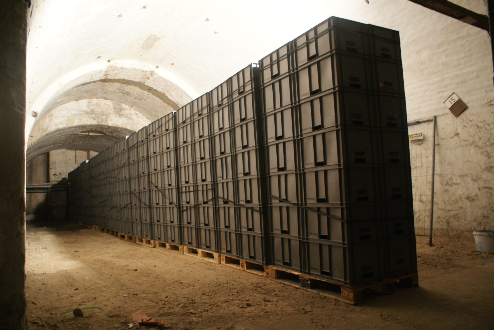

Ce vendredi après-midi, nous avons déchargé un camion que nous avions fait venir d'Allemagne avec 33 palettes qui contenaient du matériel informatique et surtout les (trop ?) nombreuses  caisses grises.

Elles serviront aux usagers de La Fabrique pour ranger, transporter et trier, mais également à toutes sortes de choses.

Une belle opération de récupération à grande échelle ! On commence à sentir l'intérêt d'avoir plein de place.

Le déchargement, en images...

[Lien vers la vidéo Youtube](https://www.youtube.com/embed/OtOAI94PPpU)

<iframe width="560" height="315" src="https://www.youtube.com/embed/OtOAI94PPpU?si=VVnKUs9Cva3Hog71" title="YouTube video player" frameborder="0" allow="accelerometer; autoplay; clipboard-write; encrypted-media; gyroscope; picture-in-picture; web-share" referrerpolicy="strict-origin-when-cross-origin" allowfullscreen></iframe>

