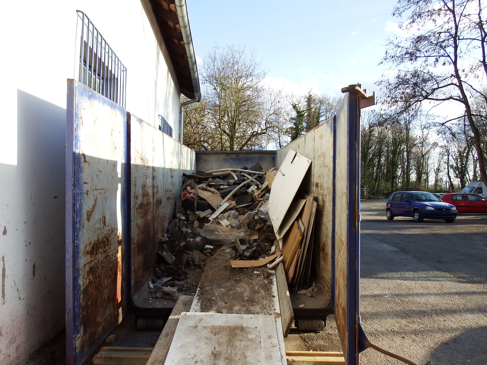

Il faut le dire, à l'origine les locaux ressemblaient surtout à un dépotoir. Pas mal de choses avaient été vidées en octobre pour la Psyloween, une partie des fossés avaient été curés, on s'était débrouillé pour que ceux qui y avaient stocké des affaires les récupèrent : matériel son, échafaudages, 3 m³ de cafetières, une camionnette en kit, 1 m³ d'huile de vidange une voiture entière...<!--more-->

Il restait quand même encore des gravats de la démolition, plusieurs générations de tuyauterie inutile et de la crasse à peu près partout. Même si le métal a été emmené par les ferrailleurs qui passent régulièrement voir si on a des choses intéressantes pour eux, c'est pas moins de 10 tonnes de déchets que l'on a dû mettre à la benne. Le camion s'en souviendra.

[Lien vers la vidéo Youtube](https://www.youtube.com/watch?v=F8tB-4aXyx4)

<iframe width="560" height="315" src="https://www.youtube.com/embed/F8tB-4aXyx4?si=fiiISTXBK7HjuE7N" title="YouTube video player" frameborder="0" allow="accelerometer; autoplay; clipboard-write; encrypted-media; gyroscope; picture-in-picture; web-share" referrerpolicy="strict-origin-when-cross-origin" allowfullscreen></iframe>
