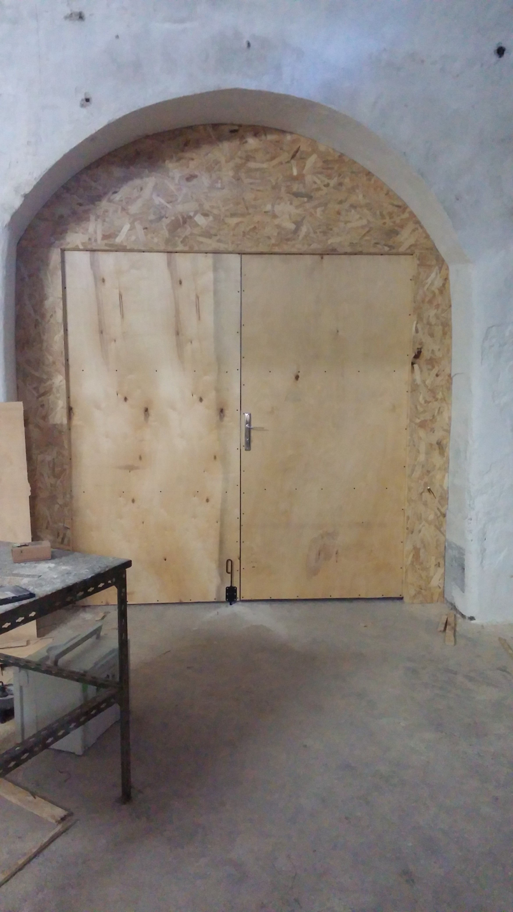
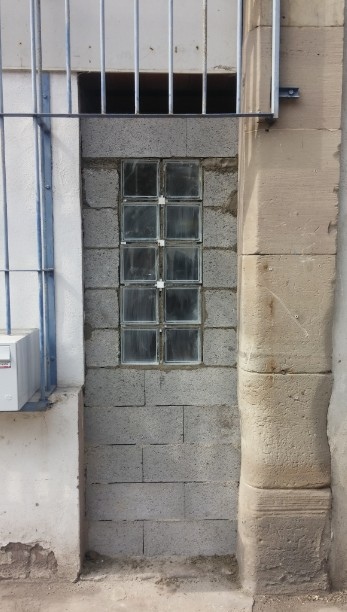
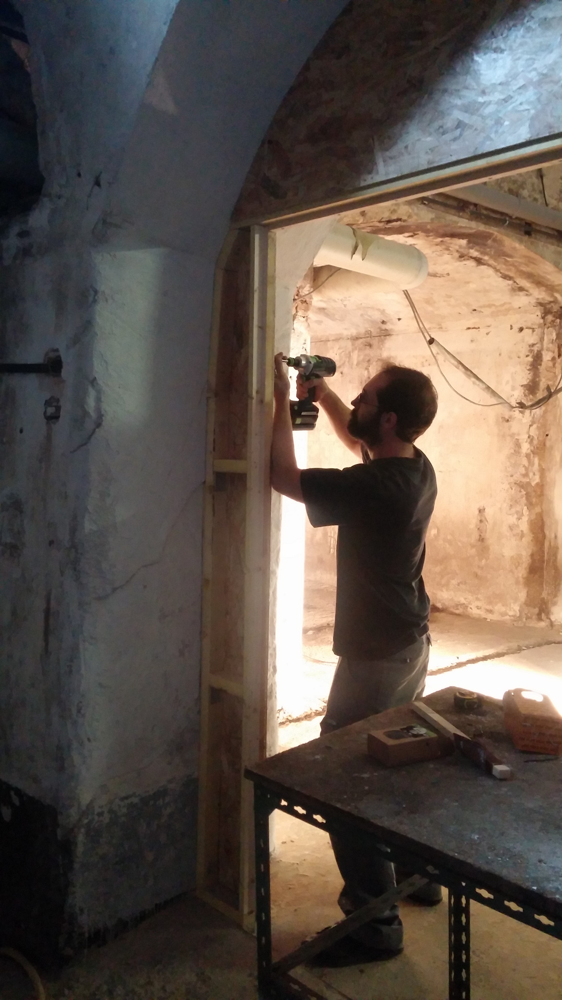
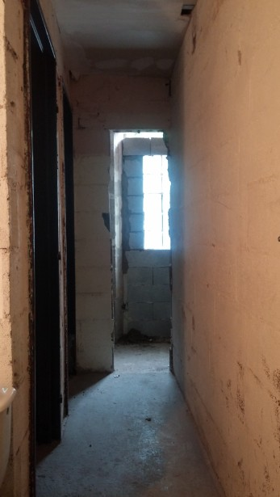
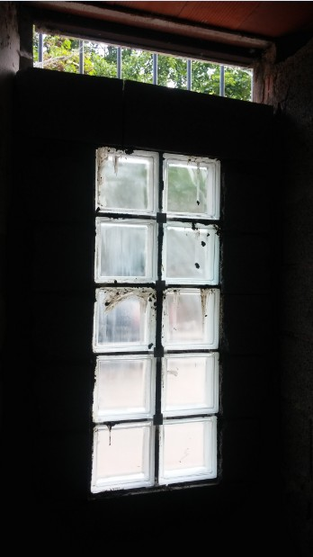

Après avoir ouvert l'espace en démolissant, on le referme ailleurs en cloisonnant. Le futur espace commence à se dessiner...

Pour terminer de séparer l'espace qui sera réservé au public du "reste", il nous manquait encore une cloison. Du côté du hall nous voulions faire passer les toilettes extérieures à l'intérieur, et gagner quelques m² de sanitaires.

C'est chose faite. Menuiserie ou maçonnerie, chacun sa spécialité.

Côté travées : montage d'une cloison à ossature bois avec une porte à double battant pour pouvoir circuler facilement, tout ça sur mesure et fait maison avec une serrure et tout ce qu'il faut.

Ça a aussi été pour nous l'occasion de tester notre matériel de menuiserie (scie circulaire, scie sauteuse, ponceuse, défonceuse, visseuses sans fil...) qui attendait sagement dans un coin. Pas de surprise, quand on a du bon matériel sous la main, tout se passe bien !

On en a aussi profité pour commencer à exploiter les stocks de panneaux que l'on avait récupéré quelques semaines avant.

Au final, ça donne un bon aperçu de l'espace qui sera dédié au public.

[Lien vers la vidéo Youtube](https://www.youtube.com/watch?v=y_ytVmSY7dU)

<iframe width="560" height="315" src="https://www.youtube.com/embed/y_ytVmSY7dU?si=XFeGm5N4ZerEMkLl" title="YouTube video player" frameborder="0" allow="accelerometer; autoplay; clipboard-write; encrypted-media; gyroscope; picture-in-picture; web-share" referrerpolicy="strict-origin-when-cross-origin" allowfullscreen></iframe>

Côté sanitaires, nous voulions récupérer l'espace avec les toilettes qui donnait bizarrement vers... l'extérieur.

On démolit un mur d'un côté, on en construit un de l'autre, et hop ! ce qui était dehors se retrouve dedans, avec de la lumière en bonus grâce aux briques de verre.

Il ne reste plus qu'à choisir ce qu'on va en faire. Un troisième WC, un vestiaire, un placard à balais ?
