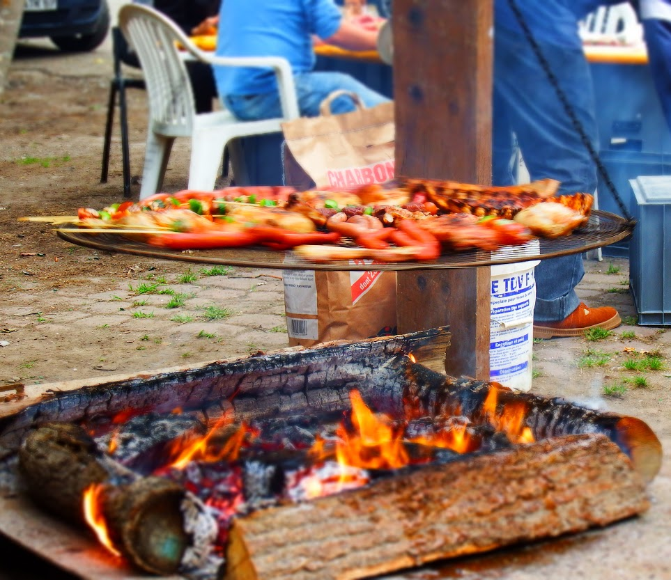
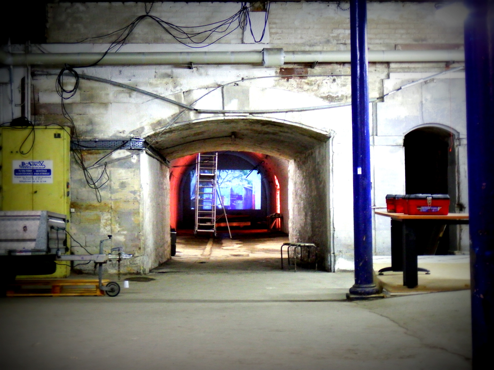

Bonjour à tous,

nous tenons à remercier tous ceux qui étaient présents vendredi 19 juin à La Fabrique.

Merci pour la participation de chacun, en termes de saucisses et autres boisson, de bonne humeur et simplement pour l’intérêt que vous portez à ce que nous faisons. La soirée était très agréable et nous étions heureux de voir tant de monde réuni dans nos locaux du 91C route des Romains qui ont, habituellement, plutôt la forme d’un grand chantier. C’était un plaisir d’avoir l’occasion de vous faire découvrir (ou redécouvrir) ce lieu dans lequel nous avons passé déjà beaucoup de temps ces derniers mois et où, nous l’espérons, nous en passerons plus encore par la suite !

Vous faire venir n’était pas anodin pour nous. En effet, nous attaquons la dernière ligne droite avant l’ouverture au public de La Fabrique à la rentrée. Il ne nous reste donc plus que cet été pour être prêts, et nous aurons pour cela besoin de toutes les bonnes volontés disponibles. Donc, si vous êtes prêts à nous aider vous êtes les bienvenus. Quelles que soient vos envies ou vos compétences, il est possible de participer : prendre part au chantier, réfléchir à l’organisation, aider à l’élaboration du site internet… et, bien sûr, parler de La Fabrique autour de vous.

De notre côté nous allons tâcher de vous donner des nouvelles régulières. Pour commencer, nous enverrons un mail hebdomadaire résumant les tâches en cours, les rendez-vous et les besoins immédiat de la semaine sur lesquels il est possible de s’impliquer. Si vous ne souhaitez plus être sollicités, faites le nous savoir par mail à [contact@lafab.org](mailto:contact@lafab.org), nous vous retirerons de la liste.

Trêve de blablas, entrons dans le vif du sujet : le planning de la semaine prochaine est le suivant :

- lundi 29/06 - préparation de notre stand pour EdgeFest : petits montages électroniques et bateaux téléguidés avec pour but une création collective : plein de petites lumières sur l’eau.

- mardi 30/06 :
    - 19:00 - réunion hebdomadaire générale
    - 20:00 - réunion site internet

- samedi 04/07 - participation à [EdgeFest](http://www.edgefest.fr/edgeday.html) : Pour le moment, Manu est tout seul pour tenir le stand ! Toute personne prête à lui donner un coup de main est la bienvenue.

- vendredi 03/07 - après-midi chantier

 

En parallèle, parmi les choses  à faire :

- passer de la chaux sur les murs
- remonter et tester des ordinateurs
- monter des bureaux
- trier les matériaux et composants
- nettoyer
- ...

 

Si vous avez des disponibilités (aux moments prévus ou à d’autres) ou des propositions, n’hésitez pas à nous le faire savoir !

 

La Fabrique vous dit “Merci !”.
