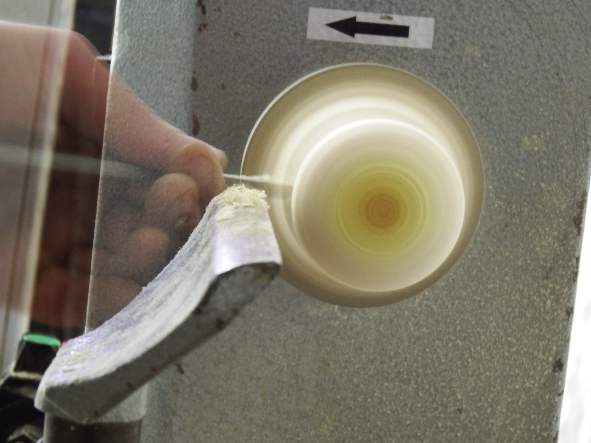
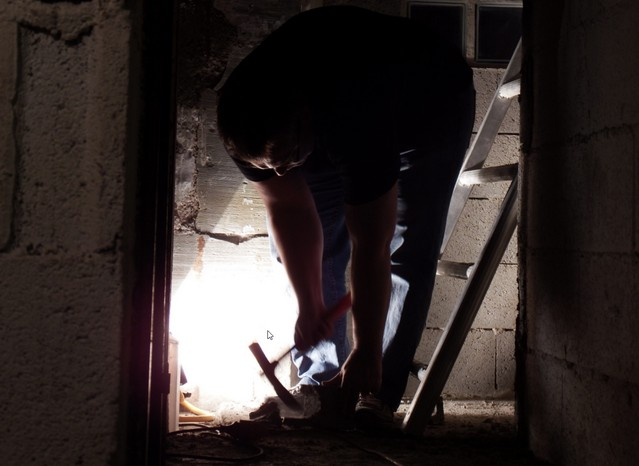
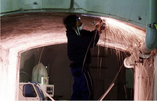

Julien a mis en route le tour à bois, et il marche bien, ça fera des beaux objets en perspective.

Mercredi dernier Mathieu, Johann et Serge ont travaillé de soirée au niveau du passage 2 et des sanitaires. La livraison du bois de Jeudi nous a permis de démarrer les travaux du passage 2. Le plancher en OSB est fait ! Nous avons aussi avancé notre réflexion sur le site internet. Tout ceci et plus à voir sur [cette vidéo](https://www.youtube.com/watch?v=LsWTUBFt-z0).

<iframe width="560" height="315" src="https://www.youtube.com/embed/LsWTUBFt-z0?si=uyjpqVtYPXD7FXy4" title="YouTube video player" frameborder="0" allow="accelerometer; autoplay; clipboard-write; encrypted-media; gyroscope; picture-in-picture; web-share" referrerpolicy="strict-origin-when-cross-origin" allowfullscreen></iframe>

