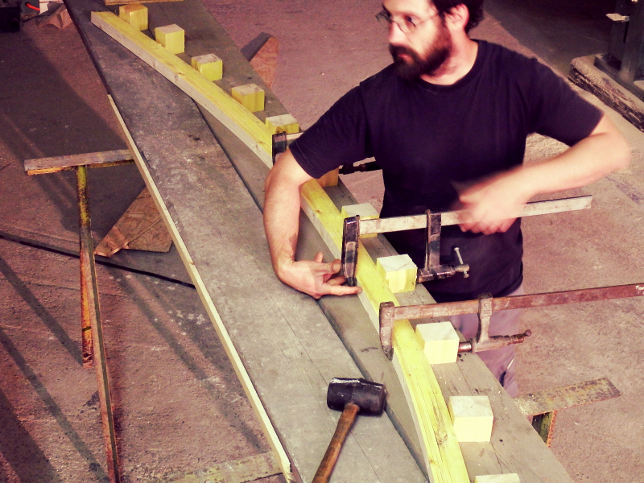
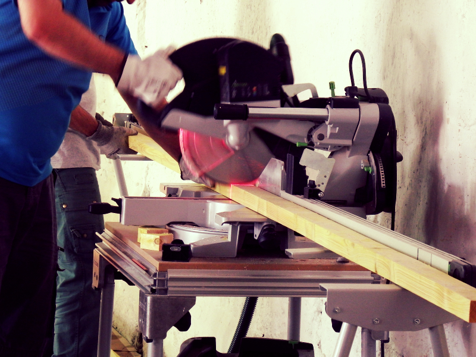

Les arches pour le toit de la cabane dans le passage 2 ont été réalisées.

Les travaux de découpe et de cintrage seront à voir en video sur la [chaine Youtube de la Fabrique](https://www.youtube.com/channel/UCaih6kluRYDDN1_1duZ_VLg). La structure des murs est construite aussi. Reste à assembler le tout !

