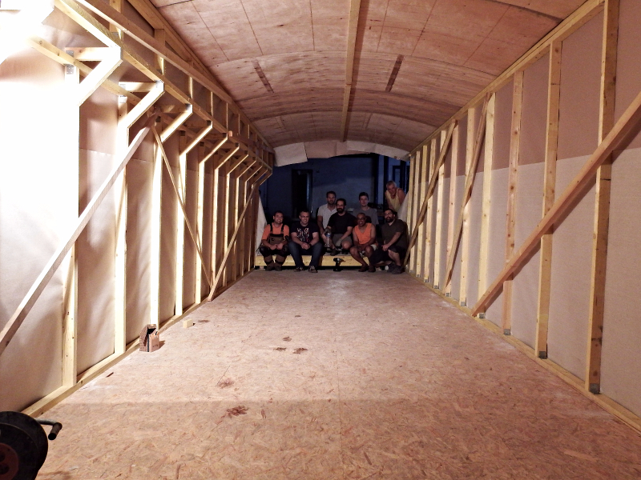
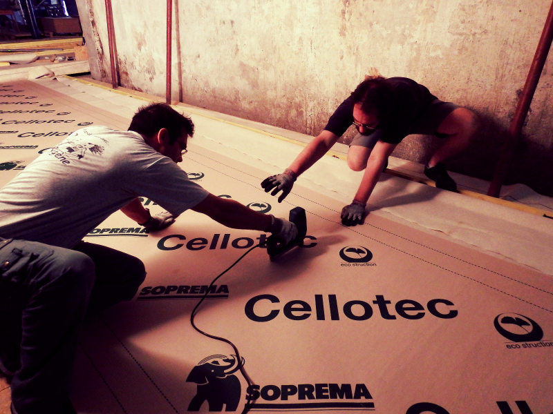
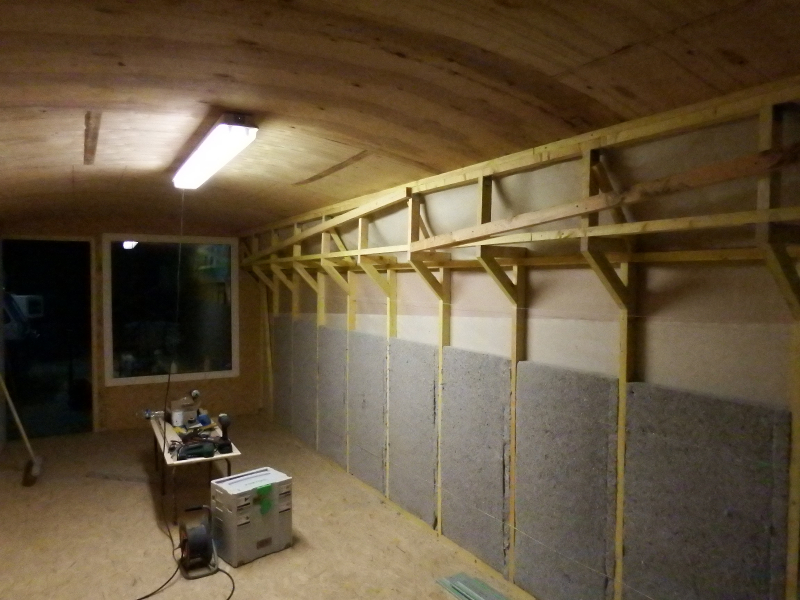

La cabane dans le passage 2 est faite !!! C'est quand même un peu plus qu'une cabane... vous jugerez par vous même. Félicitons Julien pour avoir mené à bien ce chantier. Un grand grand merci aux "égyptiens" qui ont permis la manutention et la pose du toit et des murs, votre aide fut essentielle. Nous tenons aussi à remercier l'entreprise [SOPREMA](http://www.soprema.fr/) et son laboratoire R&D qui a fourni les matériaux pour l'isolation et l'étanchéité, un beau résultat pour un partenariat de revalorisation prometteur. Cette espace sera dédié à l'atelier électronique et numérique. Une rangée de paillasses électroniques sur toute la longueur et de l'autre coté des étagères de rangement pour les composants.

