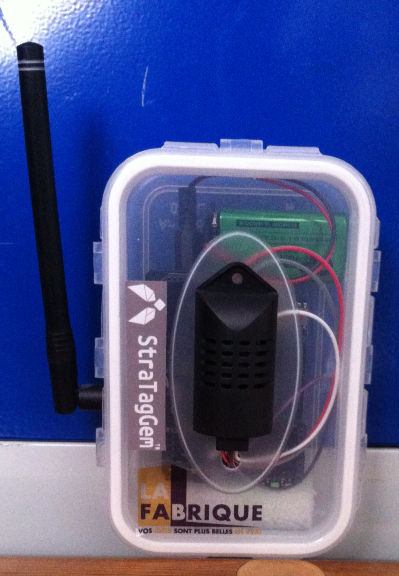
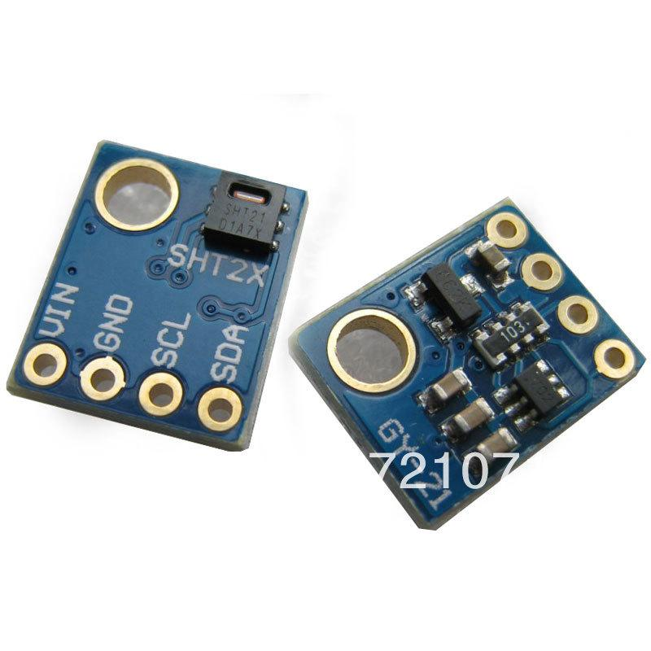

Jeudi dernier la première étape d'instrumentation de La Fabrique a été effectuée.

Une passerelle LoRa a été installée dans le bureau. C'est un engin capable de communiquer en radio sur de longues distances et dans des conditions difficiles. Deux capteurs de température et d'humidité (sht21) équipés de modem LoRa on été réalisés (voir photo ci-dessous) et testés avec succès ! En effet la couverture radio de La Fabrique est excellente puisque depuis le bureau la passerelle couvre toute La Fabrique jusqu'au fond du tunnel 9 ( 90 mètres de portée à travers les gros murs des tunnels tout de même !).

