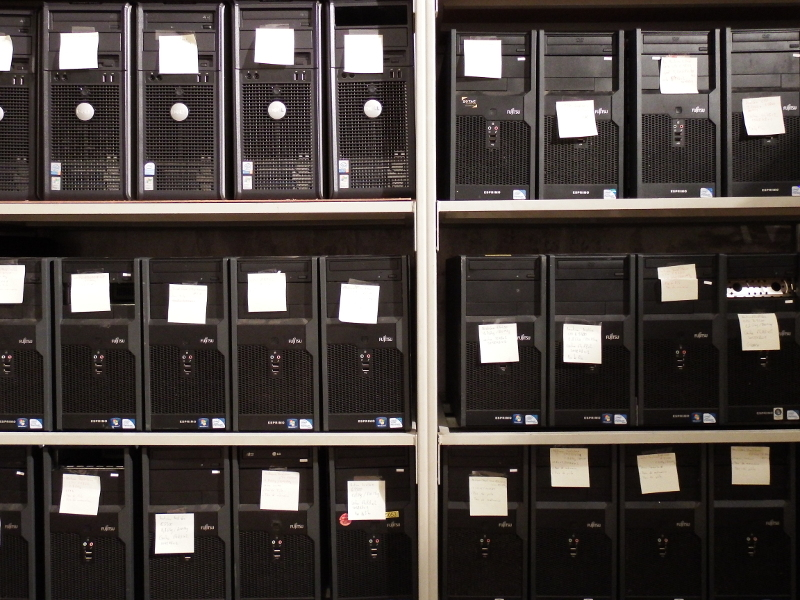

La commande pour le matériel électrique est passée !

François, Joël et Johann ont finalisé cette tache cruciale. Les travaux électriques vont enfin pouvoir commencer.

La lumière dans l'atelier mécatronique a été installée avec 5 rampes de tube fluo. Merci au travail préparatoire de Véronique et Stéphane. Des étagères ont été fabriquées par Mathieu dans une des alcôves du bureau.

L'inventaire des PC fixes est terminé. Et notre premier ordinateur a été baptisé [Herminette](https://fr.wikipedia.org/wiki/Herminette). Merci à Manu² et son équipe.
