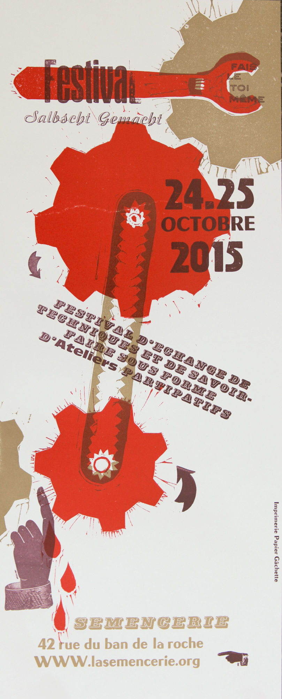

Ce week-end du 24-25 octobre, La Fabrique participera au [Festival Selbsgemachst 2015](http://selbstgemacht-diy.blogspot.com/) à la [Semencerie](http://www.lasemencerie.org).
En partenariat avec [le FabLab du Shadock, autrement appelé AV-Lab](http://www.av-lab.net/), venez construire des lucioles lumineuses et clignotantes !

Sous forme d’atelier de 2h, ouvert à tous les niveaux en matière d'électronique, le but est d'apprendre les rudiments d'un montage et de la soudure électronique, mais aussi de découvrir quelques composants permettant à une LED de clignoter plus ou moins longtemps et plus ou moins vite. En parallèle, un plotter de découpe et une fraiseuse vous permettront de fabriquer le support et le contenant.

 

Nous vous invitons à passer nous voir et à profiter du programme très varié des activités proposées.
