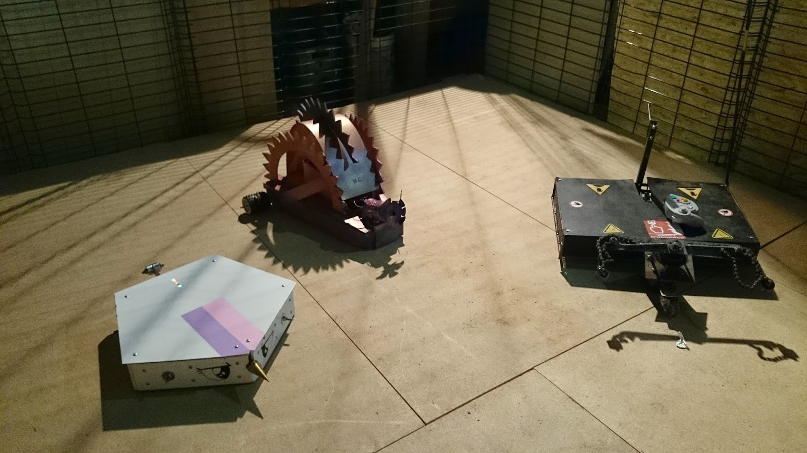
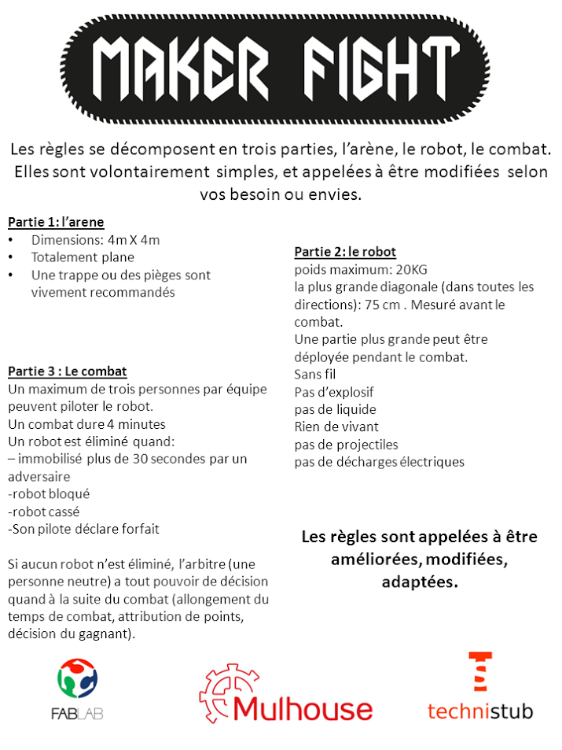

Technistub, le fablab & makerspace de Mulhouse vous défie dans un combat de robots

**DIY unique en France: #MAKERFIGHT !**

#Makerfight est le résultat de discussions démarrées au Technistub en Juillet 2014. Nous voulions créer un évènement festif mêlant créativité, technique, électronique, mécanique et surtout fun. L’idée d’un combat de robots venait de naitre, et en trois mois, la première édition de Makerfight avait lieu dans nos locaux à Mulhouse!

**Fabriquer un robot pour Makerfight impose deux choses essentielles:** apprendre et s’amuser. La création d’un robot permet de se frotter à de nombreux domaines et de s’initier ou se perfectionner à de nombreux sujets : mécanique, électronique, transmission & communication et programmation.

Makers, Hackers, étudiants, passionnés, geeks et tous les autres, venez participer et vous mesurer à d'autres robots. (les inscriptions sont gratuites).

Enfin, vous n’êtes pas seul pour le développement et la fabrication de votre robot! Nous sommes ici en plein dans les valeurs défendues par les fablabs et makerspaces : apprendre, créer, partager.

N’hésitez pas à aller dans un fablab, makerspace, hackerspace (ou autre) près de chez vous pour concevoir votre robot, le peaufiner, le fabriquer, le tester et l’optimiser. Cette fois, afin de laisser du temps pour le développement des robots, plus de 5 mois sont laissés aux concurrents avant le jour J.

Pour #Makerfight 2, le tournoi se déroulera le **samedi 9 avril 2016 à Mulhouse**. Les détails concernant le lieu et les horaires exacts seront confirmés après la date limite d’inscription pour tenir compte du nombre de robots pour l’organisation. Les inscriptions sont ouvertes jusqu'au 1er mars 2016.

Le programme (provisoire) de la journée est dispo sur le mini-site de l'événement : [http://www.makerfight.fr](http://www.makerfight.fr)

Tout au long de la journée (et de la soirée), des ateliers et autres animations par et pour les makers seront organisées.

Des infos seront régulièrement postées sur le site et les réseaux sociaux de Technistub, suivez-nous !

Vous y trouverez aussi, une annonce plus détaillée, le règlement, des affiches au format A4, etc.

Nous sommes en contact avec divers acteurs du mouvement des makers pour obtenir du soutien pour diverses choses et en particulier les lots pour les vainqueurs...

Si vous voulez savoir à quoi ont ressemblé la session de test et première édition officielle, c'est par [ici](https://www.youtube.com/watch?v=MXhlifpBwRw)  ou [là](https://www.youtube.com/watch?v=lF90DkhM-BQ).

 

<iframe src="//www.youtube.com/embed/wKLo90r3yXk" width="425" height="350" allowfullscreen="allowfullscreen"></iframe>

