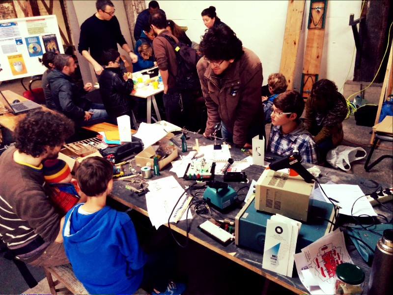
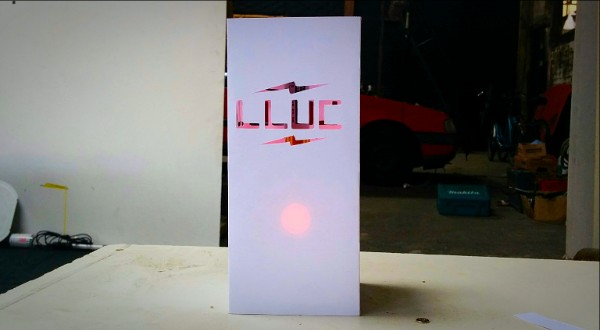

**Les équipes de La FABRIQUE et AV LAB ont animé des ateliers de fabrication de lampions à la Semencerie, gigantesque atelier d’artistes, le week-end du 24-25 octobre.**

Événement annuel, le “Selbsgemacht”, traduction alsacienne du “faire soi-même”, se voulait familial. Au total, une dizaine de familles ont pu réaliser leur lampion clignotant. AV LAB animait la découpe et Mathieu, pour La FABRIQUE, la réalisation des circuits électroniques. Le circuit, réalisé avec notre micro fraiseuse (voir plus bas) permet simplement de faire clignoter une LED à l’aide d’un composant très pratique, le [NE555](https://fr.wikipedia.org/wiki/NE555). En choisissant des valeurs de résistance et de capacité, il est possible de faire clignoter plus ou moins vite et plus ou moins longtemps la LED.

Ce circuit est un excellent support d’initiation à l'électronique. D’ailleurs les apprentis électroniciens ont pu s’initier à la soudure des composants et à l'expérimentation sur [plaquette d’essai](http://www.elektronique.fr/montages/diviseur-tension/utiliser-plaque-essai.php). Le succès était au rendez-vous !

Un Grand Merci à la Semencerie pour cette action ! Si vous voulez en savoir davantage, leur page [Facebook](https://www.facebook.com/LaSemencerie) est à parcourir sans plus attendre !

Et surtout… N’hésitez plus, venez découvrir à La FABRIQUE comment, par exemple, piloter des servo-moteurs avec le NE555 et plein d’autres applications !

