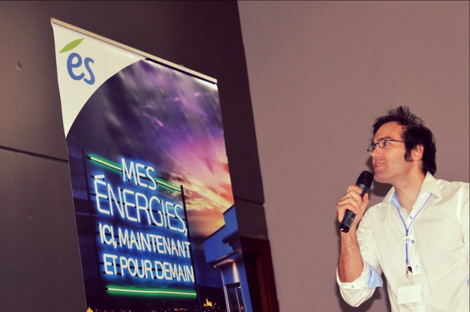

**Du 09 au 11 octobre 2015, 1er [Hackathon](https://fr.wikipedia.org/wiki/Hackathon) dédié à l'Industrie en Alsace. 54h pour innover et inventer l’avenir de l'industrie.**

La FABRIQUE était partenaire de cet évènement particulier dédié au start-up. Sur le temps d’un week-end, l’INSA a ouvert ces portes pour un marathon de l’innovation. L’objectif ? Faire se rencontrer des dizaines de passionnés pour porter à ébullition des idées par milliers et faire émerger des projets novateurs à forte potentialité industrielle. Des équipes d’une dizaine de personnes se fédèrent autour d’idées proposées spontanément par les participants ou par les sponsors. Ils ont alors 54h pour plancher sur les thématiques d’actualité : énergie, [industrie 4.0](https://fr.wikipedia.org/wiki/Industrie_4.0) et objets connectés.

A la fin du week-end, après d’intenses heures de réflexion, de collaboration, de ténacité, chaque équipe présente, lors du concours final, leur prototype de projet industriel viable, appuyé par un business plan, une maquette de principe ou des prototypes. Au final, le Hacking Industry Camp favorise l’émergence d’idées et de projets novateurs, graine essentielle à la réalisation concrète d’une start-up. François, membre du Jury, a remis un prix au nom de La FABRIQUE. L’équipe gagnante, #22 “Looky Lux”, peut aujourd’hui disposer d’un Abonnement d’un an pour les aider à imaginer, finaliser, concevoir et réaliser leur prototype d'éclairage intelligent. En quoi consiste exactement leur projet ? Il s’agit d’adapter l’éclairage à des situations d’usage, afin de mettre en lumière une situation de danger ou une zone d’ombre pour faciliter et sécuriser la circulation des véhicules et des piétons. A partir de jeux de lumières pré-programmés et sur commande, l’infrastructure ou le véhicule équipé du module connecté adapte son faisceau d’éclairage, et apporte ainsi une information plus riche à l’usager humain, pour lui faciliter l’analyse de la situation, et rendre son passage plus sûr. Looky Lux a également remporté le prix de l’ES doté de 2000€.

Pour plus d’éclairages sur le sujet, rendez-vous sur [http://www.hackingindustry.camp/](http://www.hackingindustry.camp/)

Des membres de La FABRIQUE était présent bénévolement pour soutenir les équipes, notamment Manuel qui a pu conseillé les équipes en tant que coach expert sur les objets connectés ; une balise de STRATAGGEM était à disposition pour des démonstrations.

L’autre temps fort de l'évènement était les “keynotes”. Manuel nous a fait un panorama technique des solutions radio fréquence pour les objets connectés, et notamment le système LoRa qu’il utilise pour ses phares de vélo connectés. Lors d’une autre présentation, François est, quant à lui, revenu sur la genèse de La FABRIQUE, nous racontant ainsi qu’il souhaitait retrouver l’esprit des clubs fusées auxquels il a participé dans les années 90. Décollage immédiat !
