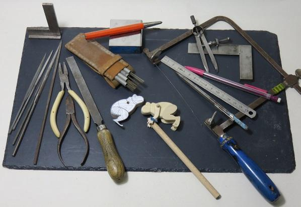
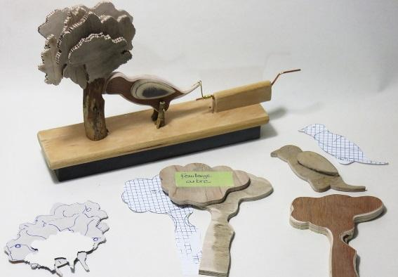

# **FORMATION PETITS OBJETS**

## **Automates – Modélisme – Mobiles – Décoration**

 

_Pendant cette formation, vous aurez la satisfaction de commencer à « Faire »_ _dès la prise en main des différents outils/machines, ”en toute_ _sécurité”. Grâce à ce pied à l’étrier vous pourrez fabriquer vos petits objets, qu’ils soient décoratifs, utiles, ludiques, pour votre intérieur ou en accessoire de mode. Les dioramas, les puzzles en 3D, la découpe d’animaux ou de jouets, n’auront plus de mystère pour vous._

_J’ai hâte de vous entraîner sur le terrain des objets en mouvements, que ce soit des mobiles, des automates en bois, des useless box, … vous avez été fascinés par tous ces objets, vous avez eu l’envie de savoir les faire, et bien c’est à votre portée, il vous suffit d’apprendre à découper, puis les assembler._

 

**Formation dispensée par** **:** Véronique OHSE

**Durée** **:** **3 heures**

**Niveau** **: Tous niveaux confondus, en fonction des pré-inscriptions.**

**Matériel requis** **:** Chaussures fermées, vêtements supportant la poussière.

**Nombre de personnes mini – maxi** **:** 3 – 6

**Prix** **:** **30 €**

 

**Remarque** : D’autres dates et heures peuvent être proposés, à partir de 4 personnes sur le même créneau. N’hésitez pas à nous contacter.

**Contact – Inscription**: [veronique@atelierduciel.eu](mailto:veronique@atelierduciel.eu)

