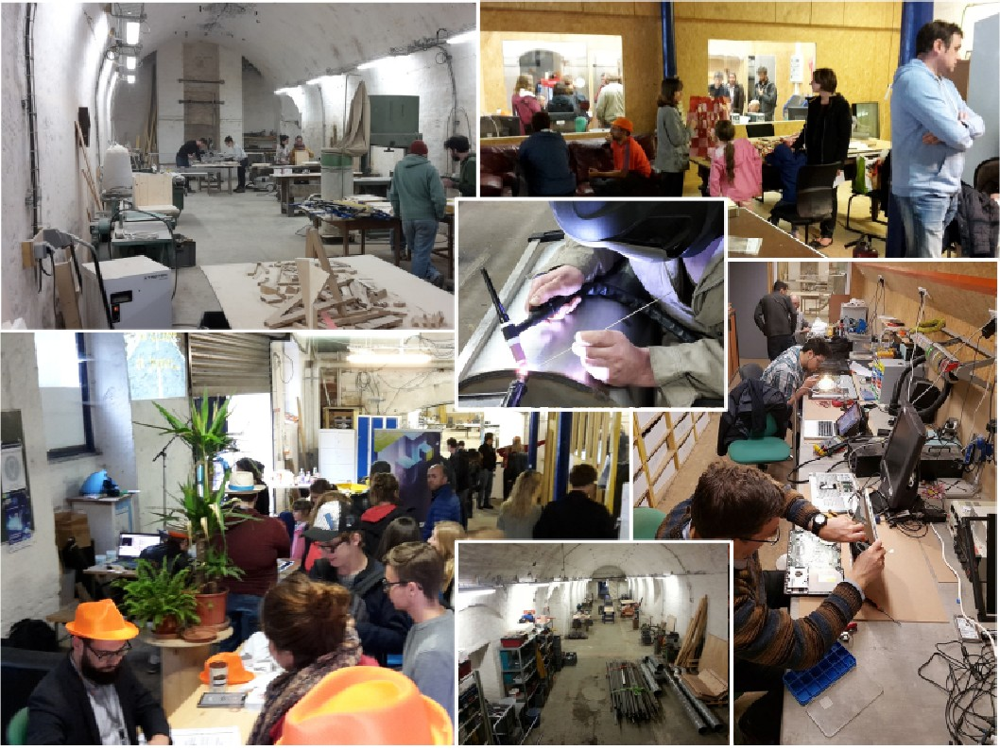
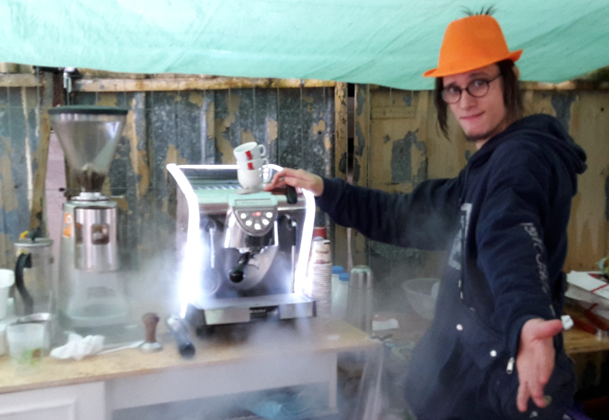
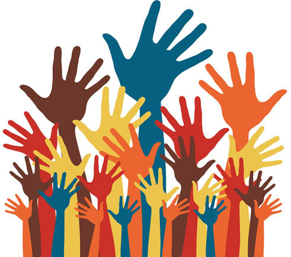
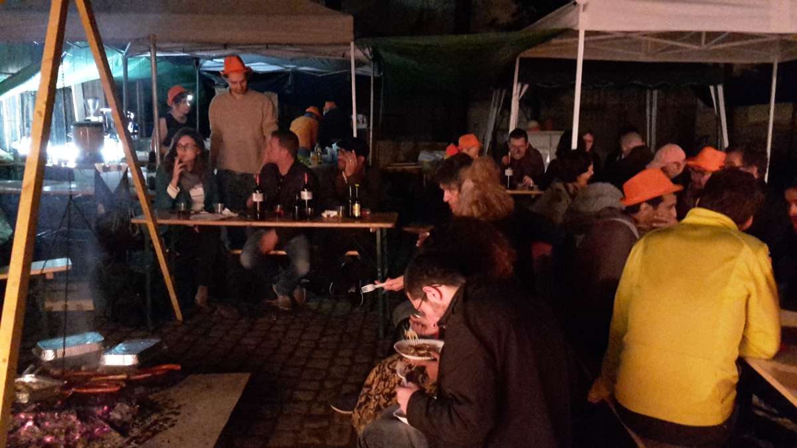

## Atelier DIY

Vous êtes tous invités à l’Assemblée Générale Ordinaire (et ses activités DIY et festives) de La FABRIQUE qui se tiendra **dans ses locaux le 1 avril à partir de 14 heures.**

 

À partir de 14h, vous aurez l’occasion de voir depuis notre dernière AG, les derniers ateliers, les derniers aménagements ainsi que les nouveaux outils à La FABRIQUE. Cette année, nous vous invitons à participer à plusieurs nouvelles activités DIY (faîte le vous-même). Celles-ci auront lieu dans l’atelier mosaïque, l’atelier couture et l’atelier bois. Cela sera aussi l’occasion d'apporter des objets cassés à réparer puisque le RepairAction sera également de la partie.

Nous vous invitons ensuite à l’Assemblée Générale Ordinaire où nous vous présenterons les bilans de l’exercice antérieur. Cela nous permettra de ne pas nous éterniser sur les présentations avant de procéder aux votes, et de mettre davantage l’accent sur le temps d’échange collectif. Venez avec vos remarques, vos idées et n’hésitez à faire bouger l’association. Ce projet est le vôtre !

Vous pouvez lire les rapports ici:

- [Rapport moral](./RAPPORTMORAL2016.pdf)
- [Rapport d'activités](./RAPPORT-D’ACTIVITÉ-2016.pdf)
- [Rapport financier](./Rapportfinancier2014-2015.pdf)

**N’hésitez pas à venir avec votre famille ou vos amis, et bien sûr, des objets à réparer ou à construire !!**

Et pour la soirée, nous vous invitons, pour finir, à **une Soirée Festive et Participative** :

Chacun apporte quelque chose à boire et/ou à manger que l’on partagera jusqu’à tard dans la nuit, en ayant enfin l’occasion d’échanger de manière détendue.

## Programme de la journée

### 14H00 - 17H00 Activité DIY

- **Atelier Mosaïque** Accessible à tous
- **Atelier Couture** De nombreux vêtements et manequins seront disponible. N'hésitez pas à venir avec vos tissus/vétements.
- **Atelier Bois** Possibilité de faire de petits travaux sur du bois de chêne
- **RepairAction** Apporter vos objets cassés

**Notre Barista**

Notre bar vous proposera des boissons fraîches et chaudes ainsi que des des en-cas.
Notre Barista est impatient de vous servir ce qu'il fait de mieux comme l'Expresso et le Cappuccino... Venez discuter café, entre autre..., avec lui !!

### Présentation des nouveautés

Toutes nos infos et explications sur les formations, nos événements, nos nouveaux tarifs et nos nouveaux horaires.

Les oeuvres de nos artisans/startup-eurs seront exposées toute la journée.

### 17H15 - 19H00 Assemblée Générale Ordinaire

- Présentation des rapports ; moral, d’activité et financier.
- Discussion sur les perspectives 2017.
- Élection des membres du CA

### 19H00 - 24H00 Repas et Soirée Festive

- **BBQ** Apportez aussi vos victuailles !!
- **Soirée dansante**, venez avec vos tubes ou vos instruments de musique.
