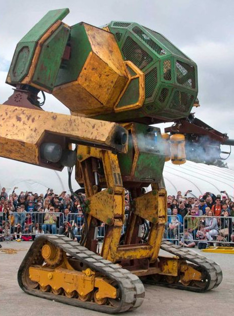
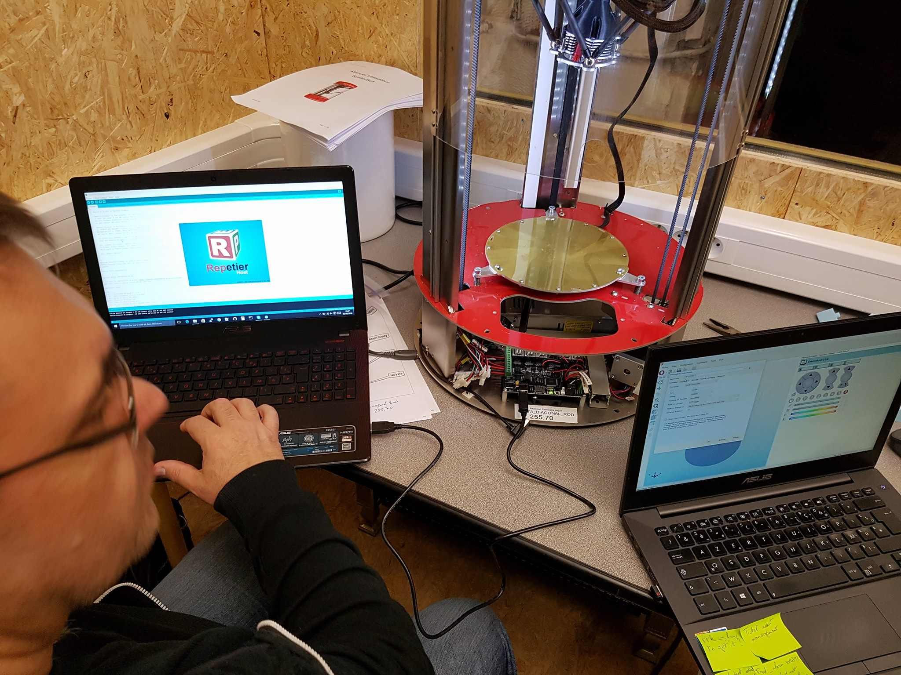
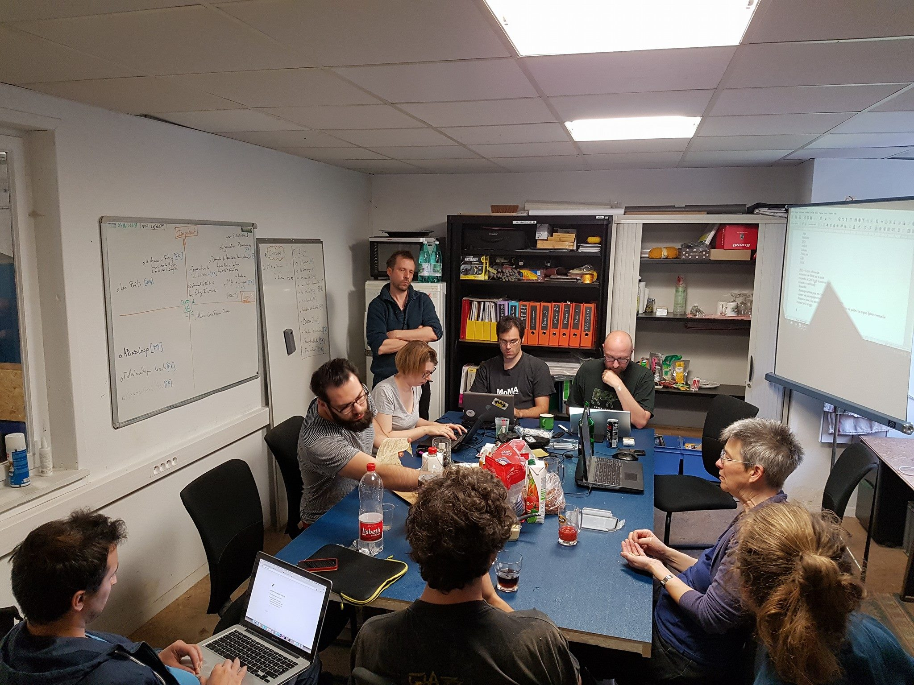
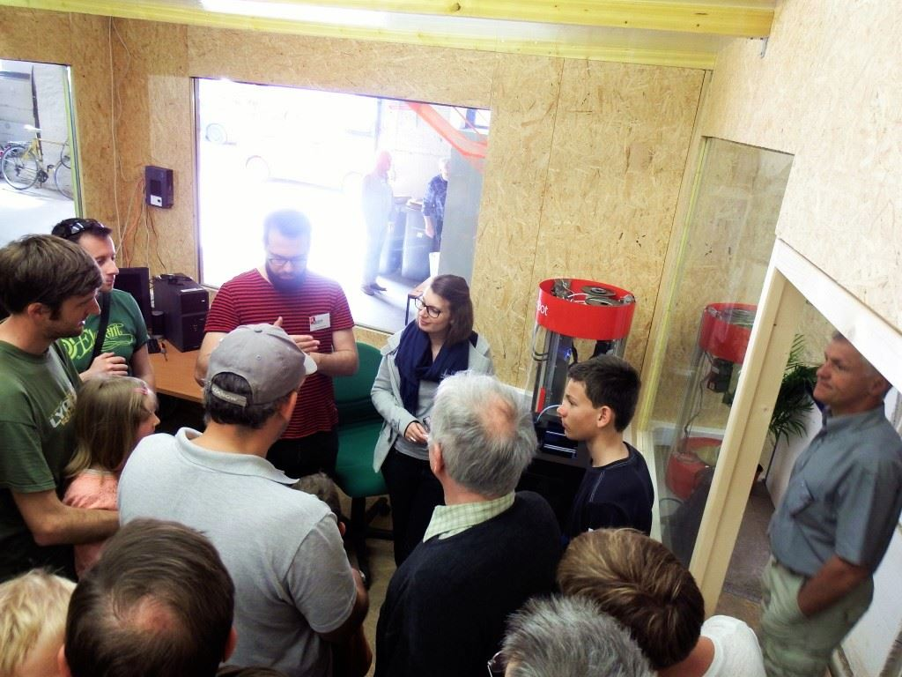
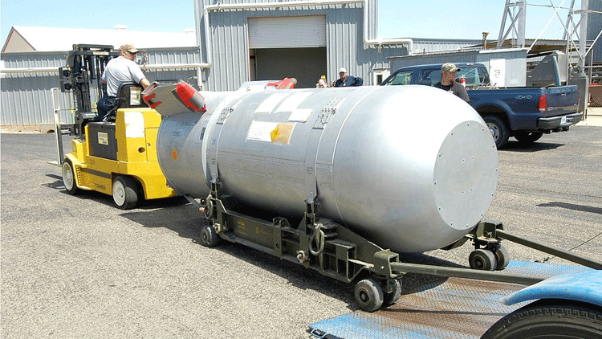
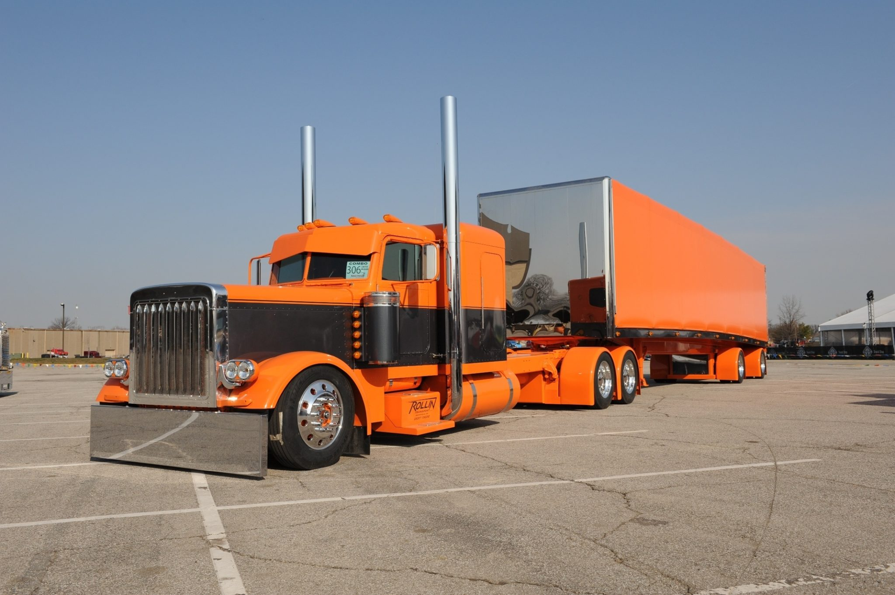
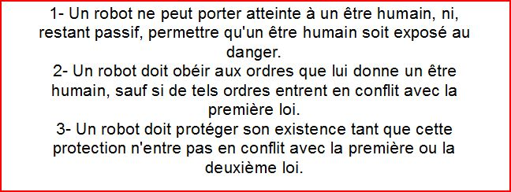
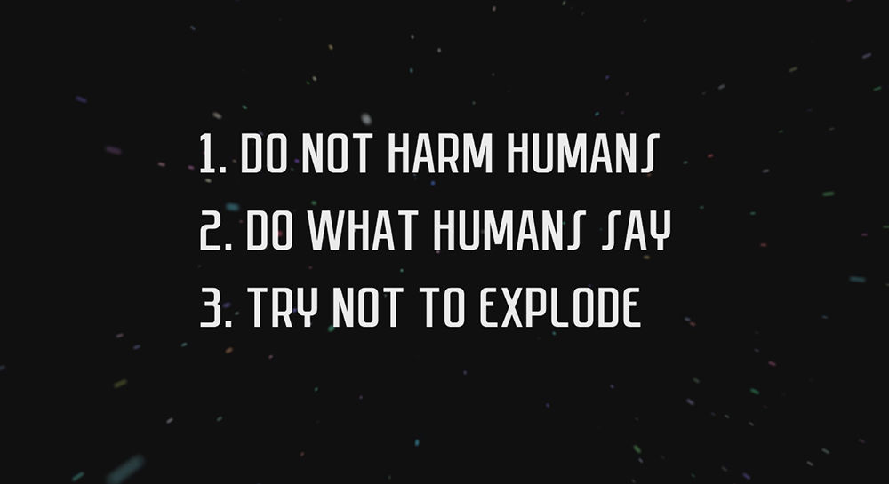

_**La FABRIQUE souhaite participer au [MAKERFIGHT 2019](http://www.makerfight.fr/)**_

*LA FABRIQUE PERSISTE DANS LES COMBATS DE ROBOTS*

Les combats auront lieux à Mulhouse Avril 2019

La FABRIQUE a décidé de (encore !) se donner les moyens de soutenir une équipe qui développera et construira un robot de combat. Avril 2019 nous nous déplacerons en équipe pour y affronter les autres robots venues des FabLabs de la France entière.

_Le MakerFight 2019 est un événnement organisé par le FabLab de TechniStub à Mulhouse._

## CONSTITUTION D'UNE ÉQUIPE !!!

La FABRIQUE a décidé de donner les moyens à une équipe de développer et construire un robot de combat. Nous mobiliserons nos ateliers, nos stocks et notre réseau pour cette équipe et l'aider à présenter un robot de combat pour le jour de la compétition en avril 2019.

Donc si construire un robot (et ici de combat) est ton rêve, ou si tu vois BattleStart Galactica ou Real Steel comme des documentaires, n'hésite pas à nous rejoindre dans cette aventure humaine et "robotesque" !!!

L'équipe devrait être constituée d'au moins **six membres (max 12 mais avec plusieurs robots)** avec des profils divers et nul n'a besoin d'être un expert ou de savoir tout faire. Il faudra simplement peut être un peu de créativité, beaucoup d'huile de coude et surtout, le goût d'apprendre et d'échanger. Pour l'humour, comme tu peux le lire sur cette page on en a déjà plein...

Ce modèle de robot de combat nous a particulièrement séduit; malheureusement, le règlement est très clair: le robot ne peut pas utiliser de projectile, ni de gaz, ni de matière vivante. Comme un opérateur cliniquement mort à l'intérieur du robot n'est pas très utile nous avons abandonné cette idée pour lui préférer un projet un tantinet moins tape à l'oeil et plus simple (comme une étoile de la mort).

 

## MISE À DISPOSITION DES MOYENS DE LA FABRIQUE

### Et La FABRIQUE met le paquet pour aider l'équipe dans son projet !

Accès à La FABRIQUE jusqu'au jour du combat final !

- **Accès à tous nos ateliers :** Métaux, bois, électronique, imprimante 3D, informatique...
- **Nous faciliterons l'accès à nos experts et intervenants extérieurs.** Pour chaque étape du projet, nous nous efforcerons de trouver les interlocuteurs qui vous aideront dans les aspects techniques.
- **Accès aux stocks de tous les ateliers**, ainsi qu'un accès aux stock backstages électro-technique provenant de toutes les époques !!!!

### **ATTENTION l'Adhésion est payante soit 10 Euro et valable un an !!!**

vendredi 13 Octobre 2018 à 15h30

PRÉSENTATION DES MEMBRES DE L'ÉQUIPE

Les candidats se réuniront à 15h30 autour du stand de TechniStub présent pendant le site du BaZar !

Les membres de TechniStub pourront vous expliquer comment ce passe l'événement et comment construire un robot mobile (destructeur ou pas). À vous de posez les bonnes questions. Une autre visite directement dans les locaux de TechniStub à Mulhouse pour aider ou conseiller notre équipe.

1er Session de Travail dans les ateliers toutes les 2 semaines.

1er Prototype

Sessions de Travail en réunions

Les réunions de travail se feront à La FABRIQUE pour définir et avancer sur le projet.

Les Jeudis Opens seront l'occasion pour l'équipe d'échanger sur leur projet

Test du Dernier Prototype

Novembre 2017 - Avril 2018

Possibilité de présenter et de tester le robot lors d'événements à La FABRIQUE ou à l'extérieur.

08 H 35 X Avril 2018 Départ pour Mulhouse

Et efficace La LaFab-Mobile !!!

Avril 2018 - Combat à Mulhouse

Que le meilleur Gagne !!!

Combats Entres Robots

Retour à Strasbourg

LE JOUR DU TOURNOI ET LES PRIX À GAGNER

**La FABRIQUE offre à toute l'équipe (les abonnements débutent au plus tard 4 mois après le jour du tournois)**

Le prix La FABRIQUE

Notre président quand t'il envèle le "haut"

Notre président est impatient de remettre aux humains qui auront détruit le plus de robots le prix de La FABRIQUE.

## **En cas de victoire de l'équipe (1ère place)**

# **Un abonnement 6 mois [- Soir & Week-end -]**

Finalement, n'oublions pas que le but principal de ce projet est de se faire plaisir, de jouer avec le rêve et de l'utiliser comme moteur pour apprendre :

- Le travail d'équipe autour d'un projet
- Le prototypage
- L'électronique, informatique
- Travail des métaux, soudage ...

COMMENT NOUS REJOINDRE ?

La Pilule Orange :
Je veux faire partie de l'équipe !

Tu t'inscris sur notre page événement [FaceBook](https://www.facebook.com/makerfight.lafab.org/) (je participe). Ou tu nous envoies un email pour nous annoncer que **tu viens le 16 septembre 2017 à La FABRIQUE** pour la journée hétérotopique.

**INFO: La journée hétérotopique** (_i.e. le lieu ou l'utopie s'installe_) de La Fabrique sera dédiée à des activités/Jeux gratuit(e)s dans tous les ateliers ainsi que la présence de La Braderie de La Fabrique et de nombreuses autres activités et spectacles à l'extérieur !

La force pourrait aussi te faire passer par ce chemin [là](/ou-nous-trouver/). Sur les humains, la pilule Orange ne fonctionne que si tu as plus de 18 ans ou si tu es accompagné d'au moins l'un de tes parents.

La Pilule Bleue

Je soutiens mais je ne m'inscris pas dans l'équipe

JE SOUTIENS LE PROJET

https://www.facebook.com/makerfight.lafab.org/

Tu peux suivre nos aventures sur FaceBook ou sur cette présente page internet tout en suivant une vie relativement normal.

Les pilules passent mieux avec un Like...

ARCHIVES SUR LE MAKERFIGHT

https://www.youtube.com/watch?v=hZqEKI1XL54

https://www.facebook.com/technistub/

LES LOIS SUR LES ROBOTS APPLIQUÉES AU MAKERFIGHT

Dépendamment de l'avancé de nos travaux nous suivront LES LOIS DE LA ROBOTIQUE dans sa version Asimov ou dans sa version actuelle (voir plus bas nos grands textes de références).
 
 
SOYONS CLAIRS !!! Aucun être vivant (intelligent ou pas...) ou des êtres dits artificiellement intelligents ne seront tués/éteints ou blessés/endommagés durant nos travaux.

LES LOIS DE LA ROBOTIQUE
Version - Asimov -

LES LOIS DE LA ROBOTIQUE

Les lois sur les armes appliquées au MakerFight !

On ne doit donc pas jeter d'eau ou d'acide pour griller les circuits électroniques du robots adverse. On ne peut pas non plus utiliser d'arme à feu (automatique ou non) puisqu'elles sont doublement exclues (comme explosif et comme projectile). On peut pas non plus utiliser une d'étoile de la mort puisqu'elle contient des opérateurs vivants (et l’Arène est de 4 m x 4 m).

Pendant toute la durée du projet, nous apprendrons aux membres de l'équipe, les mesures qu'ils faut suivre pour travailler en toute sécurité dans les ateliers. Nous les formerons aux gestes qu'ils faut connaître pour bien utiliser les outils et les machines outils qu'ils seront amenés à utiliser. C'est encore une bonne occasion pour apprendre à utiliser un plein d'outils qui vous servirons pour d'autres projets.

Nous insisterons sur quelques points du règlement du tournoi, celles qui vont définir nos "relations" avec les autres robots.

Vous pouvez consulter le règlement complet du tournoi [ici](/reglement-du-makerfight3/)

**Reste La Force Brute :** donner des coups et éviter les coups/prises de l'autre

Ici vous pourrez visionner les vidéos des combats de l'année dernière et de voir les différentes techniques de combat utilisées.

Vous pouvez également nous faire des suggestions sur les différents aspects techniques du robot soit en venant un jeudi soir à La FABRIQUE, soit sur [FaceBook](https://www.facebook.com/makerfight.lafab.org/). Le temps est aussi un aspect important dans la réussite de ce projet.

LES PREMIERS PROTOTYPES ?

Pour ceux qui veulent aller plus loin voici une liste de liens qui vous donneront plus d'infos sur les combats de robots.

Sur cette page vous pourrez voir quelques unes des étapes de conception du robot construit par le FabLab de Nancy pour le MakerFight 2016 et cela en débutant seulement un mois avant le tournoi.

**D'autres documents**

Le règlement du tournoi : [ici](/reglement-du-makerfight3/)

D'autres vidéos de combats de robots du [MakerFight2](https://www.youtube.com/watch?v=5Z7cbkSV0Uk&list=PLGItAiiH6MVxVgIJ_XBmaqh0GaGatZiL2&index=15) et [du monde entier.](https://www.youtube.com/results?search_query=robot+fight)

Article sur le MakerFight 2015 dans [L'ALSACE.fr,](http://www.lalsace.fr/haut-rhin/2016/04/11/qui-c-est-le-plus-costaud-c-est-le-marteau) [makery](http://www.makery.info/2016/04/12/makerfight-des-boulons-de-la-sueur-et-de-la-casse/)

Archive MakerFight sur le site de [TechniStub](http://technistub.org/?cat=23&paged=2).

Organisation de la conception chez [TechniStub](http://us9.campaign-archive2.com/?u=683f62961e21de4e5e69d581f&id=6c1a59229a&e=a5a3b2e376) 

[ABONNEZ-VOUS ! Et SUIVEZ-NOUS](https://www.facebook.com/makerfight.lafab.org/)

