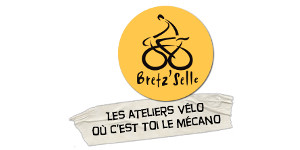
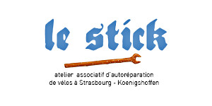
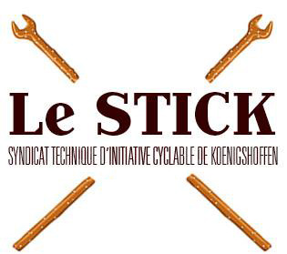
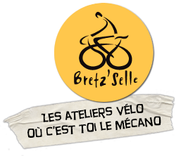
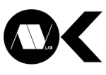
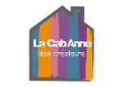
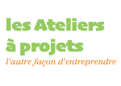

# SAMEDI 16 SEPTEMBRE, NE RATEZ PAS LA BRADERIE DE LA FABRIQUE !

## APRÉS LE SUCCÈS DE L'ÉDITION 2016, LA FABRIQUE REMET ÇA !

Du Géo Trouvetou à l'ingénieur, du customiseur de meubles ou de vêtements d'Emmaüs vintage au designer, du bricoleur du dimanche au réparateur en tout genre, LA BRADERIE DE LA FABRIQUE EST FAITE POUR VOUS !

C'est aussi l'opportunité de découvrir et rejoindre ce gigantesque atelier qu'est La Fabrique, qui vous accueille toute l'année et vous offre COURS ET FORMATIONS pour multiplier vos compétences et savoir-faire.

MAKERS ET BRICOLEURS, CETTE JOURNÉE EST LA VÔTRE !

FORMULAIRE D'INSCRIPTION

JE VEUX M'INSCRIRE !

UN CONCEPT UNIQUE !

Notre souhait est d'installer La Braderie dans un espace où l'objet n'est pas seulement acheté ou vendu mais où il peut être également RÉPARÉ, RECYCLÉ voire REVALORISÉ !

C'est le but des BRAD'ZONES et de leurs experts qui mettront à votre disposition tout le matériel nécessaire pour tester et réparer les objets que vous souhaitez vendre, acheter ou troquer.

La Fabrique vous ouvre les portes de ses ateliers INFORMATIQUE / ÉLECTRONIQUE et COUTURE / ART TEXTILE pour réparer les objets que vous pensiez perdus ou les vêtements auxquels vous teniez mais qui mériteraient bien quelques reprises !

BRETZ'SELLE et LE STICK se joignent également à notre initiative et mettront à votre disposition une BRAD'ZONE où vos vélos pourront être remis en selle !

NOS PARTENAIRES

De nombreux partenaires seront présents à nos côtés durant cet évènement, chacun avec sa personnalité. L'occasion, pour eux, de présenter leurs activités mais aussi (et surtout !), pour vous, de découvrir les autres tiers-lieux de la région. Nous envisageons La Braderie comme un moment de promotion, d'échange et de partage entre toutes les structures à vocation participative !

LES ATELIERS VÉLO OÙ C'EST TOI LE MÉCANO

Le STICK et Bretz’Selle, c’est la promotion active du vélo basée sur l’apprentissage de la mécanique, l'animation et la mise à disposition d'ateliers équipés, le réemploi de vélos inutilisés.

Ils seront présents pour vous guider avec tout leur matériel dans la réparation de votre vélo.

LES ATELIERS VÉLO OÙ C'EST TOI LE MÉCANO

Le STICK et Bretz’Selle, c’est la promotion active du vélo basée sur l’apprentissage de la mécanique, l'animation et la mise à disposition d'ateliers équipés, le réemploi de vélos inutilisés.

Ils seront présents pour vous guider avec tout leur matériel dans la réparation de votre vélo.

FABLAB & MAKERSPACE

TechniStub est un atelier-laboratoire associatif mutualisant différents moyens techniques nécessaires à la réalisation de projets technologiques, comme la fabrication et l'organisation de combats de robots. Une de leur bête métallique sera sur place. Vous pourrez aussi trouver des outils et des oscilloscopes à prix cassés.

CONSTRUIRE L'ÉCOSYSTÈME NUMÉRIQUE EN ALSACE

Coupable des plus grands évènements créatifs numériques de Strasbourg (du Hackathon à Edgefest), co-responsable du développement de nombreuses Startups, Alsace Digitale et sa communauté de bidouilleurs, les HackSXB, vous présentent leurs prochains évènements et leur dernière invention : un jeu vidéo interactif sur grand écran.

LE FABLAB DU SHADOK

DIY : "Do it yourself"

Ou comment fabriquer à peu près n’importe quoi par soi-même ! L’ère du numérique transforme les manières de vivre, de penser et de créer. AVLab vous montrera la voie pour appréhender ce nouvel univers.

UN TIERS-LIEU QUI FAVORISE LA CRÉATIVITÉ

Un tiers-lieu à Schiltigheim combinant des espaces de travail et de créations au service des artistes, bricoleurs, créateurs, étudiants, particuliers ou professionnels ...

Un écosystème créatif pour passer rapidement des idées à la réalisation.

L'AUTRE FAÇON D'ENTREPRENDRE

Les Ateliers à projets présenteront leurs machines à construire soi-même, indispensables aux bricoleurs, inventeurs et prototypistes.

Perceuse à colonne multifonctions, ponceuse-calibreuse, imprimante 3D …

La Braderie de La Fabrique se déroulera sur le site même de La Fabrique : PARC GRÜBER - 91 ROUTE DES ROMAINS - 67200 STRASBOURG - KOENIGSHOFFEN

## TOUT SAVOIR SUR LES STANDS À RÉSERVER !

Qui peut réserver un stand ?

Celui qui le souhaite !

Que vous soyez particulier ou artisan, adhérent à La Fabrique ou non, si vous partagez les mêmes valeurs que nous, La Braderie de La Fabrique est pour vous !

Que peut-on vendre ?

Outils, machines-outils, imprimantes 3D, appareils électriques, retro-gaming, vieux jouets, livres, meubles, vêtements …

Tous ces objets de la vie courante qui s’entassent dans un coin de votre maison. Ces objets peuvent faire le bonheur d’un autre, offrez leur une deuxième vie !

C'est quoi les tarifs ?

Ça dépend du mètre linéaire !

5,00 € les 2.5m linéaires 10,00 € les 5m linéaires

Profondeur des stands : 2m

Un privilège adhérent ?

Un stand en commun !

Pour tous les adhérents à La Fabrique, un stand commun vous est réservé. Vous pourrez y déposer jusqu’à trois objets. Ce sera l’occasion de vous entraîner ensemble au négoce et au troc !

Inscrivez-vous !!

Si vous ne voulez pas rater cette occasion unique, c'est maintenant ! Nous n'avons qu'un nombre limité de stands à vous proposer !

## VISITES GUIDÉES

La Braderie de La Fabrique est aussi une occasion unique de vous dévoiler le site dans ses moindres recoins. Depuis deux ans, de nombreux bénévoles ont travaillé d'arrache-pied pour la création d'ateliers. Des VISITES GUIDÉES seront organisées tout au long de la journée pour que les plus curieux puissent découvrir les aménagements, les outils et tout le potentiel de La Fabrique.

Les INSCRIPTIONS au programme automne-hiver 2017 des formations et des activités de La Fabrique seront ouvertes !

## DÉTENTE ET RESTAURATION

La Fabrique met à votre disposition un ESPACE AVEC CANAPÉS tout confort pour ceux qui voudraient reposer leurs pieds ou simplement PARTAGER des idées, et DÉBATTRE avec passion !

L'espace BAR / RESTAURATION et ses tables se trouve tout à côté et saura vous combler avec ses formules adaptées tout au long de la journée : tartines et viennoiseries au petit déj', snack-assiettes le midi et grillades le soir !

À vos papilles !

Après une journée aussi intense que celle qui se prépare, on ne vous lâchera pas comme ça dans la nature ! Non non non !

À partir de 18h, place à l'AFTER BRAD ! Rejoignons-nous autour d'un bon repas convivial. Sur le barbecue, toute chose qui se grille, le sera. Viandes ou légumes, il y en aura pour tous les goûts !

Et puis, pour accompagner le tout, rien de tel qu'un peu de musique. Et là, la scène vous appartient ! Nous encourageons tout le monde à venir ravir nos petites oreilles avec son instrument de musique préféré. C'est le BOEUF MUSICAL DE LA BRADERIE !

Tu veux être bénévole à cet événement spécial ?

Tu veux en profiter pour connaître / découvrir de l'intérieur et plus facilement le milieu des makers ? Avoir le privilège de pouvoir rentrer dans les lieux réservés au STAFF ? Être l'un des tous premiers possesseurs d'un chapeau orange ? Trouver des gens qui partagent tes projets ? C'est aussi l'opportunité de rencontrer plus facilement des gens qui partageront tes objectifs !

Écris-nous à [contact@lafab.org](mailto:contact@lafab.org)

Cette page a été réalisée par [Fanny Greullet](http://deviantbird.com "Contactez Fanny") qui vous souhaite une bonne Braderie à tous !

