# SAMEDI 16 SEPTEMBRE LA FABRIQUE EXPÉRIMENTE

# LA JOURNÉE HÉTÉROTOPIQUE

L'**hétérotopie**, du grec topos, _lieu_, et hétéro, _autre_ : _lieu autre_, est un concept forgé par Michel Foucault dans une conférence de 1967 intitulée _Des espaces autres_. Il y définit les **hétérotopies** comme une localisation physique de l'utopie.

_"Il y a dans toute culture, dans toute civilisation, des lieux réels, des lieux effectifs, des lieux qui sont dessinés dans l'institution même de la société, et qui sont des sortes d'utopies effectivement réalisées. Des sortes de lieux qui sont hors de tous les lieux, bien que pourtant ils soient effectivement localisables."_

_\-- Michel Foucault_

## QUAND L'UTOPIE S'INSTALLE DANS UN (TIERS-) LIEU !"

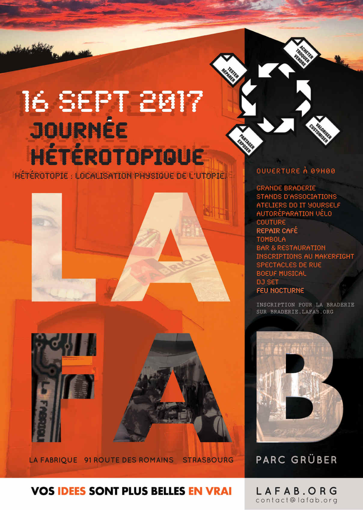

Depuis plusieurs années, La Fabrique s'est installée dans la partie glacière de l'ancienne brasserie Grüber. Comme de nombreuses associations, La Fabrique est mise au défi d'être viable économiquement tout en conservant ses objectifs et ses valeurs basées sur le partage et la connaissance accessible au plus grand nombre. Pour cela, elle expérimente différentes gouvernances, différents fonctionnements et de nouvelles opportunités pour chacun d'apprendre et créer. Au fil du temps, La Fabrique veut continuer à expérimenter de nouvelles manières d'agir et de construire ensemble.

C'est dans cet élan qu'elle lance cette année sa JOURNÉE HÉTÉROTOPIQUE, le jour de fête de La Fabrique.

Tout tiers-lieu est une hétérotopie. Il est issu de la volonté de quelques uns de concrétiser un imaginaire, une utopie, de lui donner corps dans un espace et de définir des normes spécifiques aux personnes et à l'espace occupé. Réunir les associations locales dans un même lieu, c'est une occasion de découvrir ce qu'elles font, mais également, de découvrir comment. C'est un moment d’EXPÉRIMENTATION SOCIALE, une occasion de CHANGER NOTRE RELATION À L'OBJET ET À L'ENVIRONNEMENT.

Depuis l’année dernière, nous continuons à réunir dans un même lieu plusieurs manières de vivre son rapport avec l’objet, comme pour la braderie où l'on peut gratuitement tester/réparer/customiser l'objet que l'on vend/répare/achète/échange. Cette année, nous appliquons le même choix à l’alimentation en plaçant dans un même lieu trois manières de vivre son rapport avec la nourriture. Vous pourrez acheter à notre restaurant des tartes flambées mais aussi manger gratuitement dans l’atelier cuisine de _Disco-Soupe_ et remplir vos sacs de fruits et légumes invendus des commerces et marchés dans la _Tente des Glaneurs_.

Bien sûr, d'autres animations vous donneront aussi le choix dans les distractions : initiation au robot, rétro-gaming, couture, drone, monter soi-même des throwies, jardiner...

Alors, expérimentez !

LES HÉTÉROTOPIES PRÉSENTES

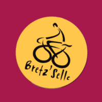

Bretz'selle \[ - 18H00 \]

Viens découvrir des modules pédagogiques pour apprendre les rudiments de la mécanique cycle ainsi que de la documentation sur l'hétérotopie cycliste !

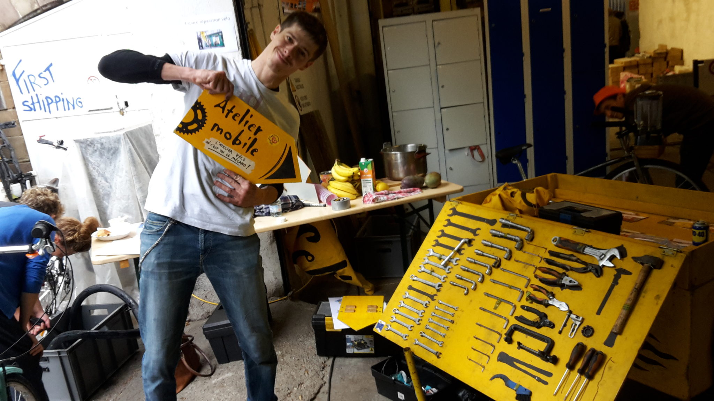

Autonomie, expérimentation

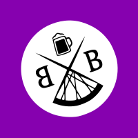

Binouze Biker \[ - 18h00 \]

Collectif de houblon et de cambouis à l'origine de courses d'orientation par équipes mêlant vélos et énigmes. Venez découvrir l'hétérotopie des Binouze Bikers à notre stand et vous motiver à participer à la prochaine course !

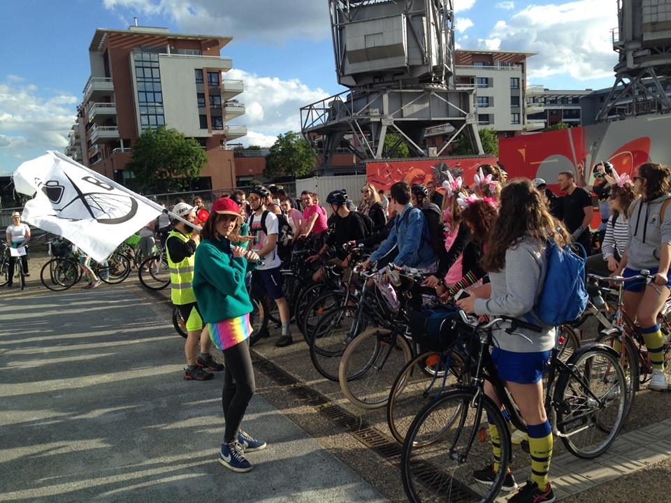

Autonomie, expérimentation

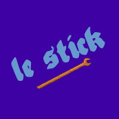

Le Stick \[ 14H00 - 18H30 \]

Le Syndicat technique d'initiative cyclable de Koenigshoffen est issu de la volonté conjointe d'habitants du quartier et de l'association Bretz'selle de créer un atelier d'autoréparation de vélos à Koenigshoffen. Venez découvrir le stand d'auto-réparation de vos biclous !

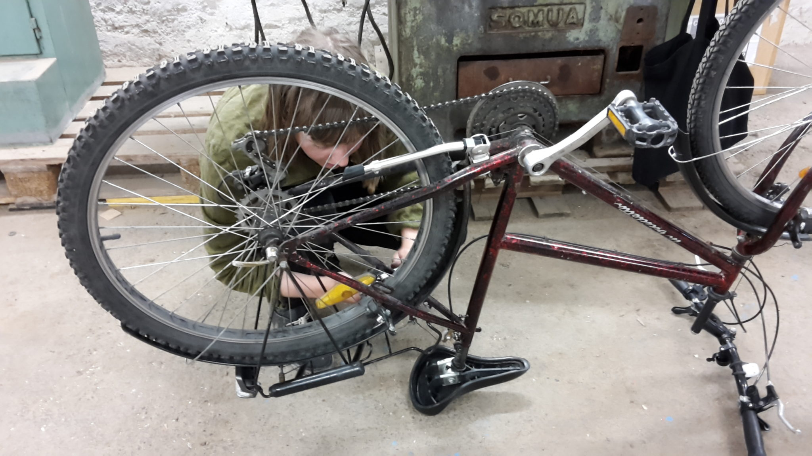

Autonomie

Alsace digitale + HackSxB \[ 11h00 - 18h00 \]

Tu aimes créer, bidouiller ? Tu es un(e) adepte des nouvelles technologies ou juste curieux(se) ? Alsace Digitale est là pour toi et te propose une initiation à la programmation et à la robotique. Mais ce n’est pas tout, si tu veux simplement jouer, le jeu multijoueur interactif et ludique devrait t’intéresser !

Expérimentation

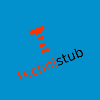

Technistub \[ 10H30 - 18H00 \]

Basé à Mulhouse, nous délocalisons notre fablab le temps de cette journée pour vous en présenter tous les aspects. À notre stand : matériel à écouler, des drones volants et roulants, présentation du [Makerfight](http://www.makerfight.fr "site makerfight")... N’hésitez pas à vous y rendre et venir nous faire signe !

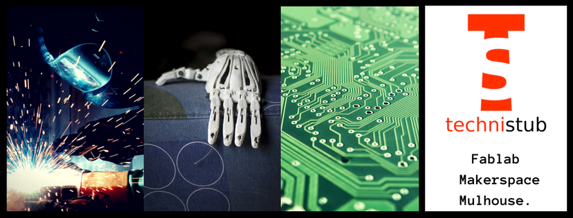

Expérimentation

Disco Soupe \[ 10H00 - 14H00 \]

**Disco Soupe ramène son vélo blender pour faire des soupes !**

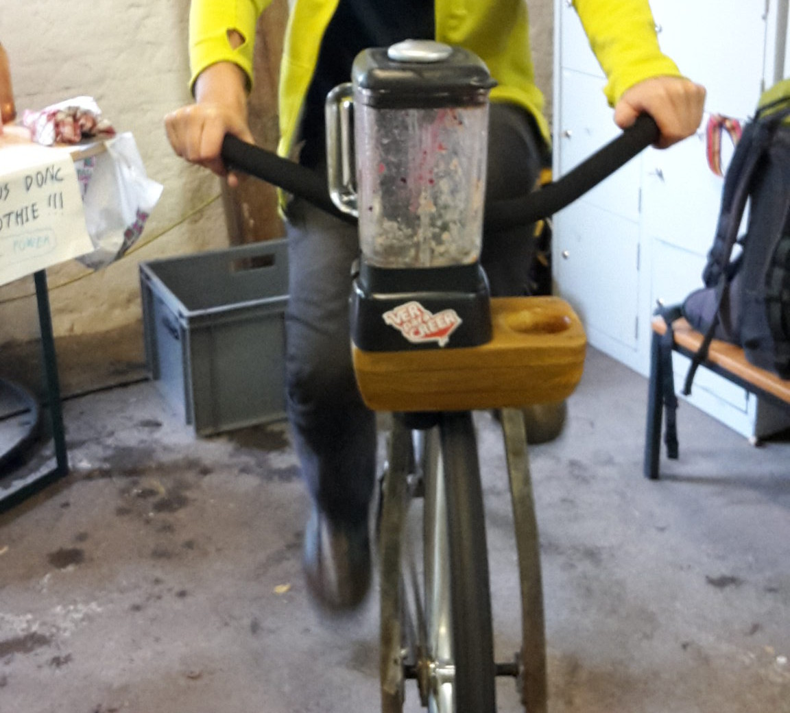

Un espace de cuisine collective sera là pour préparer des casse-croûtes tout frais à partir de fruits et légumes récupérés dans des épiceries et des petites/grandes surfaces.

Coopération

Hutte Grüber

Espace d’échange et de diffusion, nous sommes céramistes, sculpteurs, scénographes, illustrateurs, peintres issus de la HEAR et nous mettons les moyens de production et connaissances à disposition de tous dans notre atelier.

Expérimentation

Les ateliers du collectif Gruber \[ 9H00 - \]

La Drêche est un lieu indépendant et autonome imaginé et conduit par un collectif d'artistes pluridisciplinaire. L'atelier de 263m² est actuellement en phase d'aménagement.

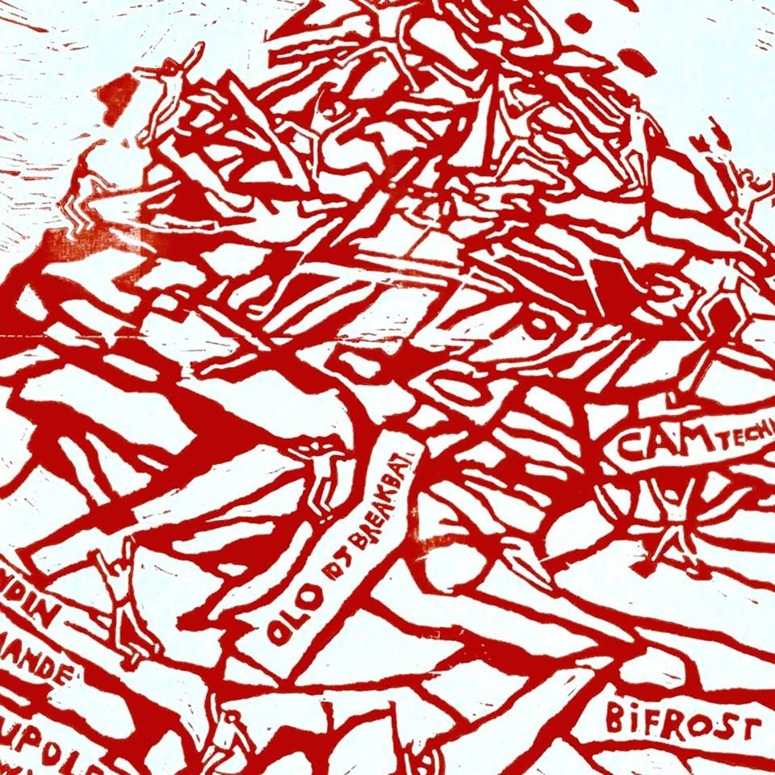

Expérimentation

Horizome

Un espace de cuisine collective sera là pour préparer des casse-croûtes tout frais à partir de fruits et légumes récupérés dans des épiceries et des petites/grandes surfaces.

Coopération

Tente des Glaneurs Strasbourg \[ 15H30 - 18H30\]

Nous avons pour but de lutter contre le gaspillage alimentaire, via la redistribution d’invendus non commercialisables mais consommables, à des personnes traversant une précarité alimentaire.

Coopération

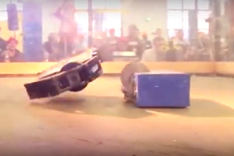

**Technistub**, LE fablab de Mulhouse, nous a informé qu'il viendrait à la journée hétérotopique avec des cadavres de robots ayant participé au **MakerFight** 2017 ! Y seront présents, **des drones volants** et **roulants** en état de fonctionnement. N'hésitez pas à venir les rencontrer !

## LES HÉTÉROTOPIES DE LA FABRIQUE

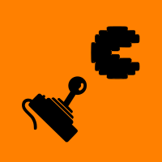

Retro-gaming

Jeux retro-gaming

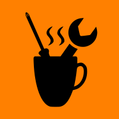

Repair Café \[ 14H00 - 18H00 \]

Réparer ce qui est cassé, surtout les petites pannes électriques / électroniques

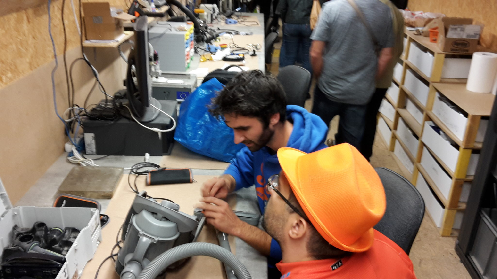

Makers du Coeur

**Do It For Others** Fabrication de petits objets pour répondre aux besoins des associations présentes.

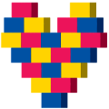

\[/vc\_column\_text\]

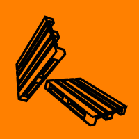

Kapla

Espace de construction en Kapla fabriqué avec des palettes récupérées.

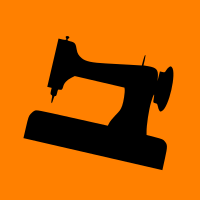

Couture \[ 14H00 - 18H00 \]

Retouches, créations, expositions

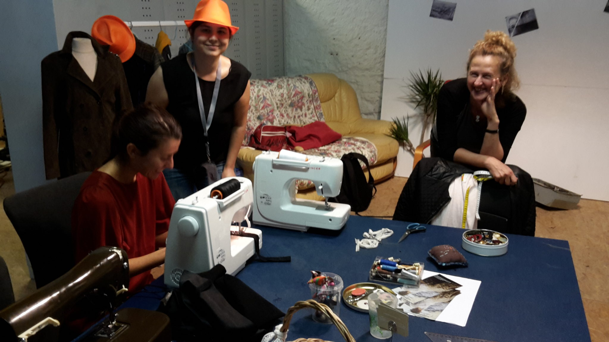

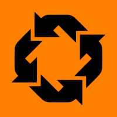

La Braderie de La Fabrique \[ 9H00 - 18H00 \]

Vends, troque, répare, achète... Pour avoir plus de détails et réserver un stand, suis ce lien.

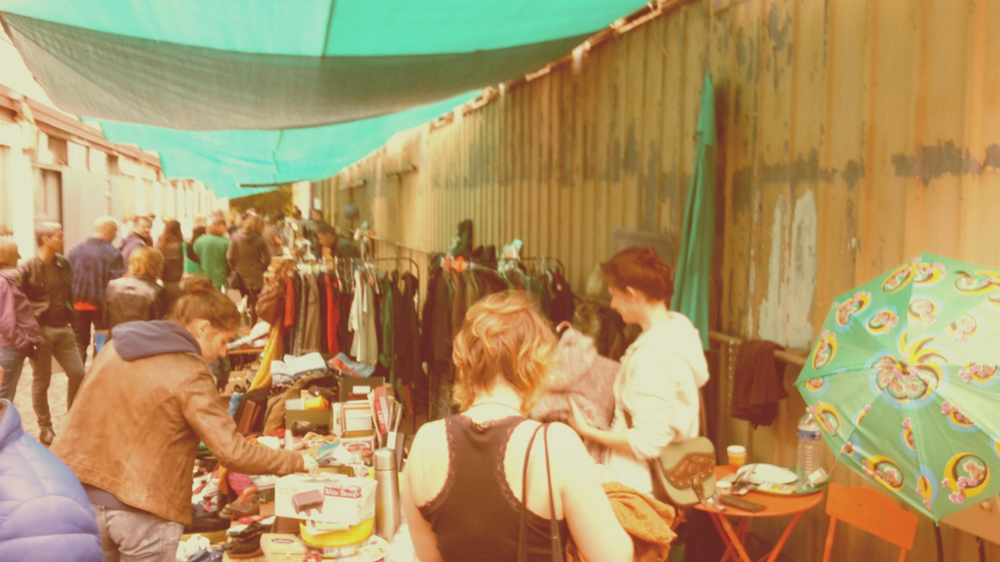

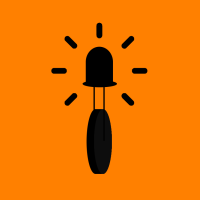

Throwies \[ 11H00 - 13H00 \]
 \[ 16H00 - 18H00 \]

Monter des leds avec sa pile et un aimant pour faire des Throwies

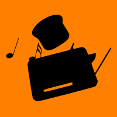

Musique Piezo \[10H00 -18H30\]

Création de musique avec du matériel électronique ménager transformé en générateur de son

## À VOIR AUSSI PENDANT LA JOURNÉE HÉTÉROTOPIQUE

La bière à la carotte de La Fabrique \[ Bar \]

**La Langoustine des Prés** Tous les détails sur notre site[biere.lafab.org

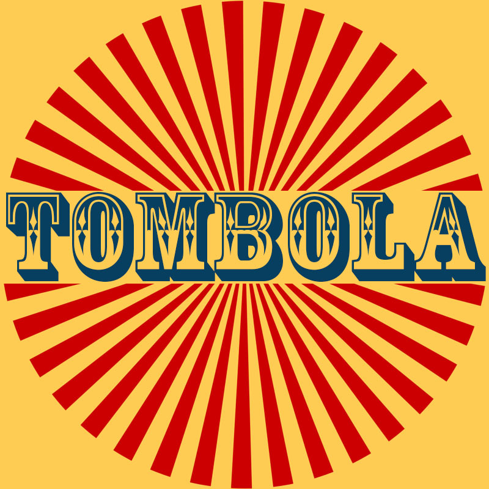

Grande tombola de La Fabrique \[ 19H00 \]

On déstocke et on réserve de belles pièces pour la tombola !!!

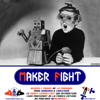

La Fabrique au Maker Fight 2018 \[ Toute la journée \]

Inscription au groupe de La Fabrique au Maker Fight 2018. Technistub présentera des robots "destructeurs". De nombreux détails sont présents sur le site dédié.

Dispensaire des plantes \[ 9H00 - 18H00 \]

Horizome et le collectif gruber vous présenteront un espace où vous pourrez apprendre ou aider à entretenir des plantes par le jardinage. En collaboration avec les magasins Botanic, le dispensaire des plantes recueille les plantes fatiguées, destinées à la benne de déchet vert, et les entretient. Notre objectif pour la braderie est de vendre des plantes afin d'injecter l'argent gagné dans un projet sérigraphie impliquant [La Drêche](https://www.facebook.com/collectif.ladreche/) et [Horizome](http://www.horizome.org/).

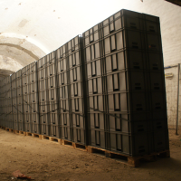

Le Stand Braderie de La Fabrique \[ 10H00 - 18H00 \]

On déstocke grave dans les travées de La Fabrique !!! Tout sera présent à La Braderie.

Radio Caddie \[ 15H30 - 17H00 \]

Cette Radio Caddie pimpée devient un bureau d’étude à ciel ouvert permettant de récolter des traces et témoignages écrits et sonores des personnes vivant sur le quartier à l’aide de micros, de papiers, de calques, de feutres... C’est un moment de partage d’idées dans une co-conception d’un cahier des charges qui permettra à terme d’affirmer une identité à radio Hautepierre. Il s'agira de se baser sur les différents retours des usagers, au travers de Radio Caddie, pour co-construire par la suite un travail commun autour de son identité visuelle, son habillage sonore et la réalisation d’un studio mobile co-construit avec des habitants bénévoles. La co-construction se fait avec les habitants en lien avec les Trames ordinaires. Nous sommes dans une phase de bêta test, au niveau des usages et des besoins.

**La bière à la carotte de La Fabrique**

Pour son événement annuel du 16 septembre 2017 et en collaboration avec la brasserie des [**Trois Mâts**](https://www.facebook.com/brasserie3mats/), La Fabrique va brasser sa propre bière et elle sera à notre couleur grâce à un ingrédient spécial : la carotte. Son nom ? **LA LANGOUSTINE DES PRÉS**. Tous les détails sur notre site biere.lafab.org.

## TOUT UN SITE À DÉCOUVRIR ET INVESTIR

La Journée Hétérotopique est aussi une occasion unique de vous dévoiler le site dans ses moindres recoins. Depuis deux ans, de nombreux bénévoles ont travaillé d'arrache-pied pour la création d'ateliers. La Fabrique ouvrira ses portes à l'occasion de cette journée particulière mais également dans le cadre des JOURNÉES EUROPÉENNES DU PATRIMOINE.

De 14h à 18h, des VISITES GUIDÉES seront organisées pour que les plus curieux puissent découvrir comment l'ancienne partie glacière de la brasserie Grüber a été transformée.

Les INSCRIPTIONS au programme automne-hiver 2017 des formations et des activités de La Fabrique seront ouvertes !

**Choisis toi-même la façon de vivre la nourriture !**

PRENDS TON REPAS EN MAIN ! \[ 11H00 - 14H00 \]

Avec Disco Soup, tout ce que tu dépenses, c'est ton énergie : lave, épluche, sublime les fruits et légumes de ton choix et déguste ta soupe sur place ! GLOUP !

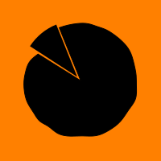

VIENS TE RAVITAILLER AU BAR DE LA FABRIQUE \[ 9H00 - 00H00 \]

Contre quelques deniers, tu repars avec une tarte flambée ! MIAM !

FAIS UN TOUR DANS LA TENTE DES GLANEURS \[ 15h30 - \]

Ils t'offriront des fruits et des légumes à emporter ! Alors ramène tes sacs !

**À tes papilles !**

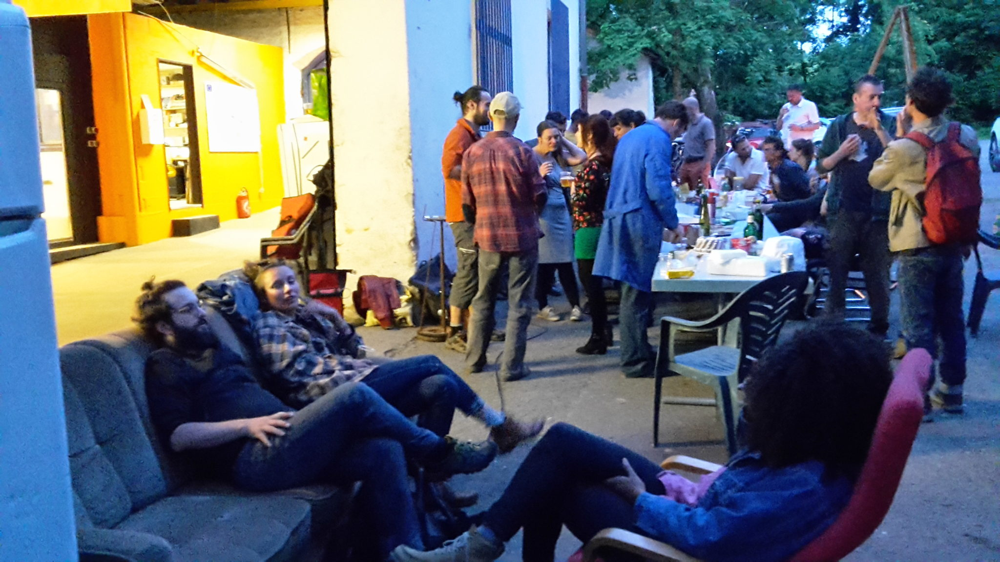

La Fabrique met à disposition un ESPACE AVEC CANAPÉS tout confort pour ceux qui voudraient reposer leurs pieds ou simplement PARTAGER des idées, et DÉBATTRE avec passion

## SOIRÉE CONCERT ACCOUSTIQUE

À partir de 18h, place à l'"AFTEROTOPIE" ! Pour la soirée, rejoignons-nous autour d'un repas convivial avec le braséro.

Pour accompagner le tout : 2 CONCERTS DE MUSIQUE INSTRUMENTALE La scène vous appartiendra également ! Nous encourageons tout le monde à venir avec son instrument de musique préféré au BOEUF MUSICAL !

Le Secours Populaire Français

Il sera présent dans un des stands de La Braderie, pour vous parler de ses activités mais également pour y vendre de nombreux livres.

Le Stand Braderie de La Fabrique

On déstocke grave dans les travées de La Fabrique!!! Tout sera présent à La Braderie

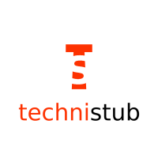

Le Stand Braderie de [Technistub](http://technistub.org/), LE fablab de Mulhouse.

Des oscilloscopes, des fers à souder enfin plein d'outils que l'on peut trouver dans un fablab.

## SYNCHRONISATION DES MONTRES

**PHASE SOLAIRE** **Braderie, stands et ateliers ouverts**

**PHASE LUNAIRE** **Brasero, concert, boeuf musical**

La Journée Hétérotopique se déroulera sur le site même de La Fabrique : PARC GRÜBER - 91 ROUTE DES ROMAINS - 67200 STRASBOURG - KOENIGSHOFFEN

Tu veux être bénévole sur cet événement spécial ?

Tu veux en profiter pour connaître / découvrir de l'intérieur et plus facilement le milieu des makers ? Avoir le privilège de pouvoir rentrer dans les lieux réservés au STAFF ? Être l'un des tous premiers possesseurs d'un chapeau orange ? Trouver des gens qui partagent tes projets ? C'est aussi l'opportunité de rencontrer plus facilement des gens qui partageront tes objectifs !

Écris-nous à [contact@lafab.org](mailto:contact@lafab.org)

La Croix-Rouge

On espère que personne n'en aura besoin mais elle sera là, au cas où... N'hésitez cependant pas à aller leur parler, c'est une opportunité pour vous de découvrir leur hétérotopie !

Idée et Organisation : [Manuel Simoes](mailto:mianuel@gmail.com "contacter Manuel") Cette page a été réalisée par [Fanny Greullet](http://deviantbird.com "deviantbird"), hétérotopologue amateur

