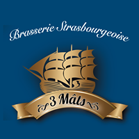
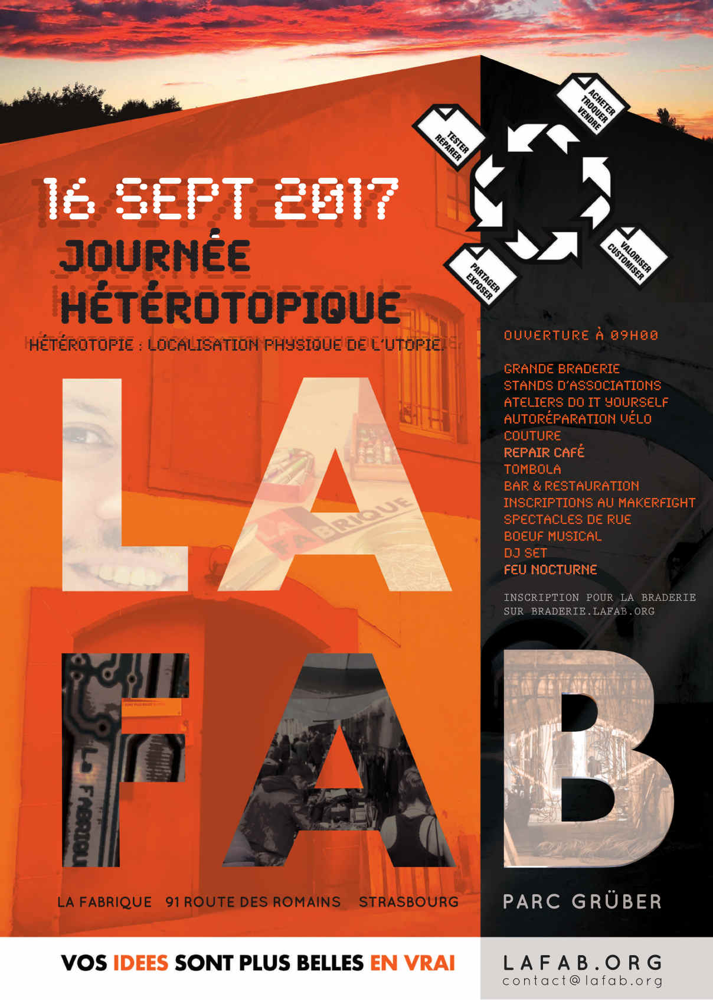

Animation rétro

**Pour sa journée hétérotopique, La Fabrique passe du Do It Yourself au Brew It Yourself, ou presque...**

Erwin Sohn, membre de La Fabrique et brasseur de talent, nous a concocté une bière à notre couleur grâce à un ingrédient spécial : la carotte ! Son nom : La Langoustine des Prés.

**C'est pas un peu bizarre comme nom ça ?**

Pas trop, non ! Quand on allie les lapins, grands amateurs de carottes, à la [Brasserie 3 Mâts](https://fr-fr.facebook.com/brasserie3mats/), et bien, un nom comme La Langoustine des Prés semble approprié !

**Ah ouais ??**

Figurez-vous que les marins et les lapins sont devenus au fil du temps de grands ennemis ! Si si ! Tout part d'une simple gourmandise pourtant. Les marins qui, autrefois, partaient pour de longues traversées sur leur navire, remplissaient des cages de lapins pour pouvoir se régaler de civets. Mais lorsque des lapins aventuriers s'échappaient, ils avaient une fâcheuse tendance à ronger les cordages qu'ils trouvaient sur leur chemin... Et ça c'est pas cool ! Les marins ont appris à se passer de civets et surtout à craindre les lapins. Tant et si bien que le mot même de lapin fût banni de leur vocabulaire et qu'ils utilisaient parfois le terme de "Langoustine des Prés" pour parler de cette bête maudite !

Et tout devint clair !!!

**Bonne dégustation à tous !**

_La Langoustine des Prés sera vendue à La Fabrique, mais également en Alsace et en Allemagne dans le milieu de la restauration._

Page web, animation retro, illustration : [Fanny Greullet](http://deviantbird.com/)

