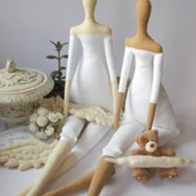

## **FORMATION COUTURE ET** PATRONAGE

 

### FABRIQUE UNE POUPÉE TILDA

_Pendant cette formation, vous allez fabriquer une poupée en chiffon au design épuré et élégant._

_Cet atelier permettra aux débutants de se familiariser avec le maniement de la machine à coudre piqueuse plate, d’aborder la découpe du tissu à l’aide d’un patron puis le montage des différentes pièces de la poupée ainsi que les vêtements pour l’habiller._

_L’atelier convient également aux initiés car il leur permettra de créer une poupée personnalisée et  de stimuler leur imagination en réalisant des tenues originales et complexes avec tout type de matériaux : tissus, cuir, feutre, plastique, etc.…_

_Cette formation est une excellente introduction au patronage et au stylisme de mode._

_Nous aborderons également la thématique de la couture manuelle, du rembourrage d’objet pour obtenir un volume, et les finitions en laine et autres matériaux pour les cheveux et accessoires._

## **Formation dispensée par :** **Isabelle Heili**

 

**Agenda :**

- **samedi 10** **et samedi 24 février : 14** **h - 17 h**

- **samedi 10** **et samedi 24 mars : 14 h - 17 h**

 

**Durée** **:** **2 fois 3 heures**, pour avoir le temps de finir.

Vous pouvez aussi venir à une seule séance et décider de finir chez vous grâce aux explications.

 

**Niveau :** **Tous niveaux confondus.**

 

**Matériel requis :** **Aucun.** Vous pouvez apporter des tissus et de vieux vêtements pour faire du recyclage.

**Note :** les machines, les gabarits, ciseaux, fils et fournitures sont inclus dans le prix; cependant vous pouvez apporter votre propre matériel.

 

**Nombre de personnes mini - maxi :** **3 - 5**

 

**Prix :** **45€ pour les 2 séances. (26€ pour une seule)**

 

**Contact - Réservation**: [iheili.ih@gmail.com](mailto:iheili.ih@gmail.com)
