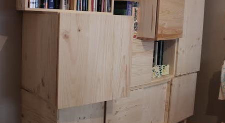

## **FORMATION MENUISERIE POUR DÉBUTANTS**

### **APPRENDRE A FAIRE UN CAISSON**

_Cet atelier permet de vous familiariser avec les machines et les techniques de la menuiserie en réalisant son premier caisson en bois, l'élément de base pour la fabrication de n'importe quel agencement ou rangement pour votre maison._

**Module 1 :**

- - règles de sécurité en atelier

- - découvrir les fondements du traçage et de l’établissement du bois

- - apprendre à rédiger une fiche de débit simple

- - initiation à l’utilisation de la scie à format

- découpe des éléments

**Module 2 :**

- - initiation à l’utilisation d’une machine à lamelles

- usinage et collage du caisson

### **Formation dispensée par :** 

**Agenda :**

**Pas de date prévue pour le moment** **Durée** **:** **2 séances de 3h**

**Niveau :** **Débutants**

**Matériel requis :**  **Porter des vêtements près du corps et des chaussures fermées.**

**Note : Chaque participant construit et emporte l'objet réalisé. Le matériel est fourni.**

**Nombre de personnes mini - maxi :** **4 - 6**

**Prix :** **90€** (+10€ d’adhésion à l'association si vous n’êtes pas encore membre)

**Contact - Réservation**:
