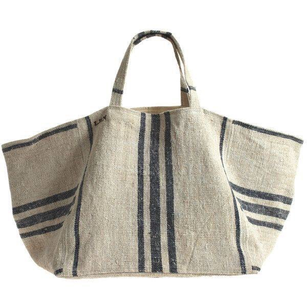

## **FORMATION COUTURE**

 

### **FABRIQUE UN TOTE BAG**

_Réalise ton Tote Bag pour faire du shopping , aller au sport ou à la plage cet été._

_Je propose deux modèles, le classique et le modèle_ _“seau”XXL, doublés ou non._

_La formation s’adresse aux débutants et aux personnes_ _confirmées qui pourront cust__omiser leur Tote avec du texte écrit à l’encre textile, des applications de rubans,  galons, boutons, pompons et autres ...._

_Fournitures:_

_Pour le Tote classique il faut du coton épais ou du lin (80 x 120 cm)_ _Pour le modèle seau  idem (150 X 120 cm).__On peut également travailler du simili cuir, de la  toile de bâche, du coton enduit.._ _Prévoir le double pour doubler ... et oui!_

_Les consommables sont fournis mais j’invite chaleureusement à apporter les fils (pour avoir les couleurs qui correspondent à votre tissu)_

## **Formation dispensée par :** **Isabelle Heili**

**Agenda :**

- **samedi 14 avril :  14h - 17h**
- **samedi 26 mai : 14h - 17h** 
- **samedi 9 juin : 14h - 17h**
- **samedi 23 juin : 14h - 17h**

**Durée** **:** **3 heures.**

**Niveau :** **Tous niveaux confondus.**

**Matériel requis :** **Apportez le tissu qui vous plaît pour votre sac.**

Coton épais ou lin (ou simili cuir, toile de bâche, coton enduit…)

Modèle Tote classique: **80 x 120 cm**

Modèle seau : **150 X 120 cm**

Prévoir le double pour doubler

**Note :** les machines, les gabarits, ciseaux, fils et fournitures sont inclus dans le prix; cependant vous pouvez apporter votre propre matériel.

**Nombre de personnes mini - maxi :** **3 - 5**

**Prix :** **25€**

**Contact - Réservation**: [iheili.ih@gmail.com](mailto:iheili.ih@gmail.com)
