# SAMEDI 13 OCTOBRE 2018

# LE BAZAR

# DE LA FABRIQUE

_"Il y a dans toute culture, dans toute civilisation, des lieux réels, des lieux effectifs, des lieux qui sont dessinés dans l'institution même de la société, et qui sont des sortes d'utopies effectivement réalisées. Des sortes de lieux qui sont hors de tous les lieux, bien que pourtant ils soient effectivement localisables."_

_\-- Michel Foucault_

## QUAND L'UTOPIE S'INSTALLE DANS UN (TIERS-) LIEU !

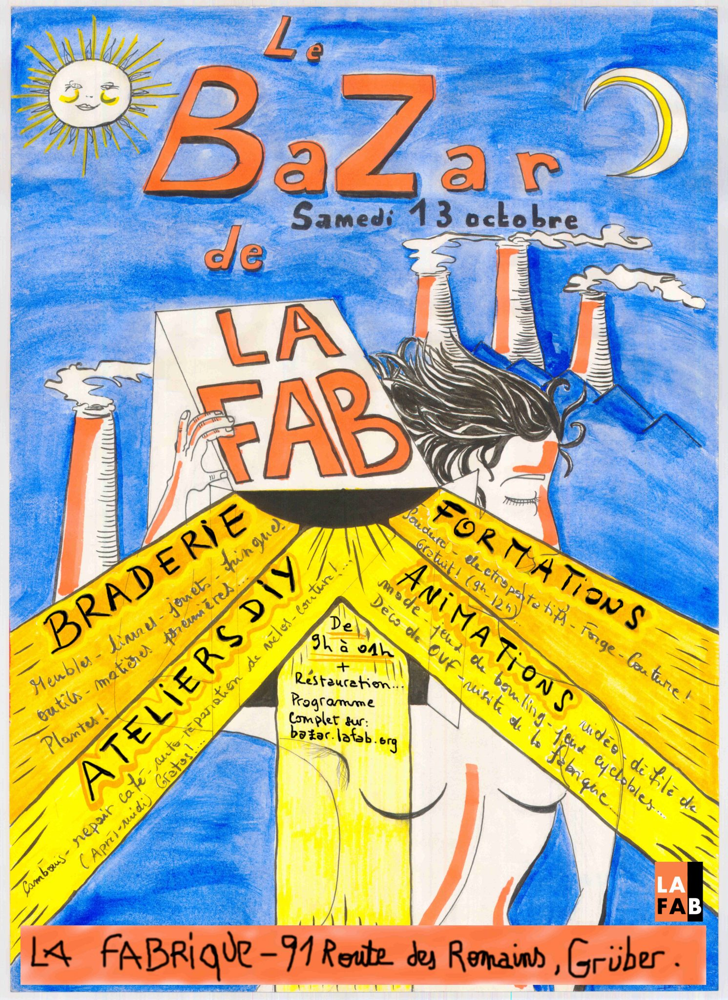

 

Depuis plusieurs années, La Fabrique s'est installée dans la partie glacière de l'ancienne brasserie Grüber. Comme de nombreuses associations, La Fabrique est mise au défi d'être viable économiquement tout en conservant ses objectifs et ses valeurs basées sur le partage et la connaissance accessible au plus grand nombre. Pour cela, elle expérimente différentes gouvernances, différents fonctionnements et de nouvelles opportunités pour chacun d'apprendre et créer. Au fil du temps, La Fabrique veut continuer à expérimenter de nouvelles manières d'agir et de construire ensemble.

C'est dans cet élan qu'elle lance cette année sa Le BaZar, le jour de fête de La Fabrique.

C'est un moment d’EXPÉRIMENTATION SOCIALE, une occasion de CHANGER NOTRE RELATION À L'OBJET ET À L'ENVIRONNEMENT.

Depuis l’année dernière, nous continuons à réunir dans un même lieu plusieurs manières de vivre son rapport avec l’objet, comme pour la braderie où l'on peut gratuitement tester/réparer/customiser l'objet que l'on vend/répare/achète/échange.

Bien sûr, d'autres animations vous donneront aussi le choix dans les distractions : initiation au robot, couture, forge, soudure, électroportatif...

Alors, expérimentez !

## LES AUTRES ASSOCIATIONS

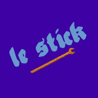

Le Stick \[ 14H00 - 18H30 \]

Le Syndicat technique d'initiative cyclable de Koenigshoffen est issu de la volonté conjointe d'habitants du quartier et de l'association Bretz'selle de créer un atelier d'autoréparation de vélos à Koenigshoffen. Venez découvrir le stand d'auto-réparation de vos biclous !

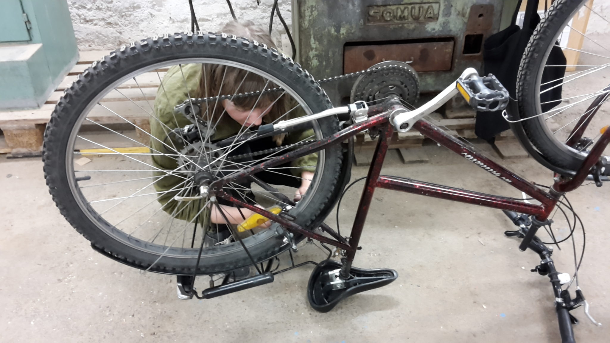

Autonomie

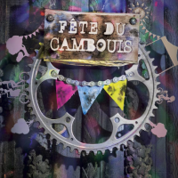

La fête du cambouis \[ 14h00 - 18h00 \]

Collectif organisant des événement du vélos et du jeux. Venez découvrir les jeux autour du vélo !

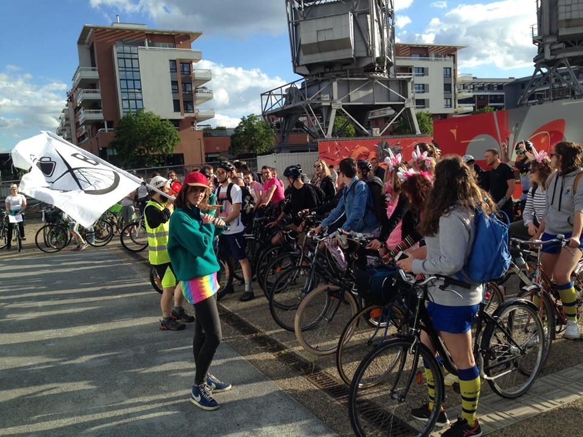

Autonomie, expérimentation

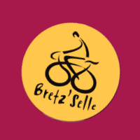

Bretz'selle \[ - 18H00 \]

Viens découvrir des modules pédagogiques pour apprendre les rudiments de la mécanique cycle ainsi que de la documentation sur l'hétérotopie cycliste !

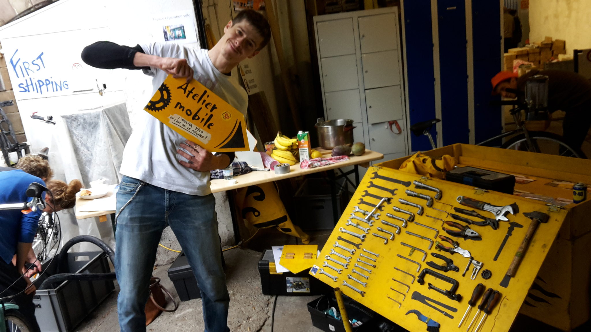

Autonomie, expérimentation

Technistub \[ 14h30 - 15h30 \]

Basé à Mulhouse, nous délocalisons notre fablab le temps de cette journée pour vous en présenter tous les aspects. À notre stand : matériel à écouler, des drones volants et roulants, présentation du [Makerfight](http://www.makerfight.fr "site makerfight")... N’hésitez pas à vous y rendre et venir nous faire signe !

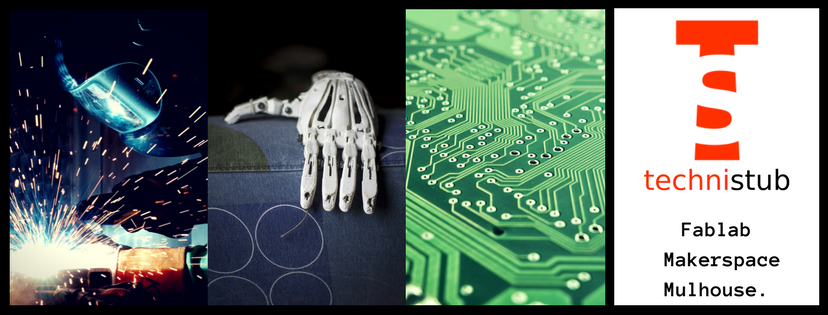

Expérimentation

Hutte Grüber

Espace d’échange et de diffusion, nous sommes céramistes, sculpteurs, scénographes, illustrateurs, peintres issus de la HEAR et nous mettons les moyens de production et connaissances à disposition de tous dans notre atelier.

Expérimentation

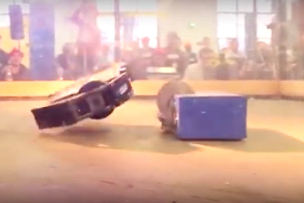

Nous vous donnons rendez-vous à 14h30 à La Fabrique pour la conférence / démonstrateur de Stéphane Laborde responsable du MakerFight et président de l'association [Technistub](https://www.facebook.com/technistub/). Il présentera le tournois de cette année. Il donnera aussi des conseils a ceux qui souhaitent s'organiser en équipe et construire un Robot (avec une démo !!!).

## LES HÉTÉROTOPIES DE LA FABRIQUE

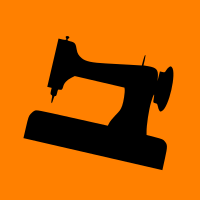

Couture \[ 14H00 - 18H00 \]

Retouches, créations, expositions

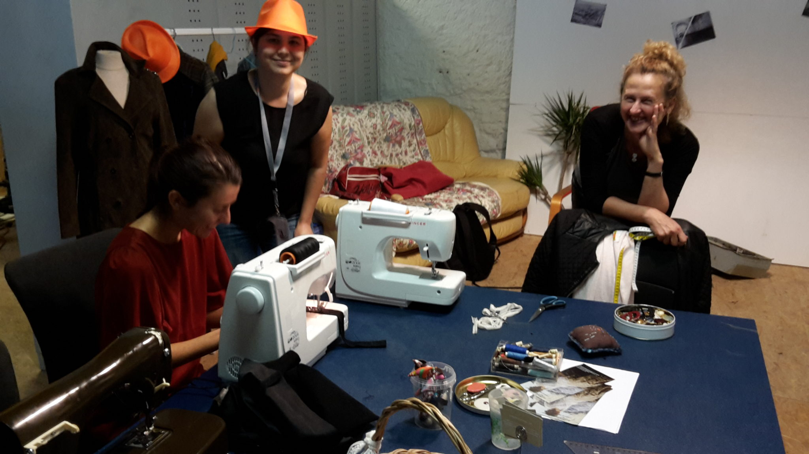

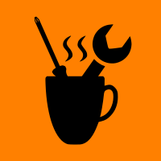

Repair Café \[ 14H00 - 18H00 \]

Réparer ce qui est cassé, surtout les petites pannes électriques / électroniques

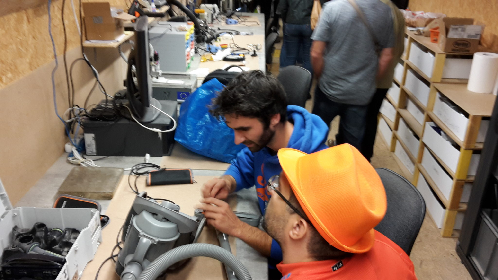

[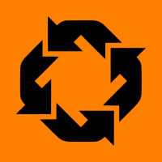](http://braderie.lafab.org)

La Braderie de La Fabrique \[ 9H00 - 18H00 \]

Vends, troque, répare, achète... Pour avoir plus de détails et réserver un stand, suis ce lien "braderie".

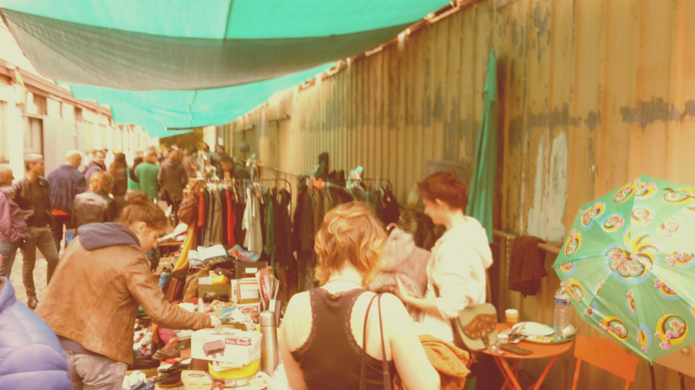

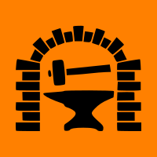

Forge \[ 14H00 - 18H00 \]

Lorem ipsum dolor sit amet

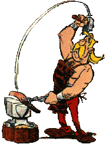

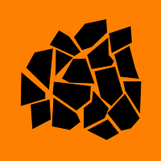

Céramique \[ 12H00 - 16H00 \]

Viens faire tes propres céramiques.

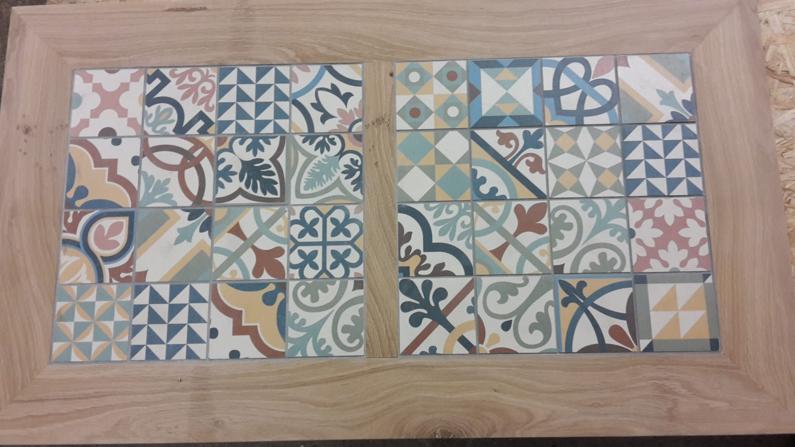

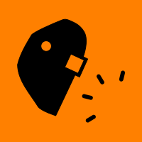

Soudure métallique \[ 14H00 - 18H00 \]

Lorem ipsum dolor sit amet

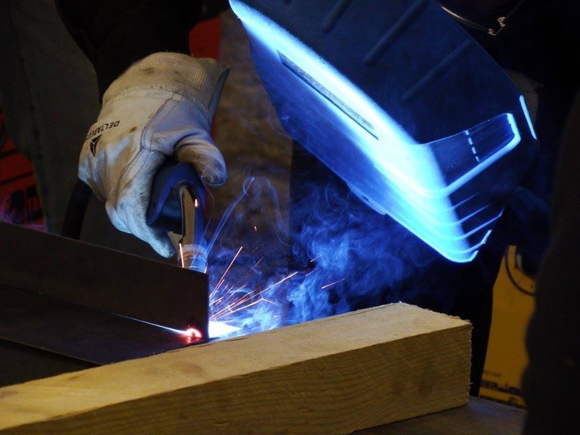

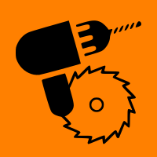

Électroportatif \[ 9H00 - 12H00 \]

Initiation aux outils, perceuses, viseuses...

## À VOIR AUSSI PENDANT LE BAZAR"

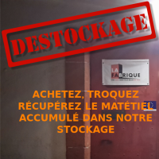

Le Stand Braderie de La Fabrique \[ 9H00 - 18H00 \]

On déstocke grave dans les travées de La Fabrique !!! Tout sera présent à La Braderie.

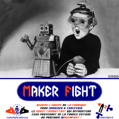

La Fabrique au Maker Fight 2018 \[ 14h30 \]

Inscription au groupe de La Fabrique au Maker Fight 2019. Technistub présentera des robots "destructeurs". De nombreux détails sont présents sur le site dédié.

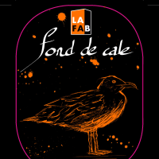

La bière à la carotte de La Fabrique \[ Bar \]

**La Fond de Cale** Tous les détails sur notre site biere.lafab.org.

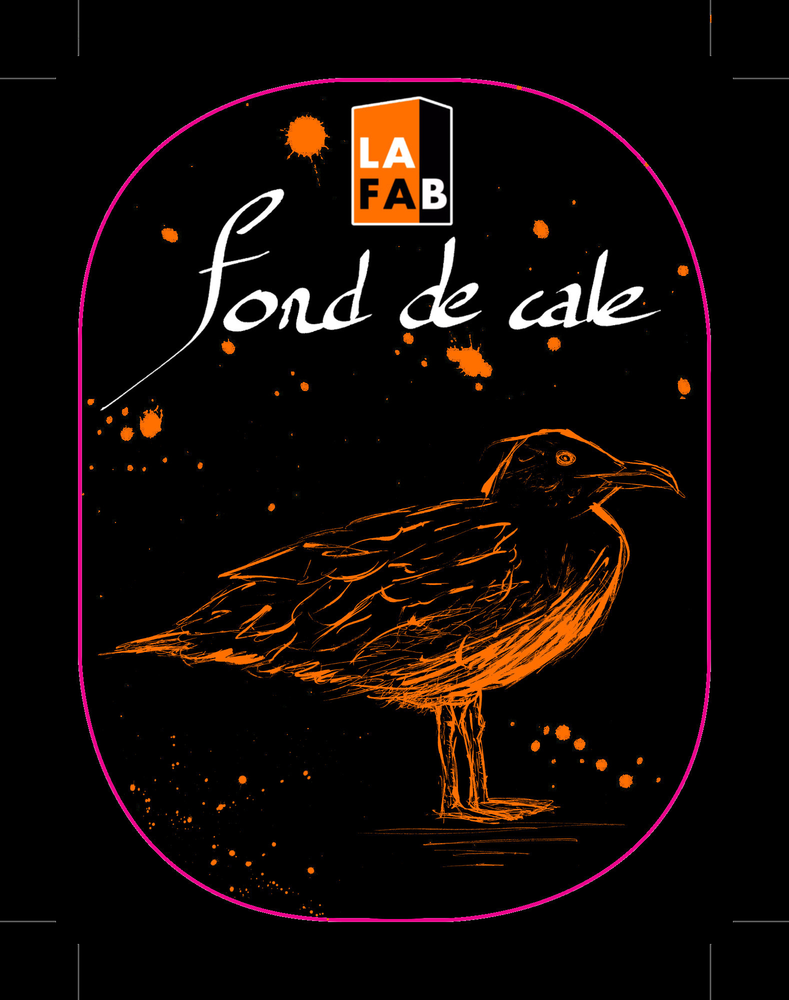

**La bière de La Fabrique**

Pour son événement annuel et en collaboration avec la brasserie des [**Trois Mâts**](https://www.facebook.com/brasserie3mats/), La Fabrique va brasser sa propre bière.

une Bière blonde houblonnée et au seigle (Indian Pale Ale), amère et légèrement épicée, mais très fruitée. 5,5% alc. Son nom ? **LA FOND DE CALE**.

Tous les détails sur notre site biere.lafab.org.

Le BaZar est aussi une occasion unique de vous dévoiler le site dans ses moindres recoins. Depuis deux ans, de nombreux bénévoles ont travaillé d'arrache-pied pour la création d'ateliers. La Fabrique ouvrira ses portes à l'occasion de cette journée particulière.

De 14h à 18h, des VISITES GUIDÉES seront organisées pour que les plus curieux puissent découvrir comment l'ancienne partie glacière de la brasserie Grüber a été transformée.

# UN P'TIT CREUX ?

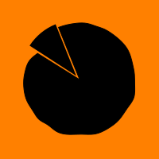

VIENS TE RAVITAILLER AU BAR DE LA FABRIQUE \[ 9H00 - 00H00 \]

Contre quelques deniers, tu repars avec une tarte flambée ou un plat typiquement africain (mafè, dieppe) ! MIAM !

**À tes papilles !**

## DÉTENTE

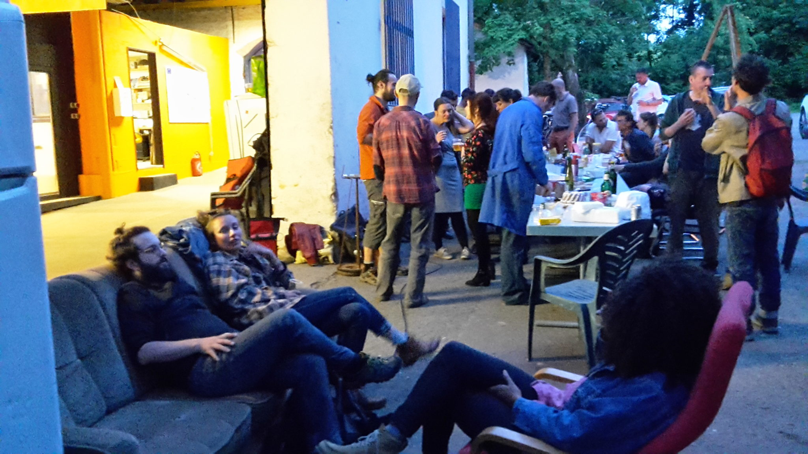

La Fabrique met à disposition un ESPACE AVEC CANAPÉS tout confort pour ceux qui voudraient reposer leurs pieds ou simplement PARTAGER des idées, et DÉBATTRE avec passion !

## SOIRÉE CONCERT ACCOUSTIQUE

À partir de 18h, place à l'"AFTER" ! Pour la soirée, rejoignons-nous autour d'un repas convivial avec le braséro.

Pour accompagner le tout : CONCERTS DE MUSIQUE INSTRUMENTALE La scène vous appartiendra également ! Nous encourageons tout le monde à venir avec son instrument de musique préféré au BOEUF MUSICAL !

## QUELQUES UNS DES STANDS À LA BRADERIE

Le Secours Populaire Français

Il sera présent dans un des stands de La Braderie, pour vous parler de ses activités mais également pour y vendre de nombreux livres.

Le Stand Braderie de La Fabrique

On déstocke grave dans les travées de La Fabrique!!! Tout sera présent à La Braderie.

## SYNCHRONISATION DES MONTRES

**PHASE SOLAIRE** **Braderie, stands et ateliers ouverts**

**PHASE LUNAIRE** **Brasero, concert, boeuf musical**

La Journée Hétérotopique se déroulera sur le site même de La Fabrique : PARC GRÜBER - 91 ROUTE DES ROMAINS - 67200 STRASBOURG - KOENIGSHOFFEN

Tu veux être bénévole sur cet événement spécial ?

Tu veux en profiter pour connaître / découvrir de l'intérieur et plus facilement le milieu des makers ? Avoir le privilège de pouvoir rentrer dans les lieux réservés au STAFF ? Être l'un des tous premiers possesseurs d'un chapeau orange ? Trouver des gens qui partagent tes projets ? C'est aussi l'opportunité de rencontrer plus facilement des gens qui partageront tes objectifs !

Écris-nous à [contact@lafab.org](mailto:contact@lafab.org)

