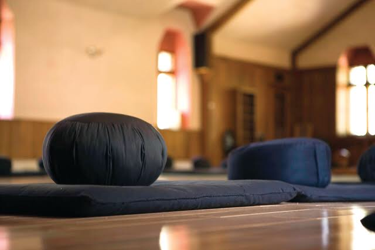

## **FORMATION COUTURE ET** PATRONAGE

### FABRIQUE UN ZAFU DE MÉDITATION

_La Fabrique vous propose un atelier pour fabriquer un Zafu de méditation._ _A cette occasion vous pourrez vous initier aux maniement des machines à coudre, apprendre à couper un tissu selon le patron, assembler les différentes pièces, préparer des plis de la bande puis coudre ... et finalement rembourrer._ _L'atelier est idéal pour les débutants mais aussi pour des gens qui ne trouvent pas de Zafu dans le commerce à leur taille par exemple._

_Le tissu utilisé sera au maximum du recyclage._ _Infos et inscriptions : iheili.ih@gmail.com_

## **Formation dispensée par :** **Isabelle Heili**

**Agenda :**

- **samedi 11mai** **: 14** **h - 17 **h****

**Durée** **:** 3h

**Niveau :****Débutants et initiés.**

**Matériel requis :** Apportez des tissus et de vieux vêtements pour faire du recyclage.

**Note :** les machines, les gabarits, ciseaux, fils et fournitures sont inclus dans le prix; cependant vous pouvez apporter votre propre matériel.

**Nombre de personnes mini - maxi :** **3 - 5**

**Prix :** **2 tickets La Fabrique (1 ticket pour les abonnés)**

**Contact - Réservation**: [iheili.ih@gmail.com](mailto:iheili.ih@gmail.com)
