# SAMEDI 12 OCTOBRE

# L'événement de La Fabrique

#  La FABastrophe

_"Il y a dans toute culture, dans toute civilisation, des lieux réels, des lieux effectifs, des lieux qui sont dessinés dans l'institution même de la société, et qui sont des sortes d'utopies effectivement réalisées. Des sortes de lieux qui sont hors de tous les lieux, bien que pourtant ils soient effectivement localisables."_

_\-- Michel Foucault_

## QUAND L'UTOPIE S'INSTALLE DANS UN (TIERS-) LIEU !

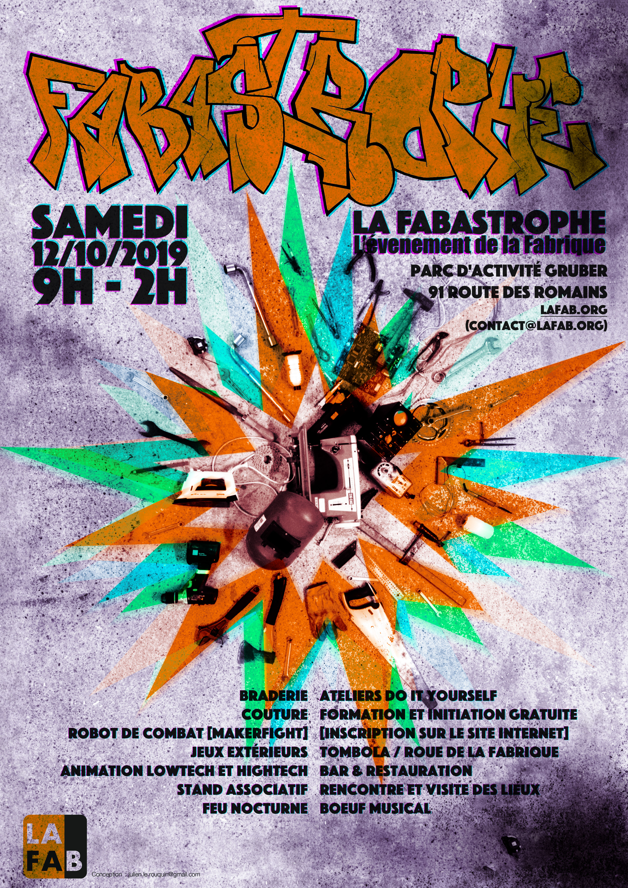

Depuis plusieurs années, La Fabrique s'est installée dans la partie glacière de l'ancienne brasserie Grüber. Comme de nombreuses associations, La Fabrique est mise au défi d'être viable économiquement tout en conservant ses objectifs et ses valeurs basées sur le partage et la connaissance accessible au plus grand nombre. Pour cela, elle expérimente différentes gouvernances, différents fonctionnements et de nouvelles opportunités pour chacun d'apprendre et créer. Au fil du temps, La Fabrique veut continuer à expérimenter de nouvelles manières d'agir et de construire ensemble.

C'est dans cet élan qu'elle lance cette année La FABastrophe, le jour de fête de La Fabrique.

Comme l’année dernière, nous continuons à réunir dans le même lieu dans un même lieu plusieurs manières de vivre son rapport avec l’objet, comme pour la braderie où l'on peut gratuitement tester/réparer/customiser l'objet que l'on vend/répare/achète/échange.

Bien sûr, d'autres animations vous donneront aussi le choix dans les distractions : initiation au robot, couture, forge, soudure, ...

Alors, expérimentez !

## LES AUTRES ASSOCIATIONS

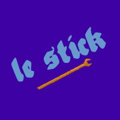

Le Stick \[ 14H00 - 18H00 \]

Le Syndicat technique d’initiative cyclable de Koenigshoffen est un atelier d’autoréparation de vélos à Koenigshoffen. Il est hébergé par la Fabrique, tous les jeudis de 18 à 20 heures. Venez découvrir le stand d’auto-réparation de vos biclous !

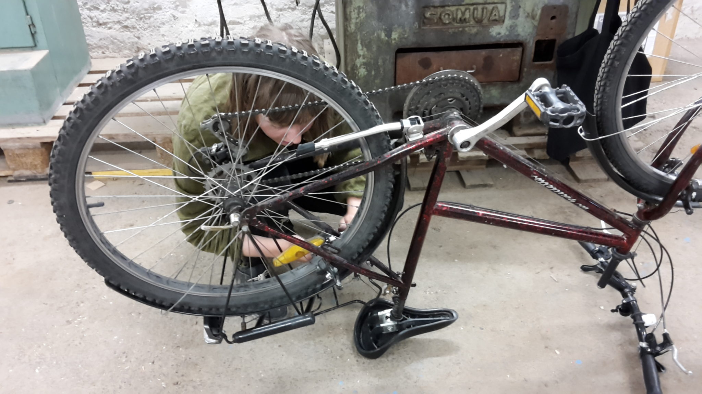

Autonomie

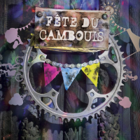

La fête du cambouis \[ 14h00 - 18h00 \]

Collectif organisant des événement du vélos et du jeux. Venez découvrir les jeux autour du vélo !

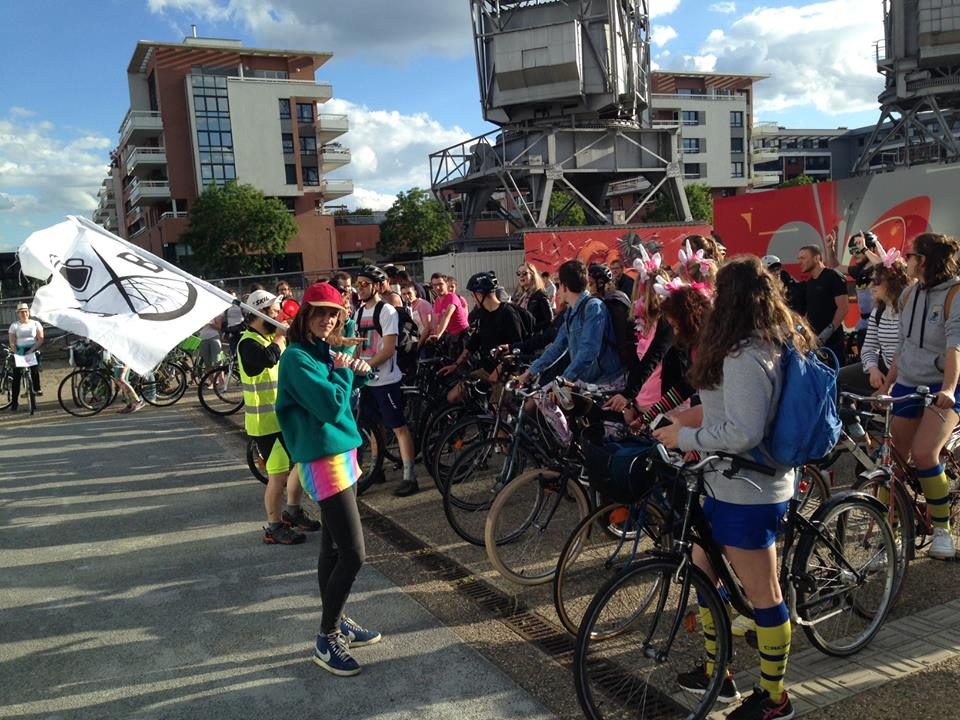

Autonomie, expérimentation

La Maison Mimir \[ 10h00 - 18h00 \]

La Maison Mimir est un lieu alternatif artistique et social autogéré. Elle est née de la rencontre entre des personnes sans domicile et des travailleurs sociaux ayant pour objectif de donner vie à un lieu d’habitation, de rencontre et de création. De nombreuses personnes d’horizons divers nous ont rejoints dans l’aventure...

Technistub

Basé à Mulhouse, nous délocalisons notre fablab le temps de cette journée pour vous en présenter tous les aspects. À notre stand : matériel à écouler, des drones volants et roulants, présentation du [Makerfight](http://www.makerfight.fr "site makerfight")... N’hésitez pas à vous y rendre et venir nous faire signe !

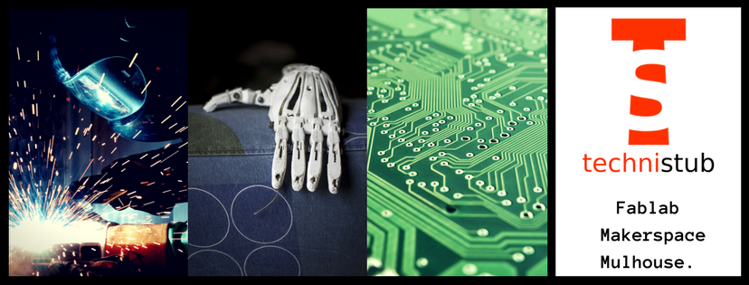

Expérimentation

## LES ANIMATIONS ET ATELIERS

http://lafab.org/2019/08/16/la-braderie-de-la-fabrique-2019/

#### LA BRADERIE DE LA FABRIQUE

10H00 - 18H00

Vends, troque, répare, achète... Pour avoir plus de détails et réserver un stand, suis ce lien.

#### LA BRADERIE DE LA FABRIQUE

10H00 - 18H00

Du Géo Trouvetou à l’ingénieur, du customiseur de meubles ou de vêtements d’Emmaüs vintage au designer, du bricoleur du dimanche au réparateur en tout genre, LA BRADERIE DE LA FABRIQUE EST FAITE POUR VOUS !

Rendez-vous sur la page de La Braderie

#### FABRIQUE TON COMPOSTEUR

10H00 - 18H00

François vous expliquera et montrera comment faire son propre compost \[jusqu’à épuisement de la matière première\]
 et il vous apprendra à utiliser les outils électroportatifs.

#### FABRIQUE TON COMPOSTE

10H00 - 18H00

François vous expliquera et montrera comment faire son propre compost \[jusqu’à épuisement de la matière première\]
 et il vous apprendra à utiliser les outils électroportatifs.

De 10 h à 13 h en continu, viens découvrir, gratuitement, les outils suivants :

- la scie circulaire sur rail,
- la perceuse et visseuse sans fil,
- la scie sauteuse.

et aussi comment on prépare un projet, quelle vis pour quel matériau, quel embout pour quelle vis, ...

et toutes ces petites choses qui facilitent la vie de la bricoleuse ou du bricoleur !

**Ensemble nous fabriquerons un composteur, qui sera mis en vente à la fin**.

Vous pouvez venir quand vous voulez, mais il n'y aura que trois personnes en même temps pour manipuler les outils.

#### FABRIQUE TON SAC EN TISSU

14H00 - 18H00

Rejoins l'équipe de Marianne et réalise un sac en tissu pour faire l'achat de denrées alimentaires (légumes, fruits...)

#### FABRIQUE TON SAC EN TISSU

14H00 - 18H00

Au travers de la réalisation d'un sac en tissu pour faire l'achat de denrées alimentaires en vrac type légumes, fruits, farines, céréales, fruits secs et compagnie, je propose une initiation à la machine à coudre. Les tissus et les ficelles de chanvre seront fournis moyennant une participation financière au sac à emporter de 2 euros minimum par sac avec un système de prix libre.

#### FABRIQUE TON ÉPONGE TAWASHI

10H00 - 18H00

Atelier fabrication de tawashis, le tout à prix libre bien sûr ([Maison mimir](https://www.facebook.com/Maisonmimir/)).

#### FABRIQUE TON PAIN

10H00 - 12H30

Fred de La Fabrique a construit un four à pain (en argile et en briques) qu'il utilisera pour cuire le pain.

#### FABRIQUE TON PAPIER MARBRÉ / CYANOTYPE

10H00 - 18H00

Anaïs vous accueillera pour apprendre et réaliser du papier marbré et cyanotype.

#### FABRIQUE TES BIJOUX

10H00 - 18H00

Atelier fabrication de bijoux, le tout à prix libre bien sûr ([Maison mimir](https://www.facebook.com/Maisonmimir/)).

#### INITIATION FORGE

14H00 - 18H00

Fabrication de décapsuleurs. Vince et son équipe vous attendent pour vous forger à la forge !

#### DÉMONSTRATION DÉCOUPE LASER

10H00 - 18H00

Viens utiliser notre nouvelle découpe laser \[jusqu'à épuisement de la matière première\]

#### INITIATION SOUDO-BRASURE

14H00 - 18H00

Initiation au Soudo-Brasage de tubes ([STICK Koenigshoffen](https://www.facebook.com/stickoenigshoffen/))

#### RÉPARE TON VÉLO

14H00 - 18H00

Stand associatif d'auto-réparation de vélos ([STICK Koenigshoffen](https://www.facebook.com/stickoenigshoffen/)).

#### RÉPARE TES OBJETS

10H00 - 18H00

Réparer ce qui est cassé, surtout les petites pannes électriques / électroniques (Repair Action de La Fabrique).

#### RÉPARE TES OBJETS

10H00 - 18H00

Réparer ce qui est cassé, surtout les petites pannes électriques / électroniques (Repair Action de La Fabrique). Notre événement, c'est l'occasion d'apporter ses objets cassés à la Fabrique ! Électronique, petit électroménager et autres bricoles qui ne fonctionnent plus - on observe, on bidouille, on trouve le problème et on voit si on peut le réparer avec les outils de notre atelier !

C'est aussi tous les 1er Jeudis du mois à La Fabrique de 20h30 à 22h30.

#### RÉPARE TES VÊTEMENTS

10H00 - 12H00

Réparation de vêtements et raccommodage BORO avec Annett et Laurence !

#### VISITE LES ATELIERS DE LA FABRIQUE

14H00 - 18H00

Les bénévoles de La Fabrique se feront un plaisir de vous faire visiter leurs ateliers.

#### INSCRIPTION AU MAKERFIGHT

14H00 - 18H00

#### RECHERCHE DE CONSEIL ?

10H00 - 18H00

Seront présents sur le site, dans un esprit de fête, et d'ouverture, des artistes, des artisans et des professionnels de toute profession. Autant que nous le pourrons, nous vous mettrons en lien en fonction de vos projets.

#### GAGNE DES PRIX

14H00 - 16H00

Notre roue de La Fabrique sera prête pour vous faire gagner de nombreux prix !!!

#### DU CAMBOUIS ET DES JEUX

14H00 - 18H00

La Fête du Cambouis est le premier festival Do It Yourself consacré au vélo.

#### DU CAMBOUIS ET DES JEUX

14H00 - 18H00

La Fête du Cambouis est le premier festival Do It Yourself consacré au vélo.

[Site](http://www.lafeteducambouis.org/) et [FB](https://www.facebook.com/Cambouis-1818822311758619/)

#### LE VESKARGÔ

10H00 - Fin du Monde

[Mou vous présentera une manière veskargette d'envisager le monde !](https://www.youtube.com/watch?v=T11kGMGvP4Y&feature=youtu.be)

Travail le véhicule et Cerveau Layer sur demande !!!!

#### CONTRÔLE UN ROBOT

14H00 - 18H00

Notre équipe de créateurs de robots de combat vous propose de télécommander un robot.

## TOUT UN SITE À DÉCOUVRIR ET INVESTIR

Le BaZar est aussi une occasion unique de vous dévoiler le site dans ses moindres recoins. Depuis deux ans, de nombreux bénévoles ont travaillé d'arrache-pied pour la création d'ateliers. La Fabrique ouvrira ses portes à l'occasion de cette journée particulière.

De 14h à 18h, des VISITES GUIDÉES seront organisées pour que les plus curieux puissent découvrir comment l'ancienne partie glacière de la brasserie Grüber a été transformée.

## UN P'TIT CREUX ?

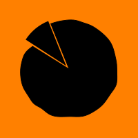

VIENS TE RAVITAILLER AU BAR DE LA FABRIQUE \[ 10H00 - 00H00 \]

Contre quelques deniers, tu repars avec une tarte flambée ou un plat typiquement africain (mafè, dieppe) ! MIAM !

**À tes papilles !**

#### DIA-SERVICES

10H00 - 20H00

Dia, nous propose des etits plats africains : Allo, Mafé, Allo Tieb

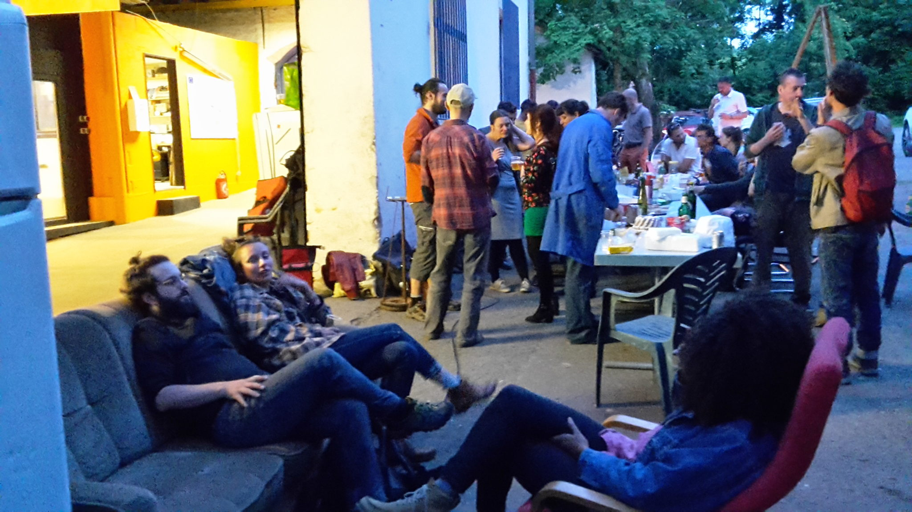

La Fabrique met à disposition un ESPACE tout confort pour ceux qui voudraient reposer leurs pieds ou simplement PARTAGER des idées, et DÉBATTRE avec passion !

## SOIRÉE CONCERT ACCOUSTIQUE

À partir de 18h, place à l'"AFTER" ! Pour la soirée, rejoignons-nous autour d'un repas convivial avec les braséros.

Pour accompagner le tout : CONCERTS DE MUSIQUE INSTRUMENTALE La scène vous appartiendra également ! Nous encourageons tout le monde à venir avec son instrument de musique préféré au BOEUF MUSICAL !

Toutes les musiques sont libres de droits et aucun musicien.ne n'est ou n'a été enregistré.e dans une société d'auteur et font don de ce moment (ils jouent gratuitement dans un événement associatif gratuit).

#### VOC'ABULEUX

18H00 - ++

#### VOC'ABULEUX

18H00 - ++

Pendant la FABastrophe, je propose VOC'ABULEUX : un atelier participatif de vocalises expressives et improvisées. Tu sais pas chanter ? Ça tombe bien on va faire des vocalises bruitées, parlées et aussi chantées. Aussi bien pour les personnes qui aiment déjà faire du bruit avec la bouche que pour les néophytes.

Alors viens enchanter ton univers en te mettant à l'aise dans ton corps et qu'on découvre ensemble des dialogues, des sons et rythmes que ta bouche aiment faire. Le tout dans la bonne humeur, le respect de l'appareil phonatoire et avec 3 fois rien.

Durée environ 1h30. Début vers 18h ou en plusieurs séances. Pour zadultes à partir de quinzans.

#### 6:00 P.M.

22H00 - ++

[électro-rock Strasbourg/Mulhouse](https://soundcloud.com/six-p-m)

#### 6:00 P.M.

23H00 - ++

[électro-rock Strasbourg/Mulhouse](https://soundcloud.com/six-p-m)

Composé de quatre musiciens (guitariste/chanteur, chanteuse, guitariste/bassiste, et percussionniste/clavier), 6:00 P.M. est un groupe aux influences multiples et éclectiques, puisant dans le rock, la musique électronique, la new wave, le blues ou encore le punk.

#### STRASS ET PARESS

23H00 - ++

Llve machine. : techno hip hop

#### EVEN-TuELLEMENT!

xxH00 - ??H00

Si vous le méritez !

## QUELQUES UNS DES STANDS À LA BRADERIE

#### DÉMONSTRATION DE FABRICATION DE STYLOS EN BOIS

13H00 - 16H00

#### DÉMONSTRATION DE FABRICATION DE STYLOS EN BOIS

13H00 - 16H00

Démonstration de fabrication de stylos : Stylo [Delalande](./Stylo-Delalande.pdf) et un document sur de l'[arbre au stylo](./de-larbe-au-stylo.pdf)

#### DÉSTOCKAGE DE LA FABRIQUE

10H00 - 18H00

On déstocke notre matériel électronique et informatique

#### COMMANDE UN BI-PORTEUR

10H00 - 18H00

Camille te le construira de A à Z.

#### COMMANDE UN BI-PORTEUR

10H00 - 18H00

Tout sur Camille et son activité de [création de Bi-Porteur](https://www.dna.fr/edition-de-strasbourg/2019/09/16/un-ingenieur-se-lance-dans-le-velo-100-sur-mesure?fbclid=IwAR2pq6PNqJ1aBCXNlwpOW_GnCcOAEADBNtTvA6MkaCHGTdP0KbmGd3NchDs)

#### VIDE DRESSING

10H00 - 18H00

Pour tous les dressing code !!!

#### FABRICE

10H00 - 17H30

De nombreux outils présent sur le stand et matières premières.

#### BERTIN SERVICES

10H00 - 18H00

Pour cet événement : vente de matériaux, outillages deuxième main (de la société), échelles, livres, tableaux, jouet pour enfant... : [Services de matériel d’entreprise](http://bertinservices.com/)

#### BERTIN SERVICES

10H00 - 18H00

Raphaël Bertin, est le responsable du stand de dé-stockage de La Fabrique (mais aussi un de ses fondateurs). Il est le chef d'entreprise de "Bertin Services" ([Service de matériel d’entreprise](https://www.facebook.com/bertinservices.fr/)).

#### ABRICOLEUSE

10H00 - 18H00

L'abricoleuse & Vente d'objets textile – création papier et autres bricolages en tout genre.

#### ABRICOLEUSE

#### 10H00 - 18H00

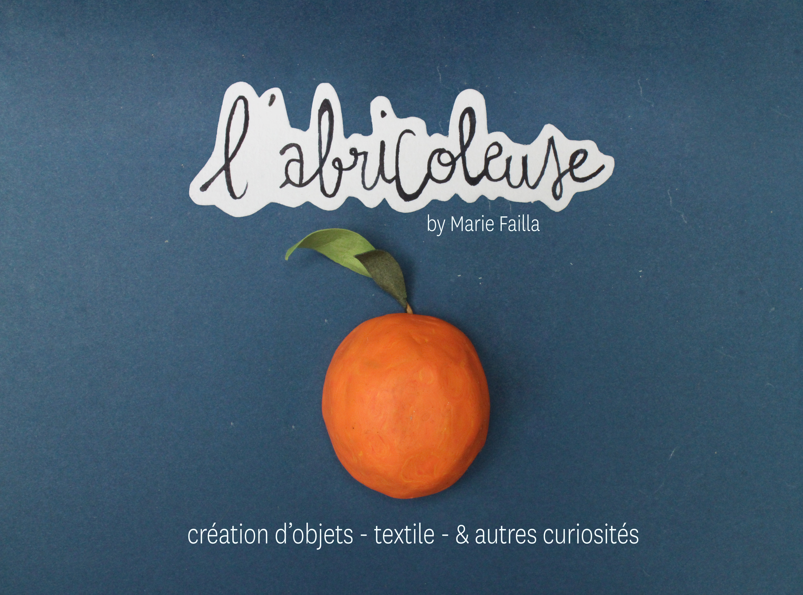
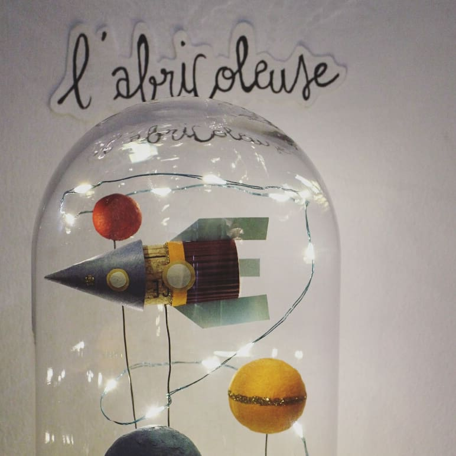
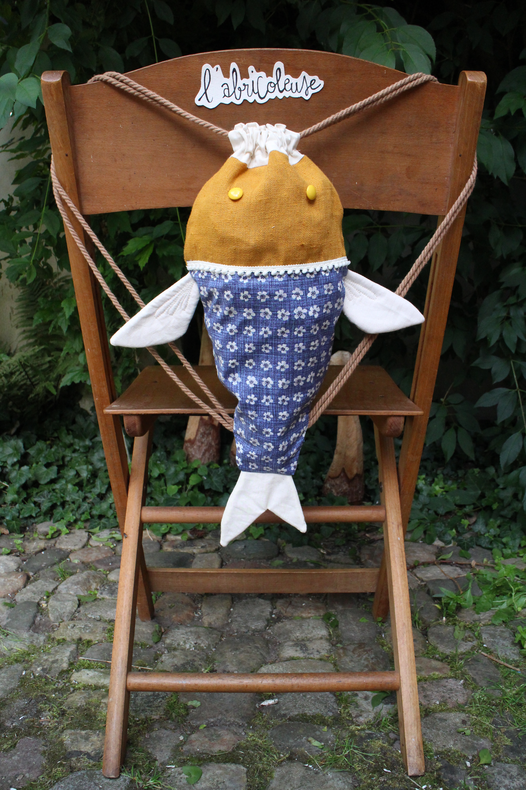
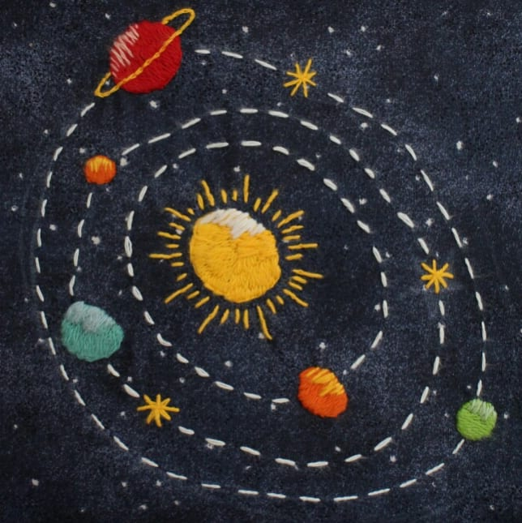

 
## SYNCHRONISATION DES MONTRES

**10:00**

**18:00**

**PHASE SOLAIRE** **Braderie, stands et ateliers ouverts**

**19:00**

**02:00**

**PHASE LUNAIRE** **Brasero, concert, boeuf musical**

La Journée Hétérotopique se déroulera sur le site même de La Fabrique : PARC GRÜBER - 91 ROUTE DES ROMAINS - 67200 STRASBOURG - KOENIGSHOFFEN

### Ou nous trouver

## **NE VOUS GAREZ PAS DANS LE PARC D'ACTIVITÉ GRUBER !!!**

**(circulation et parking perturbé du à notre événement)**

**Coordonnées GPS:** **[48.577612, 7.709597](https://www.google.com/maps/place/48%C2%B034%2739.4%22N+7%C2%B042%2734.5%22E/@48.577612,7.709597,188m/data=%213m2%211e3%214b1%214m2%213m1%211s0x0:0x0)**

**Accès Autoroute:**  7 min des deux Sorties A35 **Proximité Gare:**  30 min à pied / 20 min en bus **Accès Bus:** _Arrêt Grüber_ [ligne 4 et 50](https://www.cts-strasbourg.eu/fr/se-deplacer/fiches-horaires/) juste devant la zone Gruber

**Sur Facebook :** [https://www.facebook.com/lafab.org/](https://www.facebook.com/lafab.org/)

## ILS PARLENT DE NOUS

[DNA mercredi 9 octobre 2019](https://www.dna.fr/edition-de-strasbourg/2019/10/09/la-fabrique-un-atelier-aux-portes-grandes-ouvertes)

[pokaa.fr mardi 8 octobre 2019](https://pokaa.fr/2019/10/08/la-fabrique-un-immense-atelier-associatif-pour-rendre-la-creation-accessible-a-tous/)

## Tu veux être bénévole sur cet événement spécial ?

Tu veux en profiter pour connaître / découvrir de l'intérieur et plus facilement le milieu des makers ? Avoir le privilège de pouvoir rentrer dans les lieux réservés au STAFF ? Être l'un des tous premiers possesseurs d'un chapeau orange ? Trouver des gens qui partagent tes projets ? C'est aussi l'opportunité de rencontrer plus facilement des gens qui partageront tes objectifs !

Écris-nous à [contact@lafab.org](mailto:contact@lafab.org)
