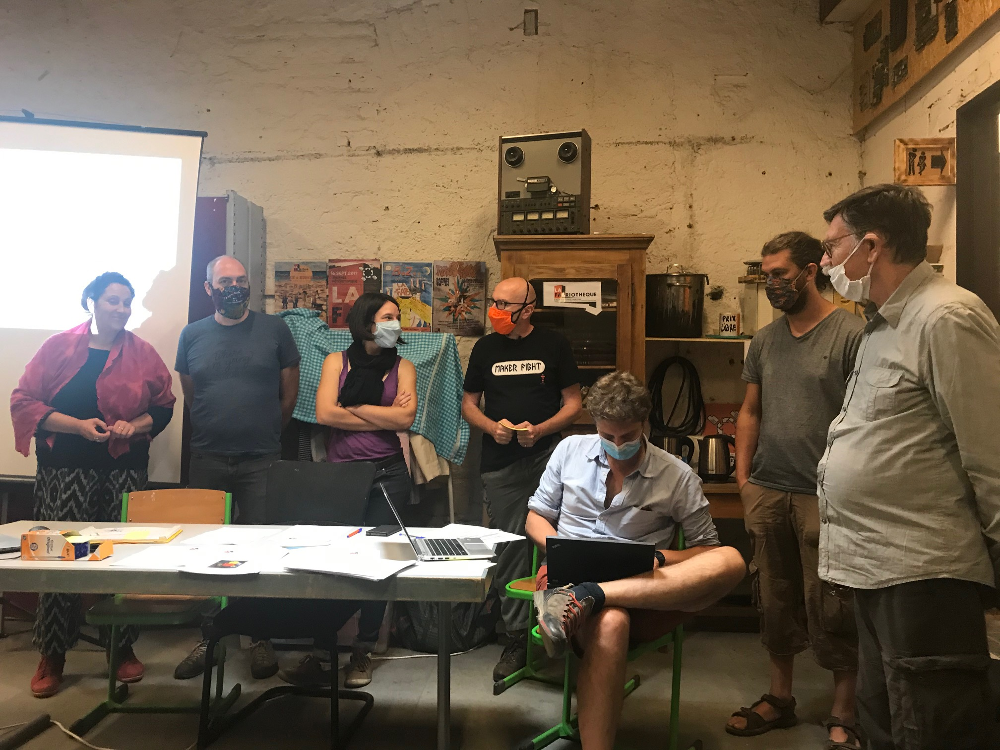

L’assemblée Générale 2020 a eu lieu le samedi 19 septembre à 17h. Cet événement survient normalement début avril mais, COVID-19 oblige, nous avons du le décaler plusieurs fois cette année.

Ce moment important dans la vie d’une association permet de faire le bilan d'une année écoulée, bilan qui prend la forme des trois rapports disponibles ci-dessous.

- [rapports d’activités](./Rapport-activités-2019.pdf)
- [rapport financier](./Rapport-financier-2019.pdf)
- [rapport moral](./Rapport-moral-2019.pdf)

A la suite de cette présentation, une élection est organisée afin de déterminer les membres du conseil d'administration. Ces élus représentent les membres de l'association et prennent les décisions de gestion. Durant cette assemblée générale ordinaire 2020, nous avons élu les personnes suivantes :

- Michel HERTANU
- Mathieu JOINIE-MAURIN
- François KORMANN
- Maud LUCAS
- Joris REHM
- Marianne SICHLER
- Mathias WEHRUNG

A la fin de l’assemblée, nous avons levé un verre pour fêter les 5 ans d’ouverture au public de La Fabrique (11 septembre 2015) !
