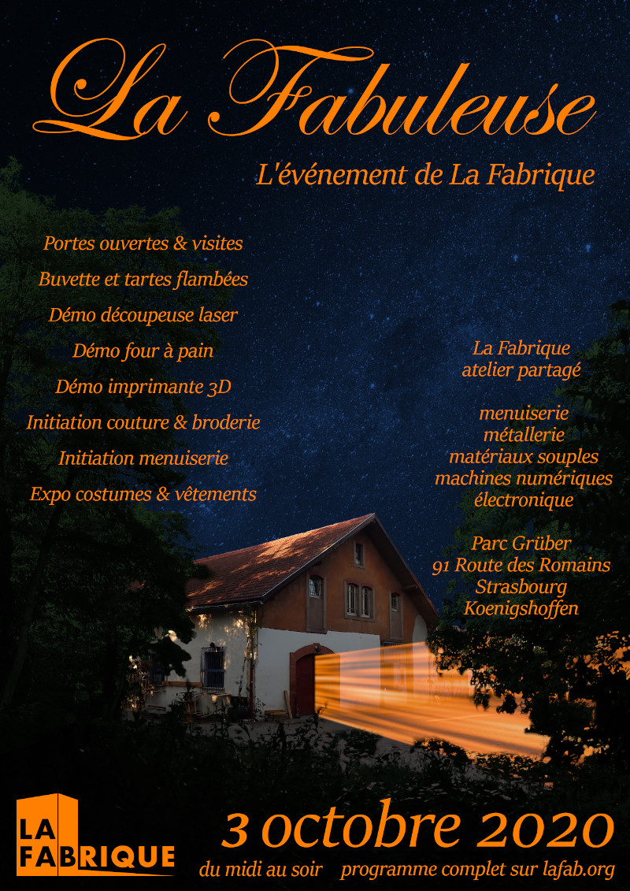

Vous le savez peut être mais nous, à La Fabrique, on aime bien changer le nom de notre fête chaque année. Et pour cette année 2020, c'est "La Fabuleuse" !  
  

Ce samedi, **La Fabrique se configure en mode portes ouvertes** avec **visites** pour découvrir nos ateliers, **buvette** pour s'asseoir pour voire un verre, discuter et stand de **tartes flambées** pour reprendre des forces.

Tout au long de la journée, dans les ateliers et à l'extérieur, **découvrez quelques projets significatifs** de nos adhérents et résidents comme une tiny-house en cours de construction, des réalisations textiles, des meubles fait dans l'atelier menuiserie et des **photographies des dernières réalisations**.

En plus de ces expositions et activités festives, voici **ci-dessous le programme** des ateliers thématiques.

**Menuiserie au fil de l'eau**  
**14h-18h** dans **l'atelier menuiserie**

François vous accueille dans l'atelier menuiserie de La Fabrique pour vous faire découvrir le travail du bois et notre atelier. Durée libre, venez simplement regarder ou participer à la réalisation d'un composteur que ce soit pour un seul trait de scie ou pour rester deux heures. Session en continu, 3 personnes maximum.

**Session découverte des arts textiles**  
**13h-18h** dans l'**atelier matériaux souples**

Accueil de publics de tous les niveaux pour initiation à la couture sur machine famille ou industrielle et au tricot. Apportez vos tissus et vos fils. Sessions d'une heure, 6 personnes maximum.  
**Et tout au long de la journée :** exposition de réalisation d'adhérent de La Fabrique, de cos'play et de l'association Patchworkers.

**Démonstration de la découpeuse graveuse laser**  
**14h-18h** dans la **cabane Laser**

Venez découvrir la technologie des machines numériques laser en pratique. Inscription sur place pour les prochaines formations. Session en continu, 4 personnes maximum.

**Démonstration de l'imprimante 3D**  
**14h-18h** dans l'**atelier électronique**

Joris vous montre le fonctionnement de notre imprimante 3D avec l'impression de petites pièces. Possibilité d'impression personnalisée, à prix libre, d'objets comme des portes clés, des décorations de bijoux fantaisie. Inscription sur place pour la formation future à la machine et son utilisation à La Fabrique. Session en continu, 4 personnes maximum.

**Répar'action**

**14h-18h** dans l'**atelier électronique**, ou dehors si la météo le permet.

Apportez vos petits électro-ménagers ou appareils informatique en panne. Dylan & Frantz vous aideront à démonter, comprendre ce qui ne marche pas, et peut-être réparer.

**Atelier découverte de l'Arduino**  
**14h-18h** dans l'**atelier électronique**

Initiation aux principes de la programmation Arduino. Inscription sur place pour la participation à une équipe de fabrication de robot. Session en continu, 4 personnes maximum.

**Ra'commode'age au coin du feu**  
**18h-20h** à **l'extérieur**

Venez avec vos vêtements troués et Laurence vous accompagnera avec une technique de raccommodage en broderie créative.

**Démonstration du four à pain**  
**Durant la journée** à **l'extérieur**

Fred vous montre notre four à pain auto-construit. Activité seulement si la météo le permet.
