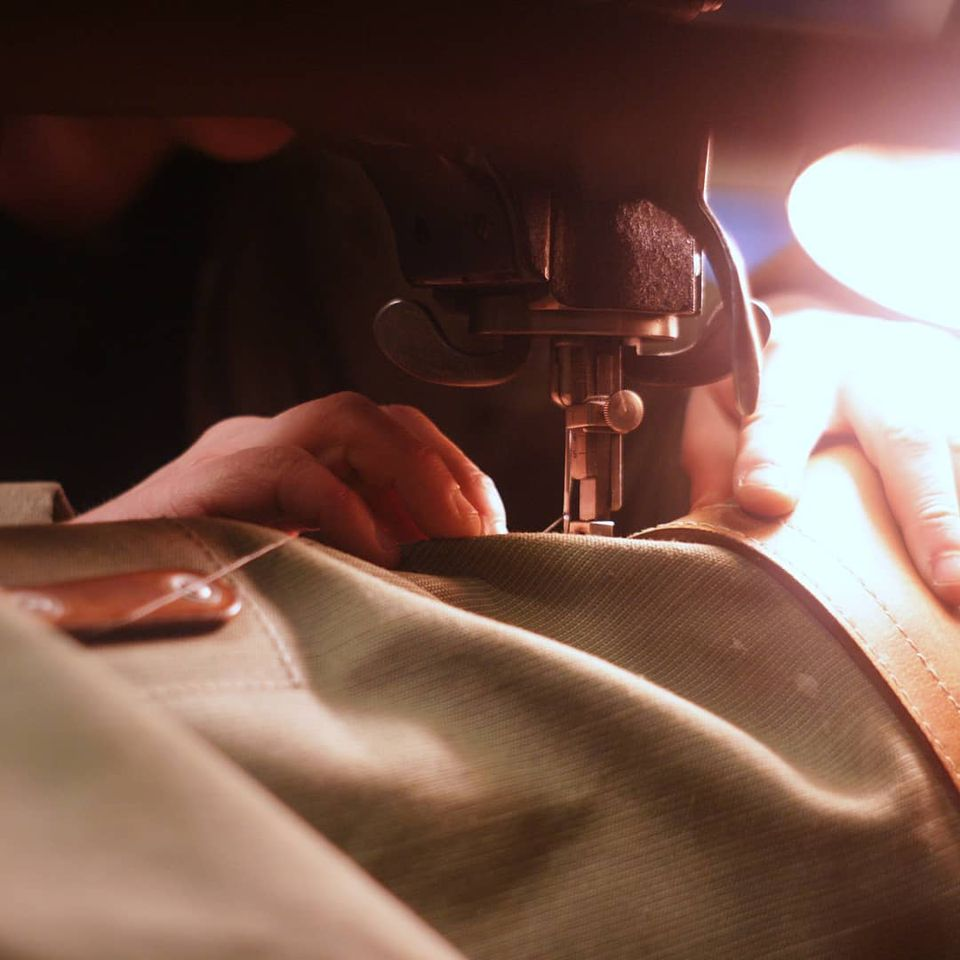

### La Fabrique ouvre un nouvel espace cordonnerie !

Depuis le début de l’année 2021, un nouvel atelier a été aménagé à La Fabrique : la cordonnerie.

Il y a désormais tout le matériel nécessaire pour réparer des chaussures et accessoires et pour fabriquer de petits objets en cuir.

La cordonnerie est désormais accessible à tous, comme les autres machines et outils de La Fabrique. Comme ailleurs, pour utiliser les machines, il faut d’abord y avoir été formé. Les dates, détails et inscription pour les activités de la cordonnerie (apprendre à fabriquer une ceinture, un étui à couteau, à ressemeler ses chaussures, etc), c’est par là.

Vous pouvez également venir **réparer vos chaussures et accessoires**, sous la supervision d’une personne compétente, **tous les jeudis soirs**, de 18 h à 20 h. Tarif : 1 ticket + les pièces éventuelles (boucles, etc).
