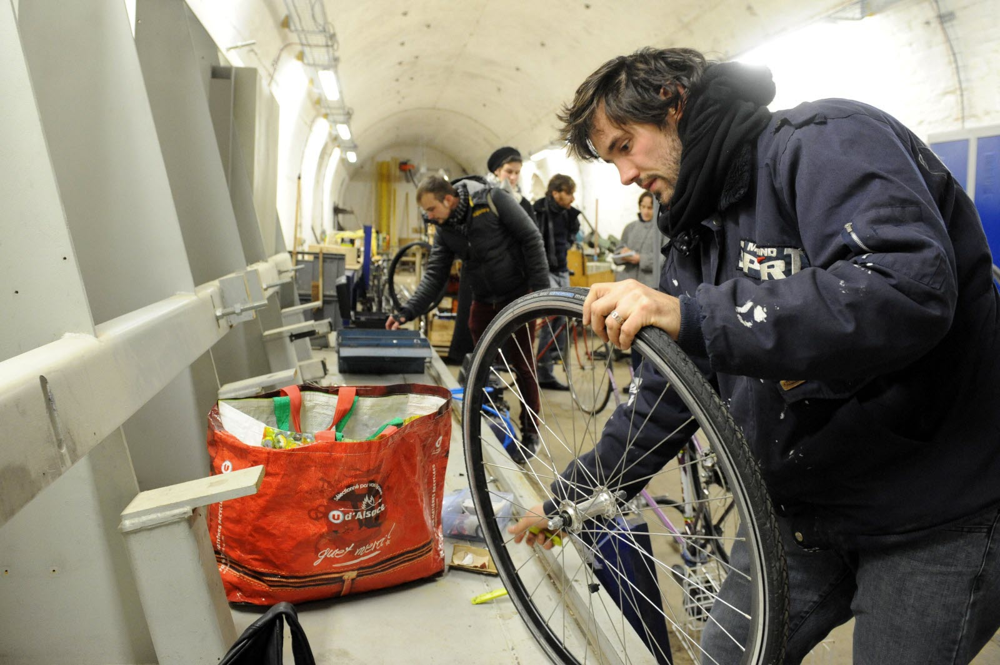

## DNA - La Fabrique, un atelier aux portes grandes ouvertes samedi à Koenigshoffen

La Fabrique, située dans le parc Gruber, est un « centre de production partagé ». L’endroit parfait pour tout faire ou réparer. Parce qu’on n’a pas toujours la place pour bricoler. Parce que l’on en a assez, de ces objets toujours en panne. Samedi, c’est portes ouvertes. L’occasion d’aller y voir de plus près.

Jean-Frédéric TUEFFERD - 19 oct. 2021 à 17:53 | mis à jour le 19 oct. 2021 à 19:40 - Temps de lecture : 2 min

[Source](https://www.dna.fr/environnement/2021/10/19/tout-faire-et-reparer-a-la-fabrique)

<figure>

<figcaption>

À la Fabrique, on peut réparer son vélo, mais aussi faire de la cordonnerie, de la couture, de la menuiserie… Pour savoir tout ce qu’on peut réaliser, le mieux est de se rendre aux portes ouvertes de l’association samedi. Photo DNA/Jean-Christophe DORN

</figcaption>

</figure>

Quand on habite en ville, un des gros problèmes qui se pose est celui de la place. Pour peu que l’on ait pour passion le bricolage, cela confine au casse-tête. Face au dilemme de savoir si l’on privilégie son lit ou son établi, la Fabrique, située route des Romains à Koenigshoffen, est peut-être la réponse idéale.

> Un fablab orienté machines-outils et activités artisanales

« Au début, raconte Maud Lucas, présidente de l’association, on avait choisi le nom de Centre de production partagé. » “La Fabrique” dit tout autant ce qu’est cet endroit situé en bas du parc Gruber. « C’est plus ou moins le principe d’un fablab, mais nous sommes plus orientés sur les machines-outils et les activités artisanales. »

Le principe est simple. « Nous mettons à disposition des ateliers équipés pour remplacer les garages qu’on n’a souvent pas en ville. » Car le bricolage prend de la place, surtout quand on a décidé de réaliser un buffet comtois ou une armoire normande. « Mutualiser l’espace et les outils permet de mieux s’équiper. » Et aussi de bénéficier de formations pour savoir se servir aux mieux et sans risque des outils. « Le but, c’est de pouvoir se débrouiller de manière autonome. » Il existe plusieurs ateliers : menuiserie, métallerie, informatique et électronique, matériaux souples (couture et cordonnerie). À cela s’ajoutent une découpeuse laser et une imprimante 3D.

Pour avoir accès à la scie sauteuse de ses rêves, il faut être adhérent, ce qui coûte 10 euros pour l’année. « Ensuite, les gens payent selon la formule qu’ils ont choisie » : soit un abonnement, soit un ticket qui correspond à trois heures d’atelier. À la Fabrique, le début de semaine est consacré à la formation, « le jeudi, on fait visiter » et les vendredis et samedis sont les jours d’ouverture (avec des possibilités pour d’autres créneaux, notamment le jeudi).

« Une fois par an, nous organisons de vraies grosses portes ouvertes. C’est l’événement de rentrée », se réjouit Maud Lucas. Cette année, ce sera ce samedi, de midi à 22 h. « Il y aura des démonstrations dans les ateliers, de petites initiations et l’exposition de quelques pièces réalisées par les membres. » De quoi se donner envie de mettre la main à la pâte, pour faire une bourse par exemple, sans y laisser son portefeuille.

Samedi 23 octobre, de midi à 22 h, portes ouvertes à la Fabrique, 91 route de Romains, parc Gruber, à Koenigshoffen.

