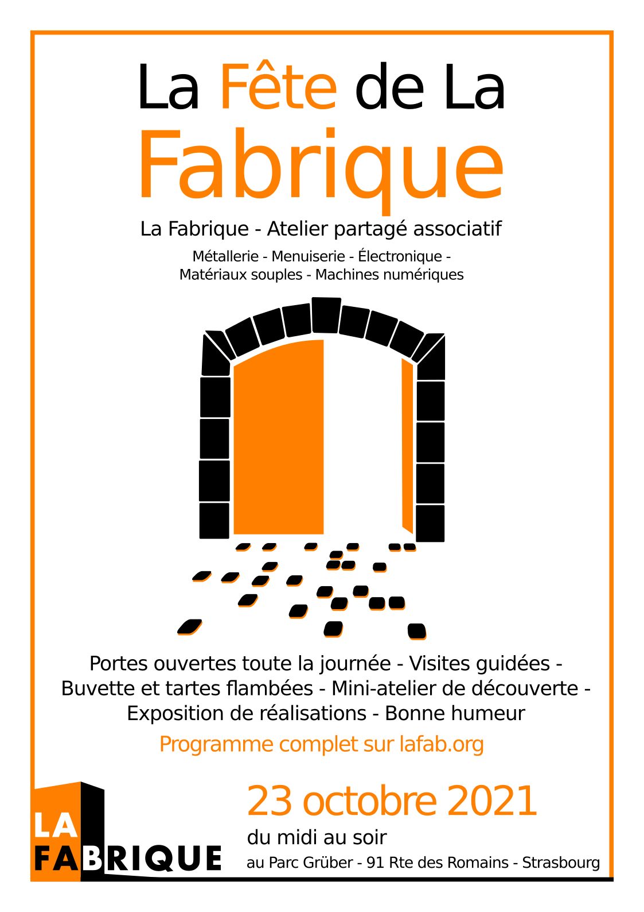

* * *

[crepuscule.studio](https://www.instagram.com/crepuscule.studio/) fut créée en Normandie en 2015, puis reprise à Strasbourg en cette année par Yoann Favre. Ce jeune ingénieur en mécanique mais aussi producteur concertiste de musique a décidé de se reconvertir dans l'artisanat. Les lustres de la marque sont réalisés à Gruber entre la Fabrique et la Maison Rose. Venez découvrir les nouveaux modèles alliant la légèreté du bois et la brillance du verre !
