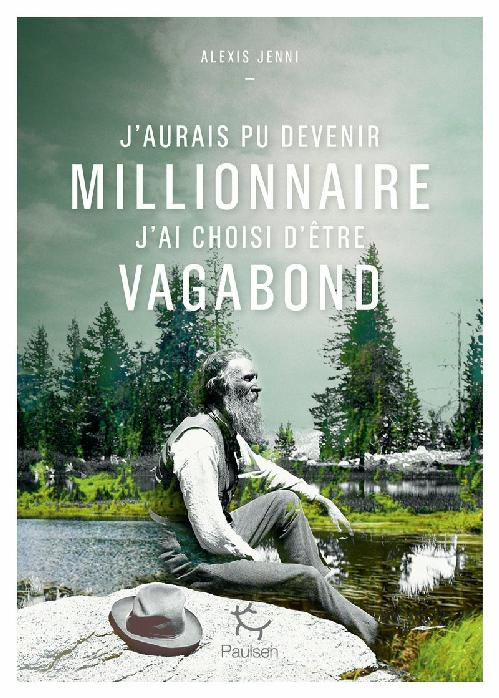

**Conseil de lecture**

Une vie de John Muir. Inventeur génial dès son plus jeune âge, amoureux de la nature, grand marcheur, il sillonna le monde à pied et fut le premier à percevoir les dangers de l'exploitation de la nature. John Muir aurait pu être millionnaire, il a choisi d'être vagabond. Il a inspiré Alexis Jenni (prix Goncourt 2011). " C'est l'homme le plus libre que j'ai jamais rencontré " disait de lui Theodore Roosevelt. Né en Écosse, débarqué à 10 ans aux États-Unis avec son frère et son père, installé dans la région des grands lacs, il travaille sans cesse dans les champs et lève parfois la tête pour regarder la nature environnante qui l'émerveille. Le soir il invente des objets mécaniques qu'il présente ensuite en ville comme, par exemple, cet appareil qui le sort automatiquement du lit à l'heure du lever. Très vite John Muir s'interroge sur le sens de cette vie de forçat, alors qu'il pourrait vivre en autonomie dans la nature. Il quitte le Wisconsin et sillonne les États-Unis à pied jusqu'en Californie. Dès lors, il parcourra le monde. Figure mythique aux États-Unis, créateur des parcs nationaux, John Muir posa clairement la question du sens de la vie dans la nouvelle société industrielle et industrieuse et il y a répondu, par son mode de vie. Prix Goncourt 2011 pour L'Art français de la guerre (Gallimard). Ce livre a reçu le prix du Livre Lumexplore 2020
