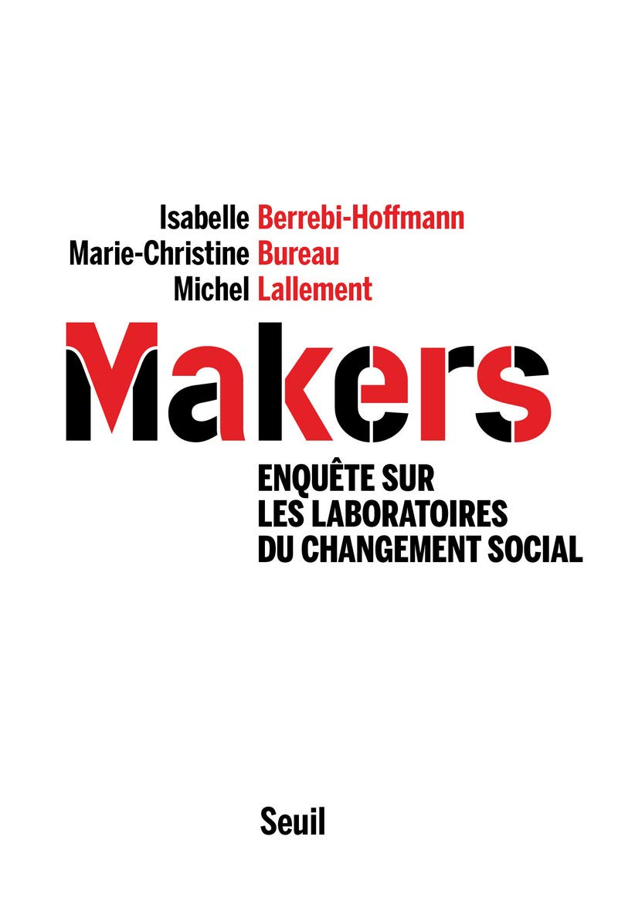

**Conseil de lecture**

Le phénomène des makers recouvre des réalités très différentes : en France, selon la terminologie retenue par les auteurs, principalement celle des hackerspaces et celle des fablabs. La différence ne tient pas seulement à une orientation qui privilégierait une intervention via et sur le logiciel libre pour les premiers, et une volonté de réalisation plus concrète pour les seconds (à travers la création d’objets nouveaux ou personnalisés, en mettant en œuvre des techniques variées au-delà de l’informatique et des imprimantes 3D, telles que différents types d’usinage ou l’assemblage de matériaux). Au-delà des projets spécifiques des différents groupes, il s’agit aussi d’un positionnement quelque peu différent vis-à-vis de leur environnement.

De façon simplifiée, selon les auteurs du livre :

— Les hackerspaces rassemblent plutôt des acteurs qui s’inscrivent dans un modèle alternatif, bien symbolisé par l’importance donnée au logiciel libre. Tout en accordant une très grande importance à leur indépendance, les membres appartiennent à une communauté solide qui se construit clairement en opposition aux entreprises qui véhiculent des valeurs qui ne sont pas les leurs.

— Les fablabs, en particulier parce qu’ils associent a priori une plus grande diversité de profils (informaticiens, électroniciens, « bricoleurs », artistes, etc.), sont dans l’ensemble plus ouverts sur le monde extérieur et privilégient des modèles de fonctionnement plus coopératifs et plus engagés dans des collaborations avec des partenaires externes.

Il convient également de signaler une spécificité française : les financements d’origine publique (en particulier émanant des collectivités locales et des institutions d’enseignement) atteignent des niveaux qui ne se rencontrent dans aucun autre pays.

Pour autant, les débats qui traversent la communauté (ou plus exactement les communautés tant les points de vue peuvent diverger) portent comme ailleurs sur le degré d’autonomie à préserver, sur l’interaction avec les secteurs marchands, sur le degré d’intégration dans l’éducation populaire, sur la participation à la vie de la cité, etc., auxquels font écho les multiples débats sémantiques sur la désignation des structures et des espaces : hackerspaces et fablabs, mais aussi usinettes, medialabs, recycling labs, brico labs et autres.

À cette diversité des pratiques, correspond évidemment une diversité aussi grande des acteurs et de leurs trajectoires : ils ont cependant en commun le fait d’être généralement très diplômés (qualitativement et quantitativement) et d’avoir dans leurs différents métiers préféré les chemins de traverse aux autoroutes. C’est donc surtout la culture du faire (autrement) qui les rassemble et les fédère. S’il est facile de faire remonter cette culture assez loin dans l’Histoire (« le bel ouvrage comme contrepoint aux désastres de la société industrielle » comme le désignent les auteurs en la faisant remonter à la seconde moitié du XVIIIe siècle), il est plus difficile d’en identifier les idées-forces et les supports sur lesquels elle est aujourd’hui bâtie.

Les auteurs en distinguent deux principales :

— un ensemble organisé auprès des notions d’accomplissement personnel et de partage, illustré par des verbes comme partager, donner, apprendre, s’outiller, jouer, participer, aider, transformer ;

— un deuxième, constitué dans une optique plus militante, qui instrumentalise (voire détourne) les techniques mainstream comme outils de résistance à des évolutions de la société jugées trop envahissantes, voire attentatoires à l’épanouissement de l’homme, et qui tente d’en renverser les conditions d’usage pour en faire des outils d’émancipation. Il ne faut pas pour autant ignorer un troisième aspect qui peut pour certains fort bien s’accommoder de la logique marchande (c’est en particulier le cas de certains fablabs), envisageant une production à plus grande échelle, même si elle n’a pas vocation au degré de standardisation de la production de masse. Cependant, la question de la liberté, qu’elle soit d’expression, politique ou commerciale, demeure un élément constituant important du sentiment d’appartenance à la communauté

— une valeur qui est d’ailleurs aussi très présente chez de nombreux grands acteurs de la « nouvelle économie », sous la forme particulière du « libertarianisme ». Si les espaces créés par les makers ne fonctionnent jamais en vase clos, une grande diversité d’attitudes existe dans les approches adoptées par les différents groupes dans leur façon de régir leurs rapports avec le monde extérieur. Au sein de la communauté, des modes d’organisation solide et liquide coexistent, avec toute une palette de nuances. La nouvelle tendance dominante semble cependant à la création de lieux à vocation multiple, de plus grande taille, réunissant davantage de moyens techniques, fondés à partir de partenariats composites. Elle ne préjuge en rien des évolutions à court et moyen termes dans un monde qui se réinvente en permanence. Il est probable en particulier que la vogue croissante d’un coworking de plus en plus favorisé par les pouvoirs publics et les entreprises (et qui répond à une vraie demande sociale, même si elle ne touche pas tous les individus) aura des conséquences sur cette évolution, que certains choisissent de l’accompagner ou au contraire de s’en démarquer. La préservation d’une autonomie culturelle sera de toute façon un enjeu majeur pour le mouvement des makers dans les années à venir.

**Auteurs:** : Isabelle Berrebi-Hoffmann, Marie-Christine Bureau, Michel Lallement

