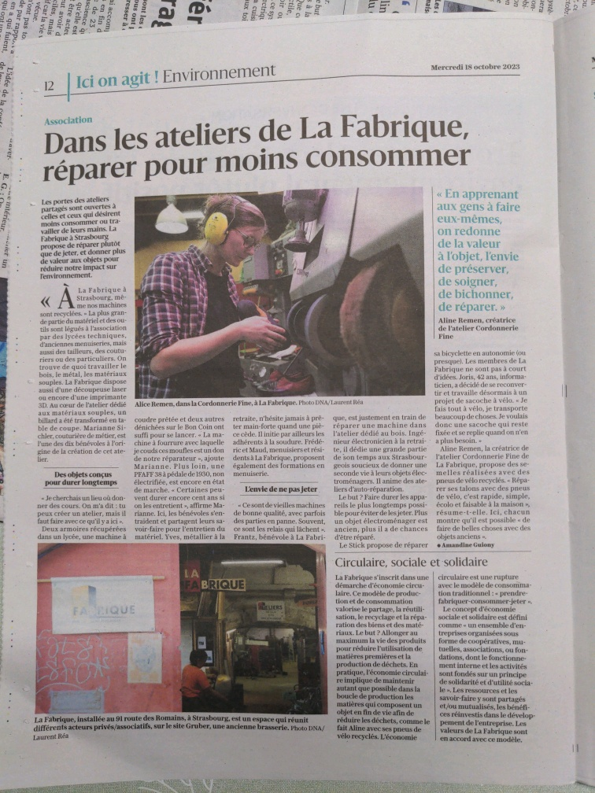

Les portes des ateliers partagés sont ouvertes à celles et ceux qui désirent moins consommer ou travailler de leurs mains. La Fabrique à Strasbourg propose de réparer plutôt que de jeter, et donner plus de valeur aux objets pour réduire notre impact sur l’environnement.

[Article des DNA](https://www.dna.fr/environnement/2023/10/18/la-fabrique-reparer-pour-moins-consommer)

