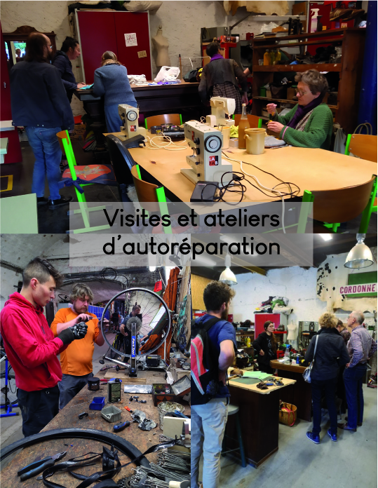
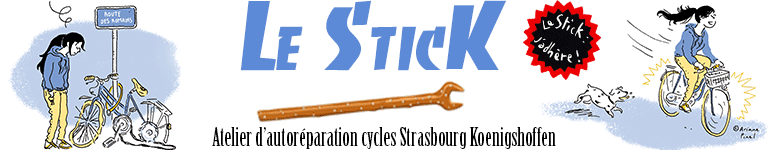

## LES JEUDIS LORS DE NOS PORTES OUVERTES

**Réparez vos chaussures, faites vos retouches de vêtements et nous vous aidons à diagnostiquer et réparer votre électroménager...**

- Venez visiter à partir de 18 h 30.

- Faites-vous aider à réparer vos chaussures et retoucher vos vêtements (adhésion annuelle à la Fabrique + 1 ticket).

- Répar'action : les 1ers jeudis du mois de 19 h à 21 h, diagnostiquez et réparez votre électroménager (gratuit).

### APPRENEZ À RÉPARER VOTRE VÉLO AU STICK\_\_\_

**Les jeudis de 18h à 20h et les dimanches de 13h à 15h  **

[Le Stick](http://www.lestick.fr/) est une association d’aide à la réparation de vélo et indépendante de La Fabrique qui utilise nos locaux. Elle propose des ateliers hebdomadaires où chacun peut apporter son vélo et le réparer à l’aide des outils et pièces mis à disposition, ou apprendre à le réparer avec les bénévoles de l’asso.

L'adhésion annuelle au Stick est de **5 euros** seulement.

## ÊTRE CONSEILLÉ DANS LE DÉMARRAGE D'UN PROJET

#### VOIR [L'AGENDA](/events/)

**Tarif des sessions accompagnées : 30 €**

## CLUB BOIS

#### SESSIONS ACCOMPAGNÉES EN MENUISERIE

**Certains vendredis après-midi.**

Pour **vous aider à démarrer un projet**_,_ nous organisons des _**Clubs Bois**_, (session accompagnée en menuiserie). Réservée à celles et ceux qui ont **déjà reçu les initiations aux machines** et qui ont besoin d’aide pour démarrer un projet ou qui n’osent pas encore le face à face avec la dégau.

## CLUB MÉTAL

#### SESSIONS ACCOMPAGNÉES EN SOUDAGE

**Certains samedis après-midi**.
