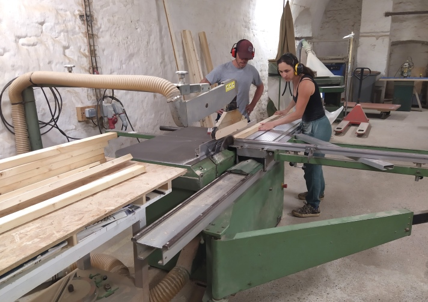
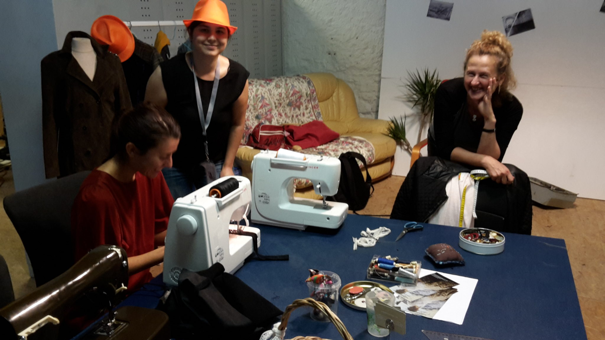
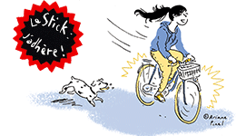
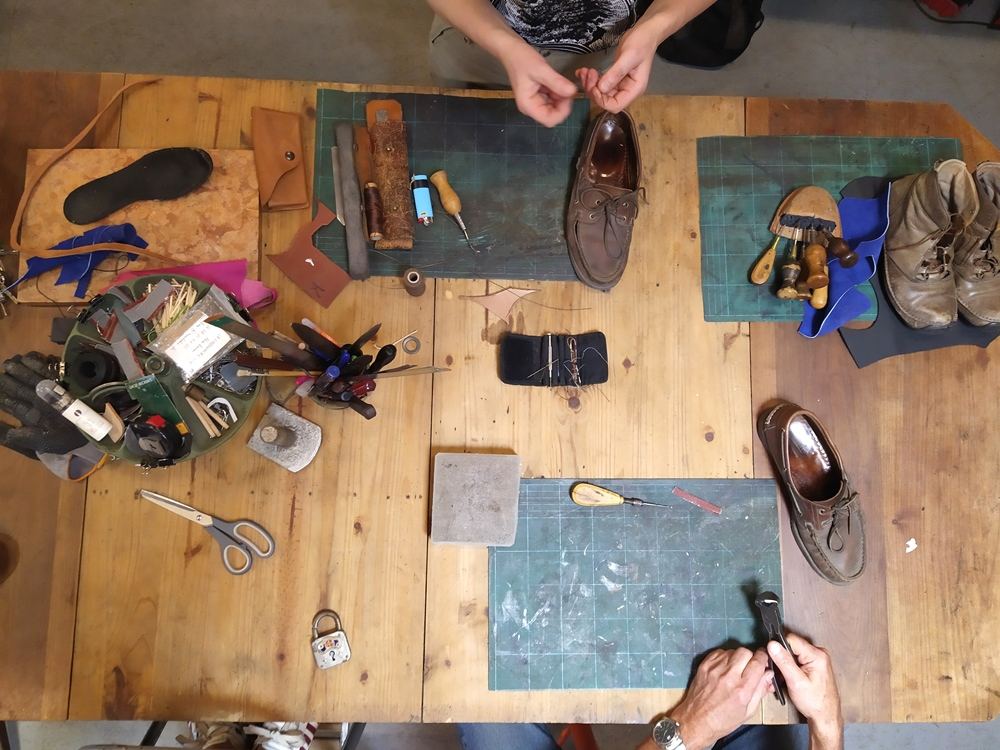
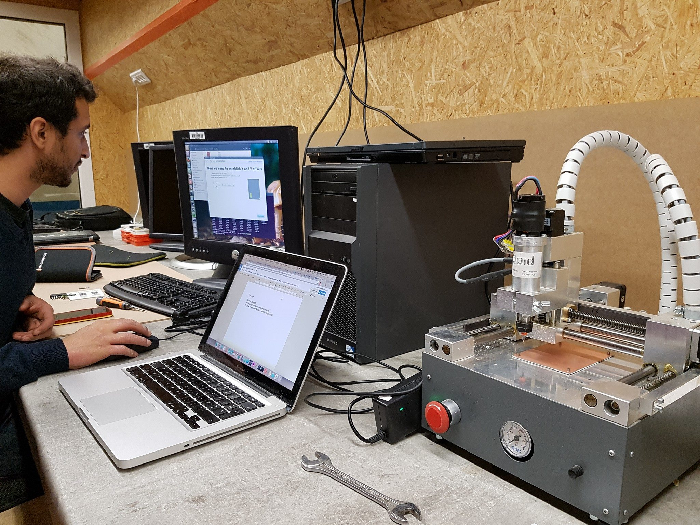

## MENUISERIE

**Initiations et accompagnements**

**Pour les détails, pour les dates et pour vous inscrire [c'est par là](https://lab.lafab.org/#!/)**

**L'initiation est obligatoire pour accéder en autonomie :**

\- aux scies à format (**_débiter du bois:_** _scie à format, et autres scies)_

\- à la dégauchisseuse et raboteuse (_**débuter avec le bois massif** : raboteuse / dégauchisseuse_)

\- au tour à bois

**Nous proposons d'autres initiations pour des techniques particulières :**

\- Techniques d'assemblages (lamelleuse notamment)

\- Assemblages à la main (usage des outils à main)

**Tarif des initiations : 30€**

Ensuite, pour **vous aider à démarrer un projet**_,_ nous organisons des _**Clubs Bois**_, (session accompagnée en menuiserie). Réservée à celles et ceux qui ont déjà reçu les initiations aux machines et qui ont besoin d'aide pour démarrer un projet ou qui n'osent pas encore le face à face avec la dégau.

**Tarif des sessions accompagnées : 2 tickets**

## PORTES OUVERTES

**Tous les jeudis à partir de 18h**

**Le Jeudi,** c'est le jour pour visiter la Fabrique et discuter projet.

#### Et chaque premier jeudi du mois c’est :

Le Répar’Action de 19h à 21h pour réparer son petit électroménager (gratuit) Le Club retouches de 18h à 20h pour repriser ses vêtements et autres objets textiles à la main avec la technique japonaise du boro ou à la machine (adhésion à jour + 1 ticket).

## CLUB COUTURE

Un samedi par mois de 14h à 17h (voir calendrier)**

2017/07/20161001_151932.jpg

Une professionnelle vous accompagne dans vos réalisations et personnalisations de vêtements ou accessoires. Le nombre de participants est limité.

Nous vous demandons de vous inscrire en créant d'abord un compte sur [lab.lafab.org](https://lab.lafab.org/#!/) . N'hésitez pas à nous contacter en cas de difficultés pour vous inscrire, pour toute demande d'information sur le Club ou pour des besoins particuliers en patronage : [ateliercouture@lafab.org](mailto:ateliercouture@lafab.org)

Chaque participant doit apporter une petite paire de ciseaux aiguisés ainsi que son tissu et son fil.

**[Prochaines dates](https://lab.lafab.org/#!/events)**

**Tarif :** 2 tickets La Fabrique par séance. 1 ticket pour les abonnés.

## LE STICK

**Les jeudis de 18h00 à 20h00 et les dimanches de 13h à 15h**

[Le Stick](http://www.lestick.fr/) est une association d'aide à la réparation de vélo et indépendante de La Fabrique qui utilise nos locaux. Elle propose des ateliers hebdomadaires où chacun peut apporter son vélo et le réparer à l'aide des outils et pièces mis à disposition, ou apprendre à le réparer avec les bénévoles de l'asso.

Tous les 3e vendredis du mois de 19h à 21h, c'est la perm des Romaines (une permanence en mixité choisie sans hommes cis-genre)

## AUTO-RÉPARATION EN CORDONNERIE

**Les jeudis de 18h à 20h (reprise le 19 septembre 2024) 

Venez apprendre à réparer vos chaussures et accessoires en cuir avec l'aide d'une professionnelle.

N'hésitez pas à venir la première fois avec plusieurs objets si vous ne savez pas trop ce qui est faisable.

**Tarif :** 1 ticket la séance

## CLUB ÉLECTRONIQUE / CLUB ROBOT

Les 2**e **et 4**e **mercredis du mois de 19h à 22h**

**PAS DE REPRISE DU CLUB ÉLECTRONIQUE POUR LE MOMENT, ON CHERCHE DES BÉNÉVOLES...**

L'équipe Électronique de La Fabrique vous accompagne dans l'atelier informatique-électronique pour mener à bien vos projets. Si vous êtes intéressés mais que vous n'avez pas d'inspiration, nous avons aussi quelques projets internes à proposer.

La Fabrique a monté une équipe pour participer au [Makerfight](https://www.makerfight.fr/) : si vous voulez les rejoindre, et participer à la création du robot de combat, c'est aussi là que ça se passe ! Ils ont aussi un [facebook](https://www.facebook.com/makerfight.lafab.org/) dédié.

(gratuit pour les adhérents de la Fabrique)

