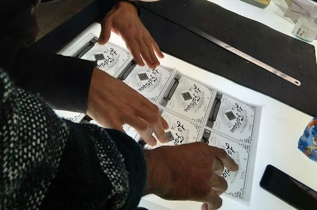

- [Venir à La Fabrique](#venir)
- [Horaires et tarifs](#horaires-et-tarifs)
- [Nous soutenir](#nous-soutenir)

---

## Venir à La Fabrique {#venir}

Par email à [contact@lafab.org](mailto:contact@lafab.org)

Nous somme dans le parc d'activité Grüber, à Strasbourg - Koenigshoffen. L'entrée est tout en bas du parc, du coté de la voie ferrée.

Adresse : [91 route des Romains, 67200 STRASBOURG](https://www.openstreetmap.org/node/4518893443)

<iframe scrolling="no" marginheight="0" marginwidth="0" src="https://www.openstreetmap.org/export/embed.html?bbox=7.643909454345704%2C48.54240971797981%2C7.775402069091798%2C48.61282434195258&amp;layer=mapnik&amp;marker=48.57762928996674%2C7.70965576171875" style="border: 1px solid black" width="425" height="350" frameborder="0"></iframe>

[Afficher une carte plus grande](https://www.openstreetmap.org/?mlat=48.5776&mlon=7.7097#map=13/48.5776/7.7097)

En transport :

- *Bus* : Arrêt Gruber lignes 4 et 50
- *Tram* : Arrêt Gruber Ligne F

Sur Mastodon : [@lafab](https://toot.aquilenet.fr/@lafab)

Sur Facebook : [lafab.org](https://www.facebook.com/lafab.org/)

---

## Horaires et tarifs {#horaires-et-tarifs}

### Accès aux ateliers en autonomie

| Jour | Horaires |
|---|---|
| Jeudi | 10h – 16h |
| Vendredi | 13h – 19h |
| Samedi | 10h – 19h |

Les jeudis soirs à partir de 18h sont réservés aux portes ouvertes — il n'est pas possible de travailler en autonomie durant cette plage.

### Adhésion

L'adhésion annuelle est la condition pour accéder aux ateliers. Elle couvre l'association et l'adhérent en cas d'accident.

**10 € / an** — se fait sur place (espèces ou chèque).

### Sessions en autonomie

Une session couvre une plage de 3 heures.

| Formule | Prix |
|---|---|
| Ticket à l'unité | 12 € |
| Carnet de 10 tickets | 75 € (7,50 €/ticket) |

### Abonnements

Les abonnements donnent accès à tous les créneaux ouverts. Un crédit de 4 €/mois pour du stockage est inclus.

| Durée | Prix |
|---|---|
| 1 mois | 50 € |
| 6 mois | 210 € (35 €/mois) |
| 1 an | 300 € |

### Stockage

Location d'espace pour laisser votre projet entre deux visites.

| Format | Prix |
|---|---|
| Caisse grise (60×40×30 cm) | 1 €/semaine |
| Étage d'étagère (= 2 caisses) | 2 €/semaine |
| Palette Europe (100×80 cm) | 4 €/semaine |

**Stockage sec** (cabane avec déshumidificateur) : tarifs doublés.

### Résidence

Pour un accès plus large que l'abonnement, notamment pour démarrer une activité professionnelle : **contact [chez] lafab.org**

---

## Nous soutenir {#nous-soutenir}

La Fabrique fonctionne entièrement sur la base du bénévolat. Voici comment y contribuer.

### Devenir membre

L'adhésion annuelle (10 €) permet de souscrire aux services, de participer à la vie de l'association et de renforcer sa légitimité.

### Relayer notre message

Parlez de La Fabrique autour de vous et dans vos associations.

### Faire un don

Dons en euros ou en matériel : **contact [chez] lafab.org**

### S'impliquer

Missions ponctuelles ou régulières, maintenance des machines, communication, trésorerie. Écrivez-nous pour accéder aux outils de coordination et intégrer les groupes de travail.

**contact [chez] lafab.org**

### Bons de Refondation

À l'origine, 13 fondateurs ont prêté plus de 40 000 € pour que La Fabrique puisse exister. Pour répartir cette dette plus largement, La Fabrique a lancé une opération de refondation.

Les 50 000 € sont découpés en 500 bons de 100 € chacun. La Fabrique s'engage à rembourser sur demande 1 % du total par an (5 bons max) lors de l'AG annuelle, en priorité aux numéros les plus bas. Seuls les membres à jour de cotisation peuvent présenter un bon au remboursement.

**Important :** seule la possession physique du bon vaut titre.

Pour acquérir un bon : **contact [chez] lafab.org**
