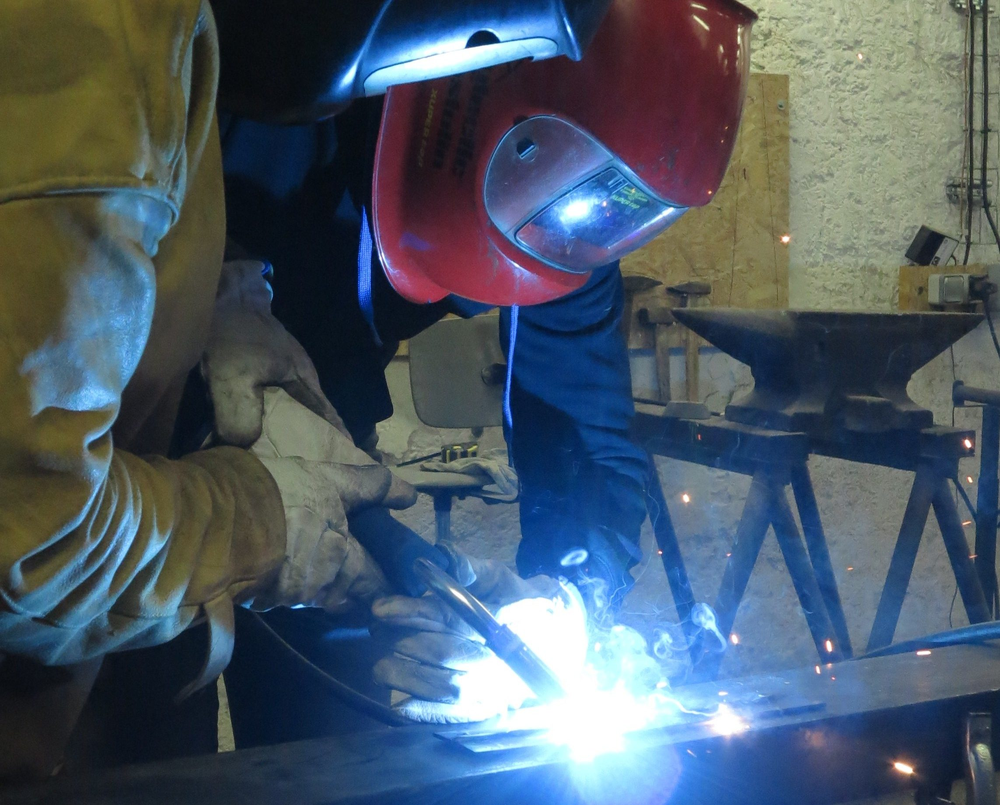
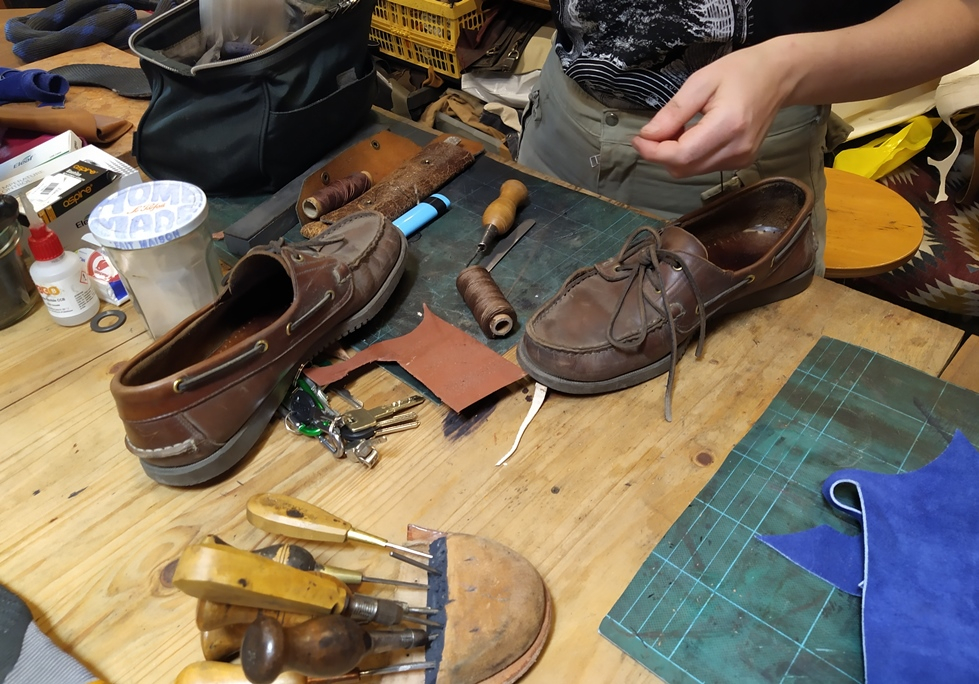
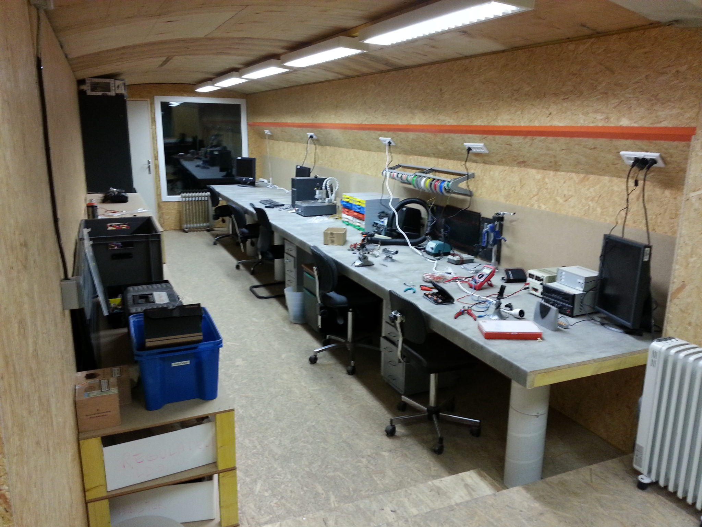
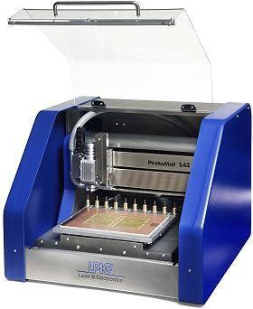
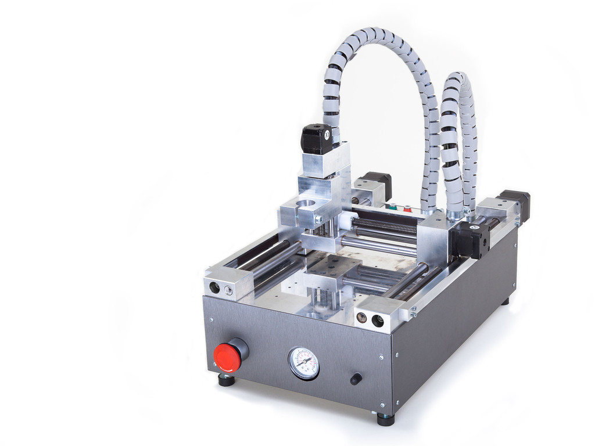

- Les sessions en autonomie coûtent 1 ticket

- Nos initiations machines sont à 30 €

- Les « Clubs » sont les sessions accompagnées, elles coûtent 30 €

- Découpe laser 15 €/h

L'agenda des activités est là : [https://lafab.org/events](/events)

Tous les tarifs sont là : [https://lafab.org/horaires-et-tarifs/](/horaires-et-tarifs/)

[S'inscrire](/events/)

## MENUISERIE

##### Surface : 100 m²

- Grande scie circulaire à format

- Scie circulaire à format

- Toupie

- Raboteuse

- Dégauchisseuse

- Scie à ruban

- Tour à bois

- Scie circulaire plongeante

- Découpeur Ponceur

- Défonceuse

- Ponceuse

- Scie Sauteuse

- Lamelleuse

- Ponceuse à Bande

- Scie radiale

**Pour découvrir l’atelier :**

**Initiations aux machines (OBLIGATOIRE pour scie à format, dégauchisseuse-raboteuse, tour à bois) :** lundi, mardi ou mercredi soir.

Club Bois : séance accompagnée, le moment pour recevoir de l’aide pour la conception et la réalisation de vos projets.

## MÉTALLERIE

##### Surface : 100 m²

- 2 Postes à souder semi-automatique MAG

- 3 Postes à souder Inverter électrode enrobée

- 2 Postes à souder TIG

- 3 Meuleuses d’angle

- 1 Scie sauteuse

- 3 Postes de travail séparés

- 1 Rouleuse

- 1 Plieuse

- 1 Scie-fraise, angle de 45° à 90° pour petits profilés

- 1 Scie à ruban, angle de 45° à 90° pour grands profilés

- 1 Découpe plasma

- Des serre-joints et outillage traditionnel de mécanique

**Pour découvrir le métal :**

**Initiation au soudage à l’électrode enrobée**; puis selon le projet prévu possibilité d’être initié au TIG ou semi-automatique.

## ATELIER DE COUTURE, MATÉRIAUX SOUPLES

##### Surface: 35 m²

- 1 grande table de découpe

- 4 machines à coudre familiales

- une surjeteuse industrielle

- 2 piqueuses plates industrielles

**Pour découvrir l’atelier :**

les dates des activités sont là : [lafab.org/events](/events)

## CORDONNERIE, MAROQUINERIE

##### Surface: 35 m²

- 1 grand établi

- machines à coudre

- banc de finitions

- outils à main

**Pour découvrir l’atelier :**

- **Les « soirées de l’auto-réparation » ont lieu les jeudis de 18h à 20h**

Une professionnelle vous accompagne dans vos réparations de chaussures et accessoires.  
Tarif : 1 ticket. Sans inscription

- **Des ateliers pour fabriquer ceinture, sandales ou étui à couteau**

## MÉCATRONIQUE

**Surface : 50 m2**

- Postes informatique et imprimantes

- Test : alimentation de laboratoire, oscilloscope, GBF

- Soudure : station à air chaud, fers à souder, binoculaire

- Prototypage PCB : PROTOMAT S62, Cirqoid

- Imprimante 3D Prusa i3

## FABRICATION ASSISTÉE PAR ORDINATEUR

### DÉCOUPEUSE LASER

**Surface utile de la machine : 120 cm x 90 cm  
**

- 2 lasers : 50 W et 150 W

- Découpe et gravure de bois, cartons, tissus organiques, cuir, acrylique

- Gravure sous certaines conditions du verre et de certains métaux

**Formation obligatoire** pour accéder ensuite à la machine en autonomie.

### FRAISAGE DE CIRCUITS IMPRIMÉS

<figure>

<figcaption>

LPKF Protomat S62

</figcaption>

</figure>

<figure>

<figcaption>

Cirqoid

</figcaption>

</figure>

### IMPRESSION 3D

<figure>

<figcaption>

Prusa i3

</figcaption>

</figure>
