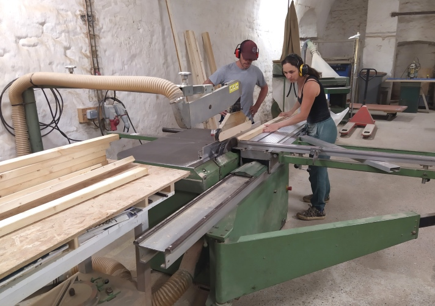
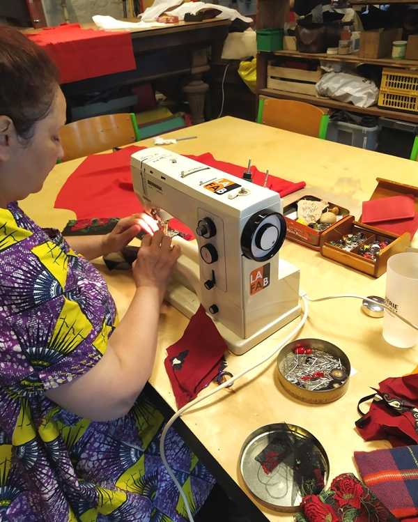
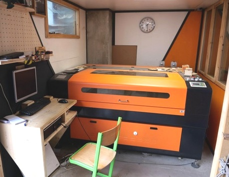
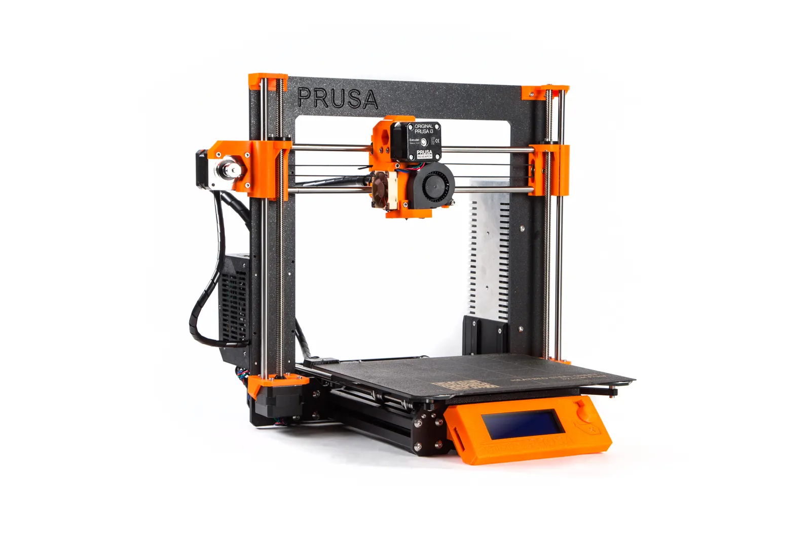

La Fabrique dispose d'un espace de 1500 m² organisé en ateliers spécialisés, équipés de machines professionnelles. Certaines machines nécessitent une initiation obligatoire avant tout accès en autonomie — ces initiations sont décrites sur la page [Formations](/initiations/).

## Menuiserie

Surface : 100 m²

### Machines-outils

| Machine | Initiation obligatoire |
|---|---|
| Scie circulaire à format | ✓ |
| Grande scie circulaire à format | ✓ |
| Scie radiale | |
| Scie à ruban | |
| Scie sauteuse | |
| Toupie | |
| Défonceuse | |
| Dégauchisseuse et raboteuse | ✓ |
| Tour à bois | ✓ |
| Ponceuse à bande | |
| Découpeur-ponceuse | |
| Lamelleuse | |

### Établis et outillage portable

6 établis de menuisier équipés, avec aspiration individuelle et outillage électroportatif courant (perceuse, visseuse, ponceuse orbitale, etc.) et outillage à main.

---

## Métallerie

Surface : 100 m²

### Soudure

| Poste | Quantité | Initiation obligatoire |
|---|---|---|
| Semi-automatique MAG | ×2 | ✓ |
| Électrode enrobée Inverter | ×3 | ✓ |
| TIG | ×2 | ✓ |

### Travail de la tôle et des profilés

- Rouleuse
- Plieuse
- Découpe plasma
- Meuleuses d'angle (×3)
- Scie à ruban pour grands profilés (45° à 90°)

### Usinage

Section en développement.

- Tour à métaux
- Fraiseuse
- Perceuse à colonne indexable

---

## Matériaux souples

### Couture et textile

Surface : 35 m²

- Grande table de découpe
- Machines à coudre familiales (×4)
- Surjeteuse industrielle
- Piqueuses plates industrielles (×2)

### Cordonnerie et maroquinerie

Surface : 35 m²

- Grand établi
- Machines à coudre
- Banc de finitions
- Outils à main

---

## Électronique et fabrication numérique

Surface : 50 m²

### Atelier électronique

- Alimentation de laboratoire, oscilloscope, GBF
- Station à air chaud, fers à souder, binoculaire
- Prototypage PCB : PROTOMAT S62, Cirqoid

### Découpe et gravure laser

Surface utile : 120 cm × 90 cm — deux lasers 50 W et 150 W.

Matériaux compatibles : bois, carton, tissu, cuir, acrylique, verre (gravure), certains métaux (gravure).

**Initiation obligatoire** avant tout accès en autonomie.

### Impression 3D

- Prusa i3 MK3
