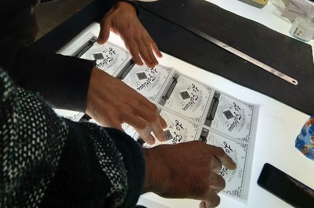

**La Situation**

À l'origine 13 des 20 fondateurs de l'association ont prếté plus de 40 000 € pour que La Fabrique puisse exister. Il était prévu que cette somme soit remboursée. Elle l’a été en partie seulement. Alsace Active nous a prêté 10 000€ quelque temps plus tard. Cela fait maintenant 7 ans que ces 13 personnes supportent le projet alors que nous avons dépassé le cap des 1200 personnes qui ont été ou sont adhérentes à notre association.

 

**L'idée aujourd'hui** c'est de répartir cette mise de fond en plus petits montants et sur plus de personnes. C’est aussi se donner de la trésorerie pour continuer à améliorer les locaux et les machines. Et bien sûr, rembourser ceux qui ont maintenant besoin de leur argent !

 

**Comment ça marche ?**

Ces 50 000 € de dettes sont découpés en 500 bons numérotés d'une valeur de 100 € chacun.

La Fabrique s'engage, tant qu'elle existe, à rembourser sur demande (et donc à détruire) 1% du total de l'opération de refondation tous les ans, soit un montant maximal de 500 €. Ceci aura lieu lors de l'assemblé générale annuelle, et uniquement pour des titres présentés par des membres à jour de cotisation.

Si plus de 5 titres sont présentés, ce sont les numéros les plus bas qui auront la priorité.

**Un registre** des bons sous forme d'un cahier, ainsi que d'un fichier informatique est tenu. Il enregistre les numéros des bons, la date d'achat et la date de destruction quand elle est connue de La Fabrique. Ce fichier est tenu à la disposition du public.

**NOTES :**

 **- Seule la possession physique du bon vaut titre de propriété.** Un bon perdu ou détérioré est définitivement perdu.

\- il faut être **membre à jour** de cotisation pour pouvoir se porter acquéreur lors de l’émission.
