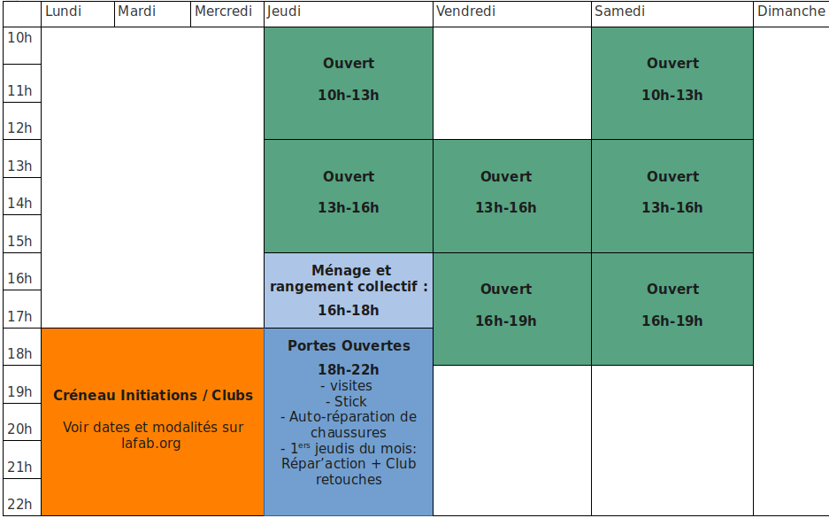
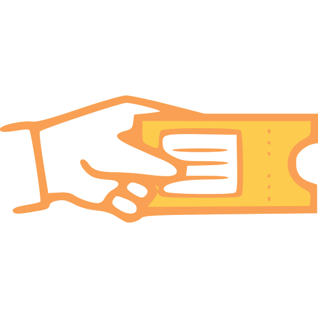
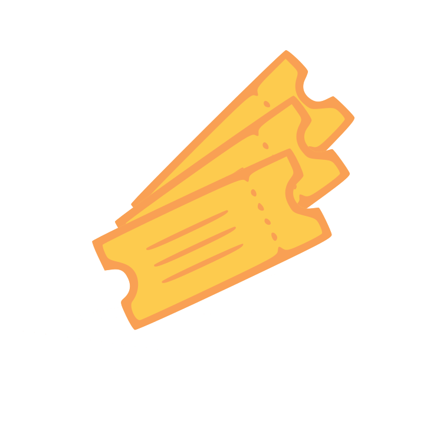
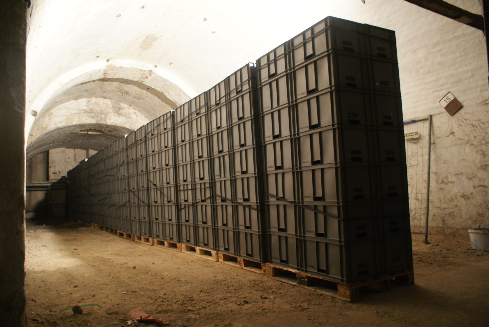

### [Grille tarifaire](/wiki/doku.php?id=grille_tarifaire) complète

## ACCÈS AUX ATELIERS

### en autonomie les jeudis, vendredis et samedis.

**Jeudi**

**10h – 16h**

**Vendredi**

**13h – 19h**

**Samedi**

**10h – 19h**

( Fermé les jours fériés )

**Si vous n’êtes pas autonomes,** chaque atelier propose des **initiations** pour les débutants et des **Clubs** pour être accompagné sur son projet. Vous trouverez les détails sur cette page : [https://lafab.org/initiations](/initiations)

Pour les inscriptions et paiements en ligne, c'est par là : [https://lafab.org/events](/events)

**Lors des portes ouvertes des jeudis soirs** il n’est pas possible de travailler en autonomie.

### **Et comment ça marche ?**

- **Les Sessions en autonomie**  
    Si vous connaissez déjà les machines que vous voulez utiliser, si vous avez déjà visité la Fabrique, suivi une formation, bref si vous êtes autonomes, **une session de 3h coûte un ticket**.

- **Les Sessions avec Accompagnement**  
    Si vous ne connaissez pas l’atelier, si vous avez fait une formation mais c’était il y a fort longtemps, si vous voulez bien un peu d’aide pour le projet pharaonique que vous avez en tête, vous pouvez venir à une session avec accompagnement (elles ont généralement lieu le samedi après-midi pour l’atelier Matériaux souples, le vendredi après-midi pour la Menuiserie et la Métallerie, les dates exactes sont à retrouver [ici](https://lab.lafab.org/#!/events))  
    Pour la menuiserie, il est obligatoire de passer d’abord par une initiation si vous voulez utiliser : scie à format, dégauchisseuse, tour à bois.  
    **Les sessions avec accompagnement coûtent 30 euros**.

- **Les Jeudis Open**  
    Tous les jeudis à partir de 18h, La Fabrique ouvre ses portes au public. Si vous souhaitez découvrir les ateliers, vous projeter dans un projet, ou parler électronique à la lueur du feu de bois, nous vous accueillons. Les visites ont lieu à 19h.  
    Lors des Jeudis Open, il n’est pas possible de travailler dans les ateliers.

## LES TARIFS

Les adhésions sont payables en ligne ci-dessous, ou sur place en espèces ou chèques (nous ne prenons pas la CB).

Pour des raisons de simplification de gestion, les tickets et abonnements au mois sont payables uniquement sur place. Vous pouvez les acheter le jour même de leur utilisation (pas besoin d’acheter à l’avance).

Seul l’abonnement annuel (à 300€) est proposé en achat en ligne (ci-dessous). Mais vous pouvez aussi l’acheter sur place.

## L'ADHÉSION

### permet de soutenir l’association et d’accéder au lieu et à toutes les activités.

Une adhésion à La FABRIQUE pour une année entière (et tout le plaisir qui va avec) coûte 10€. C’est la condition _sine qua non_ pour pouvoir accéder aux ateliers, que ce soit pour une session ou pour une formation. C’est le paiement de cette cotisation qui couvre l'association et l'adhérent en cas d'accident.

L'adhésion se fait sur place (prévoir de l'argent liquide ou un chèque) afin de découvrir La Fabrique en vrai !

## LES TICKETS

permettent d’accéder aux ateliers le temps d’une Session, c’est-à-dire une plage de 3h.

A l'unité

**A acheter sur place !**

€12.00

Carnet de 10

Soit 7,5 euros le ticket.

**A acheter sur place !**

€75.00

## ABONNEMENTS

permettent l’accès à La Fabrique sur tous les créneaux ouverts.

Les abonnements sont d'une durée d'un an, de 6 mois, ou d'un mois (jour à jour).

Crédit de 4€/mois pour du stockage

\[asp\_product id="45654"\]

6 mois

Soit 35€/mois

**A acheter sur place !**

€210.00

1 mois

**A acheter sur place !**

€50.00

## STOCKAGE

Un service de location d’espace vous est proposé, vous permettant de laisser votre projet à La FABRIQUE entre deux visites. Si vous avez besoin de plus d’espace, merci de vous adresser à nous, nous étudierons toutes les possibilités.

Vous avez le choix entre le stockage classique et le stockage sec (cabane avec déshumidificateur)

Prix stockage classique :

- Une caisse grise (60x40x30 soit 72 litres) : **1€** / caisse / semaine

- Un étage d'une étagère ( = 2 caisses grises) : **2€** / étage / semaine

- Une palette format Europe (100x80) : **4€** / palette / semaine

Prix stockage sec :

- Une caisse grise (60x40x30 soit 72 litres) : **2€** / caisse / semaine

- Un étage d'une étagère ( = 2 caisses grises) : **4€** / étage / semaine

- Une palette format Europe (100x80) : **8€** / palette / semaine

## RÉSIDENCE

Si l'abonnement ne vous suffit pas et que vous souhaitez utiliser la Fabrique encore plus souvent; par exemple pour démarrer une activité professionnelle; nous vous invitons à nous contacter :

**contact \[chez\] lafab.org**

## AUTRES SERVICES

D’autres services sont en cours d'étude, tels que :

- La commande de matériaux et/ou de matériels

- La possibilité d’utiliser de la matière première revalorisée...
