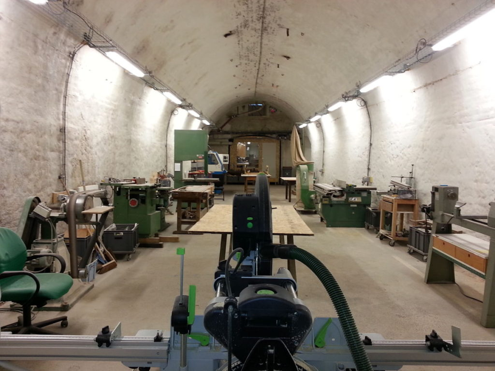
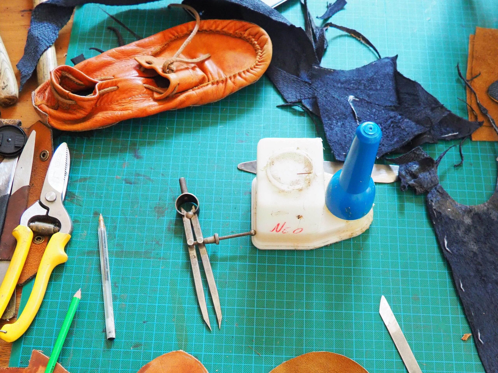
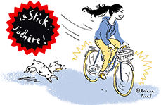
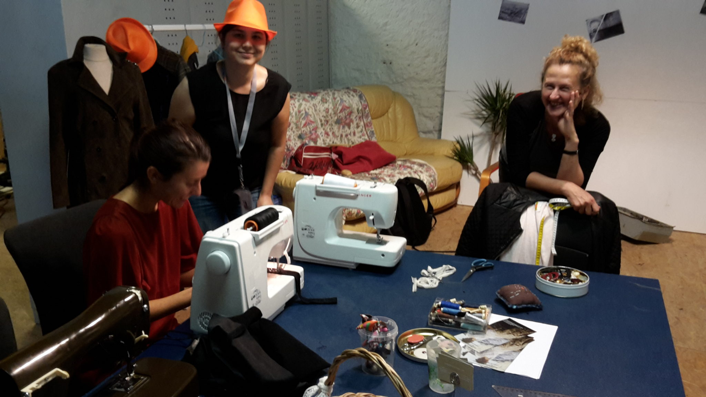
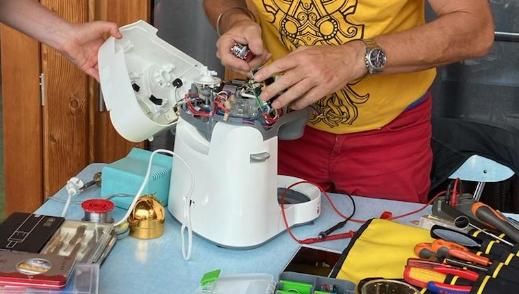
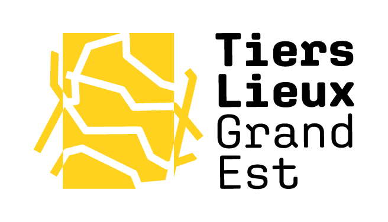

# **LA FABRIQUE,** _**des ateliers** partagés_

_**Bois, métal, couture, cordonnerie, électronique, informatique et d’autres à venir – dans l’ancienne Brasserie Gruber, à Strasbourg-Koenigshoffen.**_

Elle s’adresse aux particuliers, du débutant au professionnel, ainsi qu’aux structures associatives.

Une fois [membre](/horaires-et-tarifs/), vous pouvez accéder aux ateliers en autonomie avec :

- des tickets de sessions de 3h

- des abonnements à l’année ou au mois

- des résidences donnant un accès plus large

Vous pouvez également :

- vous initier à des machines ou techniques particulières

- profiter de sessions en accompagnement

Le concept vous plaît ? Rejoignez-nous pour faire vivre l’association !

### L'assemblée générale de la Fabrique se déroulera le vendredi 20 juin à 18h30. 
Tous les adhérents sont conviés à y participer.

[AG 2025 - Rapport d'Activités 2024-1](./AG-2025-Rapport-dActivites-2024-1.pdf)[Télécharger](./AG-2025-Rapport-dActivites-2024-1.pdf)

[AG 2025 - Rapport financier 2024 LE VRAI.docx-1](./AG-2025-Rapport-financier-2024-LE-VRAI.docx-1.pdf)[Télécharger](./AG-2025-Rapport-financier-2024-LE-VRAI.docx-1.pdf)

[AG 2025 - Rapport moral 2024](./AG-2025-Rapport-moral-2024.pdf)[Télécharger](./AG-2025-Rapport-moral-2024.pdf)

## VENEZ VISITER ET DÉCOUVRIR LES JEUDIS SOIR

En avant première de votre venue, une présentation vidéo [ici](https://www.facebook.com/DNAlsace/videos/1619861941875141/?locale=fr_FR) !

Pour tout renseignement, découvrir l'atelier, les équipements, rencontrer des bénévoles et discuter projets autour d'un verre, La Fabrique vous fait visiter tous les jeudis de 19h à 20h.  
  
  
Souscrivez à notre **[Infolettre](https://www.lafab.org/phplist/?p=subscribe)**

### Auto-réparation en cordonnerie

Les jeudis à partir de 18 h, venez apprendre à réparer vos chaussures et accessoires en cuir avec l’aide d’une professionnelle.

N’hésitez pas à venir la première fois avec plusieurs objets si vous ne savez pas trop ce qui est faisable.

### Le STICK, auto-réparation de vélos

Venez réparer ou apprendre à réparer et entretenir votre vélo !

L'atelier est ouvert **les jeudis de 18h à 20h et les dimanches de 14h à 16h !**

### Club retouches

Faites vous aider à réaliser les retouches de vos vêtements. **C'est le premier jeudi du mois de 18h à 21h.**

Prochains clubs retouche 2025 :

- jeudi 5 juin à 18h Annulé !

- jeudi 3 juillet à 18h

### Répar'action

**_RÉPARER C’EST COMPRENDRE !_**

**Les premiers jeudis du mois** **de 19 h à 21 h**, c’est l’occasion d’apporter ses objets cassés à la Fabrique ! Électronique, petit électroménager et autres bricoles qui ne fonctionnent plus – on observe, on bidouille, on trouve le problème et on voit si on peut le réparer avec les outils de notre atelier !

### **GRATUIT, OUVERT À TOUS**

<figure>

<figcaption>

La Fabrique est membre du [réseau Tiers Lieux Grand-Est](https://tierslieuxgrandest.org/)

</figcaption>

</figure>
