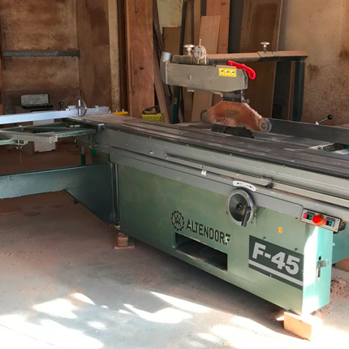
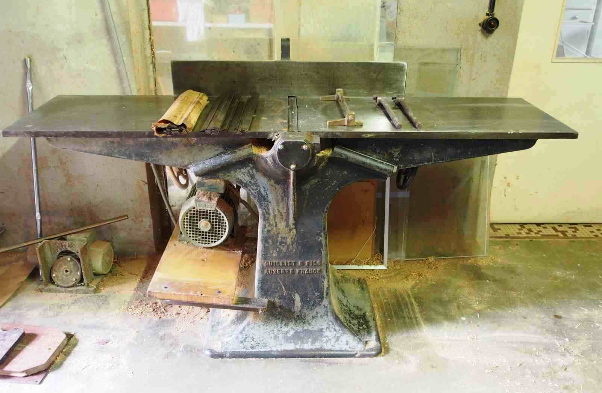
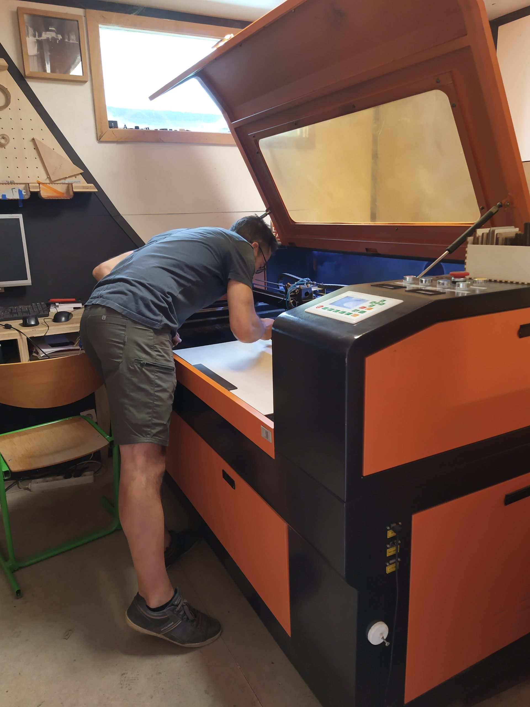
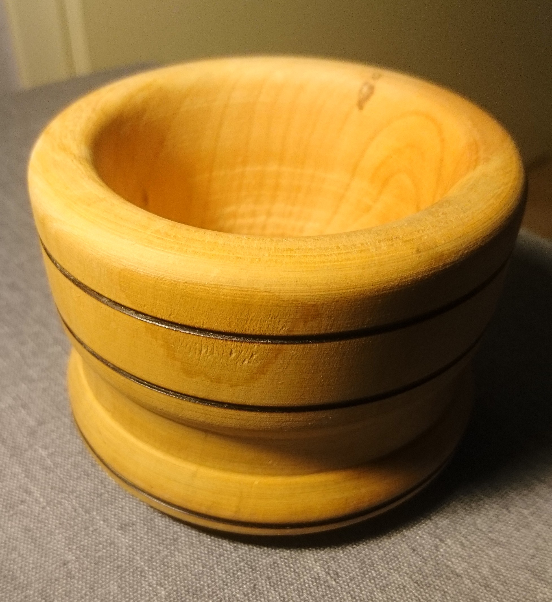
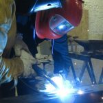
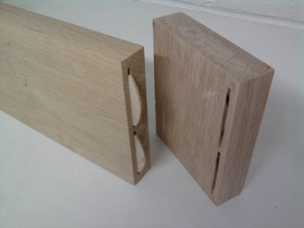
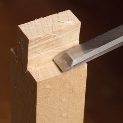
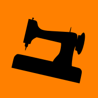

**Réservation sur calendrier [lafab.org/events](/events)**

NOTE : après réservation, toute annulation de votre part moins de 48h à l'avance ne donnera lieu à aucun remboursement ou avoir.

## POUR UN ACCÈS EN AUTONOMIE SUR LES MACHINES CONCERNÉES

### DÉBITER DU BOIS

#### UTILISER LES SCIES

**Objectifs :**

- Utiliser en sécurité les scies installées dans l'atelier menuiserie

- Monter en compétence pour découper votre bois plus rapidement qu'avec des outils électroportatifs

**Matériel requis :**

- Vêtements près du corps

- Chaussures fermées

- Cheveux attachés

- Casque anti-bruit ou bouchons d'oreilles

**Groupe** de 2 à 4 personnes

**Prix** : 30€ (+10€ d'adhésion si vous n'êtes pas membre de l'association)

Pour voir le calendrier, réserver et payer, [c’est par ici](/events).

### TRAVAIL DU BOIS MASSIF

#### FAIRE DES PLANCHES

**Objectifs :**

- S’initier au travail avec le bois massif

- Apprendre à obtenir une planche aux dimensions souhaités

**Matériel requis :**

- Vêtements près du corps

- Chaussures fermées

- Cheveux attachés

- Casque anti-bruit ou bouchons d'oreilles

**Groupe** de 2 à 4 personnes

**Prix** : 30€ (+10€ d'adhésion si vous n'êtes pas membre de l'association)

Pour voir le calendrier, réserver et payer, [c’est par ici](/events).

### DÉCOUPE LASER

#### APPRENDRE À UTILISER LA MACHINE

Cette formation permet de s’initier à l’utilisation de la machine en sécurité et d’en comprendre les grands principes de fonctionnement ainsi que ses limites. Un niveau minimum est requis quand à la manipulation/ création de fichier au format vectoriel (\*.svg, \*.ai ou \*.dxf). Si cela ne vous parle pas, merci de vous formez préalablement par vous-même ou de faire la formation correspondante (qui arrivera bientôt à La Fabrique !).

**Groupe** de 1 à 3 personnes

**Prix** : 30€ (+10€ d'adhésion si vous n'êtes pas membre de l'association)

Pour voir le calendrier, réserver et payer, [c’est par ici](/events).  

### TOUR À BOIS

#### APPRENDRE À TOURNER

<figure>

<figcaption>

Bol tourné. Par Cyril

</figcaption>

</figure>

Apprenez à vous servir du tour à bois. C'est une initiation obligatoire pour utiliser cette machine.

**Groupe** de 2 personnes

**Prix** : 30€ (+10€ d'adhésion si vous n'êtes pas membre de l'association)

Pour voir le calendrier, réserver et payer, [c’est par ici](/events).

## DÉCOUVRIR, APPRENDRE DES TECHNIQUES

### SOUDAGE

#### SOUDER DES ÉLÉMENTS MÉTALLIQUES

**Objectifs :**

- Apprendre les règles de sécurité afin de souder dans de bonnes conditions ; connaître le matériel de base (type de postes à souder, choix des électrodes, etc.) ;

- Apprendre à réaliser un cordon de soudure ;

- Apprendre à réaliser des assemblages.

**Prochaines dates et inscription :**

Nous proposons généralement des sessions une ou deux fois par mois. Pour voir le calendrier, réserver et payer, [c’est par ici](/events).

**Niveau** **:** Débutant

**Matériel requis** **:**

- Chaussures de sécurité

- **Vêtements EN COTON (les synthétiques peuvent brûler ou fondre avec les étincelles), et à MANCHES LONGUES.**

- Gants de protection **en cuir** (quelques paires sont disponibles sur place)

- Les lentilles de contact sont à éviter à cause des poussières et de la fumée dégagée par l’électrode.

- En hiver, pensez à vous habiller chaudement !

**Matériel et équipement fournis** **:**

- Postes à souder (mais vous pouvez aussi apporter le vôtre si vous en avez un)

- Cagoules de soudage

- Matériaux pour s’entraîner

**Groupe** de 3 personnes

**Prix** **: 30 €** (+ 10€ d’adhésion à La Fabrique pour les non-adhérents)

### TECHNIQUES D'ASSEMBLAGES

#### QUEL ASSEMBLAGE POUR QUEL APPLICATION

**Objectifs :**

- Aborder les différentes techniques d’assemblages avec différents outils

- Discuter / aider à préparer et éventuellement commencer à assembler votre projet

**Matériel requis :**

- Vêtements près du corps

- Chaussures fermées

- Cheveux attachés

**Groupe** de 2 à 4 personnes

**Prix** : 30€ (+10€ d'adhésion si vous n'êtes pas membre de l'association)

### ASSEMBLAGE À LA MAIN

#### SCIE JAPONAISE ET CISEAUX À BOIS

**Objectifs :**

- Découvrir les assemblages traditionnels à la main

- Découvrir l'usage des outils à main

- Réaliser au moins un assemble

**Matériel requis :**

- Vêtements près du corps

- Chaussures fermées

- Cheveux attachés

**Groupe** de 2 à 4 personnes

**Prix** : 30€ (+10€ d'adhésion si vous n'êtes pas membre de l'association)

### CLUB COUTURE

#### RETOUCHES, PATRONAGE, EXÉCUTION, ETC.

<figure>

<figcaption>

Retouches, créations, expositions

</figcaption>

</figure>

**Objectifs :**

- Accompagnement dans vos réalisations et personnalisations de vêtements ou accessoires

- Maîtrise des techniques de coupe, d'assemblage et de finition

**Matériel requis :**

Petite paire de ciseaux aiguisée

- Boite avec des épingles

- Crayon de papier

- Trois stylos feutre (noir, rouge, vert)

- Tissu

- Fil

- Si vous avez une machine à coudre, vous pouvez aussi l’apporter, que vous sachiez vous en servir ou non

**Groupe** de 2 à 4 personnes

**Prix** : 30€ (+10€ d'adhésion si vous n'êtes pas membre de l'association)
