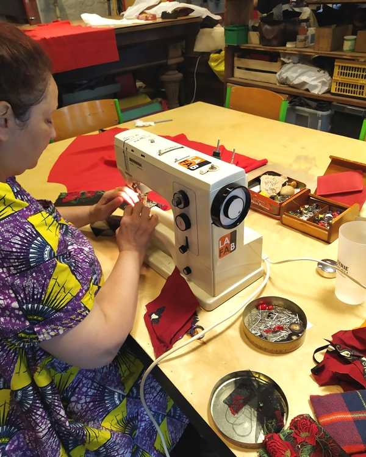
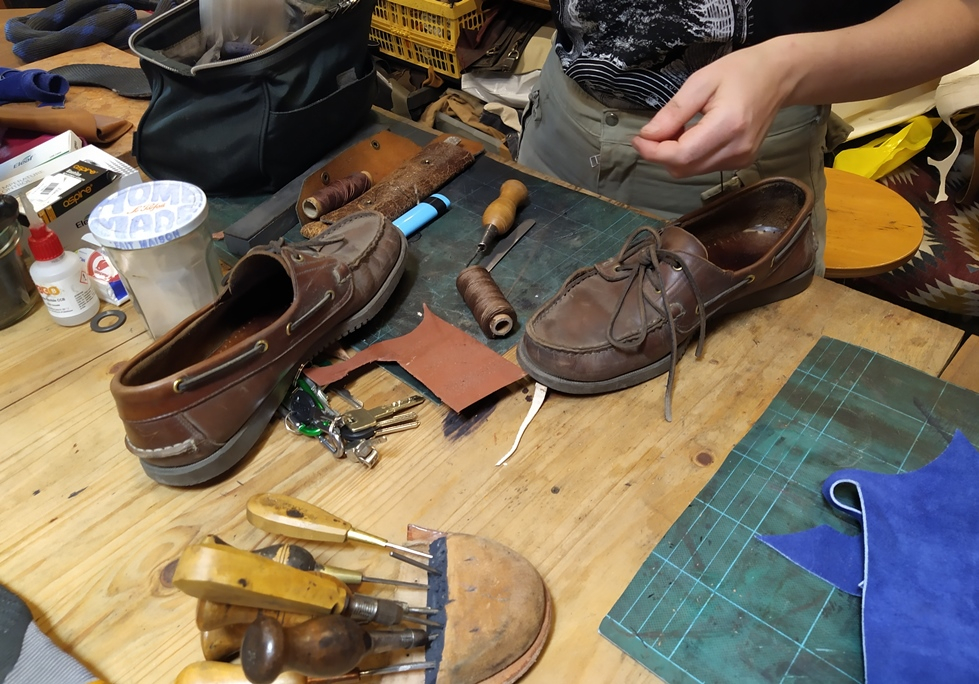

## Couture et textile  {#couture }

Surface : 35 m²

- Grande table de découpe
- Machines à coudre familiales (×4)
- Surjeteuse industrielle
- Piqueuses plates industrielles (×2)

## Cordonnerie et maroquinerie {#cordonnerie}

Surface : 35 m²

- Grand établi
- Machines à coudre
- Banc de finitions
- Outils à main

L'atelier cordonnerie est animé par une professionnelle qui propose des séances d'autoréparation : réparez vos chaussures et accessoires en cuir avec son aide. Aucune initiation obligatoire — les débutants sont les bienvenus.

Les séances ont lieu **tous les jeudis dès 18h**. Réservation sur l'[Agenda](/agenda/).
