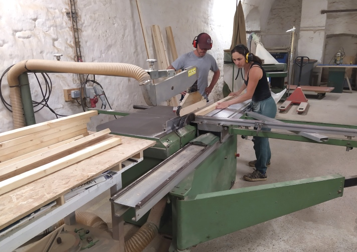
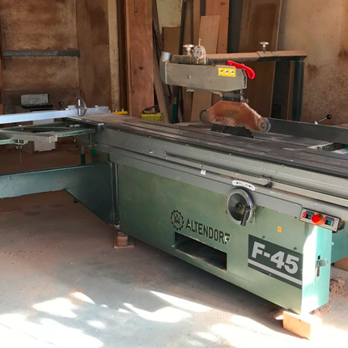
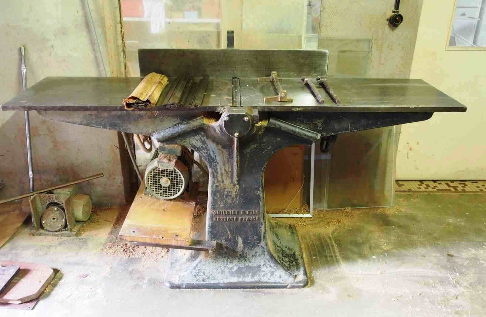
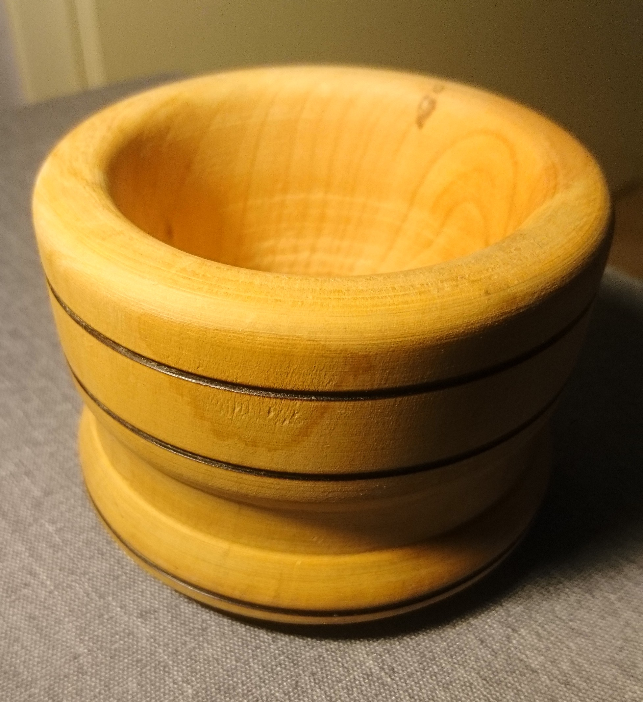
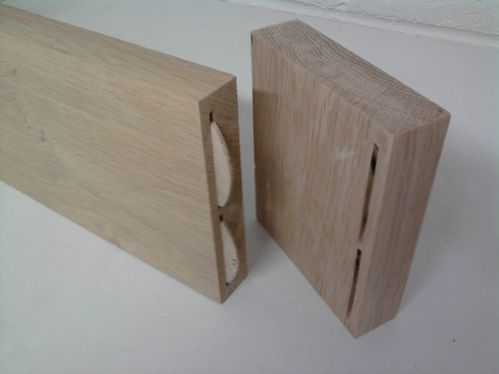
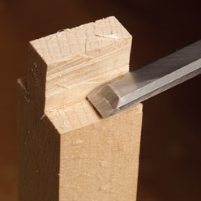

Surface : 100 m²

6 établis de menuisier équipés avec aspiration individuelle, outillage électroportatif courant et outillage à main.

## Machines-outils

| Machine | Initiation obligatoire |
|---|---|
| Scie circulaire à format | ✓ |
| Grande scie circulaire à format | ✓ |
| Scie radiale | |
| Scie à ruban | |
| Scie sauteuse | |
| Toupie | |
| Défonceuse | |
| Dégauchisseuse et raboteuse | ✓ |
| Tour à bois | ✓ |
| Ponceuse à bande | |
| Découpeur-ponceuse | |
| Lamelleuse | |

## Initiations

Les initiations sont obligatoires avant tout accès en autonomie sur les machines concernées. **30 € par session.** Réservation sur l'[Agenda](/agenda/).

### Utiliser les scies (obligatoire)

Utiliser en sécurité les scies de l'atelier (scie à format, grande scie à format). Monter en compétence pour débiter le bois rapidement.

**Équipement :** vêtements près du corps, chaussures fermées, cheveux attachés, protection auditive.
**Groupe :** 2 à 4 personnes

### Dégauchisseuse et raboteuse (obligatoire)

S'initier au travail du bois massif. Apprendre à obtenir une planche aux dimensions souhaitées.

**Équipement :** vêtements près du corps, chaussures fermées, cheveux attachés, protection auditive.
**Groupe :** 2 à 4 personnes

### Tour à bois (obligatoire)

<figure>

<figcaption>Bol tourné — Cyril</figcaption>
</figure>

Apprendre à utiliser le tour à bois en sécurité.
**Groupe :** 2 personnes

### Assemblages (thématique)

Aborder les différentes techniques d'assemblage, discuter de votre projet et commencer à assembler.
**Groupe :** 2 à 4 personnes

### Assemblages à la main (thématique)

Découvrir les assemblages traditionnels : scie japonaise, ciseaux à bois. Réaliser au moins un assemblage.
**Groupe :** 2 à 4 personnes
