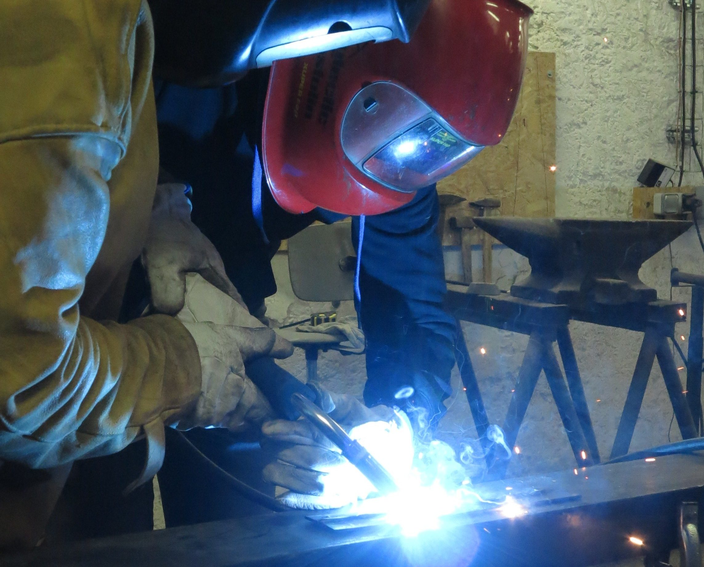
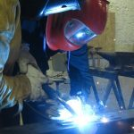

Surface : 100 m²

## Soudure

| Poste | Quantité | Initiation obligatoire |
|---|---|---|
| Semi-automatique MAG | ×2 | ✓ |
| Électrode enrobée Inverter | ×3 | ✓ |
| TIG | ×2 | ✓ |

## Travail de la tôle et des profilés

- Rouleuse
- Plieuse
- Découpe plasma
- Meuleuses d'angle (×3)
- Scie à ruban pour grands profilés (45° à 90°)

## Usinage

Section en développement.

- Tour à métaux
- Fraiseuse
- Perceuse à colonne indexable

## Initiation soudage (obligatoire)

Apprendre les règles de sécurité et les bases du soudage à l'électrode enrobée : choix du matériel, réalisation d'un cordon de soudure, assemblages simples. Selon le projet, une initiation complémentaire TIG ou MAG peut être proposée.

**Équipement :** chaussures de sécurité, vêtements en coton à manches longues (pas de synthétiques), gants en cuir. Éviter les lentilles de contact.
**Fourni :** postes à souder, cagoules, matériaux d'entraînement.
**Groupe :** 3 personnes. **Tarif :** 30 €

Réservation sur l'[Agenda](/agenda/).
