## AD - Alsace Digitale - [Alsacedigitale.org](https://www.alsacedigitale.org/)

Alsace Digitale est une association ayant pour ambition d’animer et de promouvoir la révolution numérique en Alsace. Soutenue par [l'Eurométropole de Strasbourg](http://www.strasbourg.eu) et [La Région Grand Est](https://www.grandest.fr) elle a ouvert à Rivétoile en avril 2012 ["La Plage Digitale"](http://www.laplagedigitale.eu/), le premier espace de coworking de Strasbourg.

**AD - Alsace Digitale**  
La Plage Digitale  
13 rue Jacques Peirotes  
67000 Strasbourg  
03 88 41 86 95  
contact@alsacedigitale.org

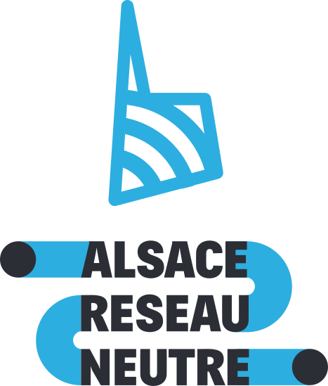

## ARN - Alsace Réseau Neutre - [arn-fai.net](https://arn-fai.net/fr)

Alsace Réseau Neutre revendique un numérique **libérateur, soutenable et accessible** et s'oppose ainsi aux dérives de la technologie.

**ARN - Alsace réseau neutre**  
42 Rue du Ban-de-la-Roche à la Semencerie  
67000 STRASBOURG  
https://arn-fai.net/fr/contact

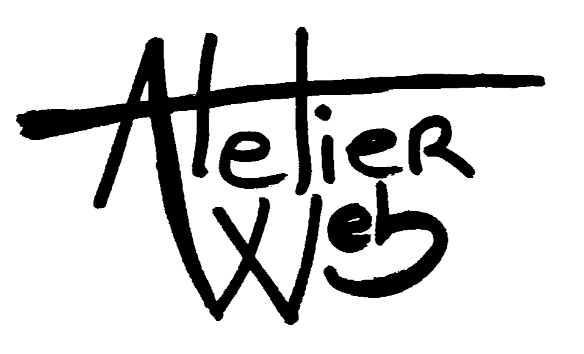

## AZQS - [Azqs.com](http://azqs.com)

Hébergement associatif basé à Strasbourg

**Association Atelier Web  
Projet AZQS.com**  
39 boulevard de Nancy  
67000 Strasbourg  
[demandedinfos@azqs.com](mailto:demandedinfos@azqs.com?subject=Demande d'info via AZQS)

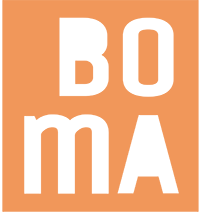

## BOMA - Les Bonnes Matières - [boma.alsace](https://boma.alsace/)

Depuis 2019, BOMA est **bureau d’études technique**, spécialisé en **matériaux de construction**, notamment dans le **réemploi** des « BOnnes MAtières » et la mise en œuvre de **matériaux biosourcés**.

**BOMA – Les Bonnes Matières**  
5 rue Kuhn  
67000 STRASBOURG  
[contact@boma.alsace](mailto:contact@boma.alsace)

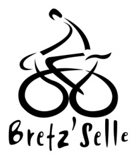

## Bretz'selle - [bretzselle.org](https://bretzselle.org/)

Bretz’Selle est une association strasbourgeoise, dédiée à la promotion active du vélo. Elle se base sur l’apprentissage de la mécanique, l’animation et la mise à disposition d’ateliers équipés, le réemploi de vélos inutilisés ainsi que l’organisation de festivités sur le thème du vélo tout au long de l’année. 

**Bretz'selle**  
10, rue des Bouchers  
67000 Strasbourg  
09 51 29 87 59  
[contact@bretzselle.org](mailto:contact@bretzselle.org)

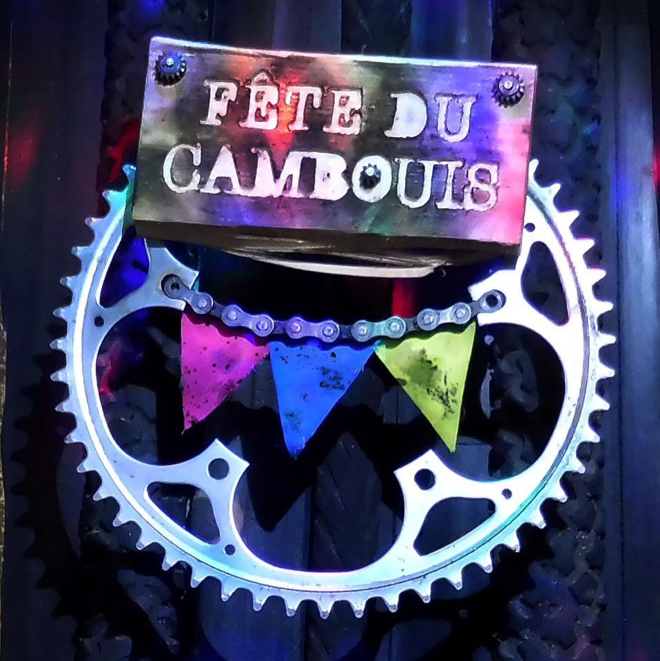

## Le Cambouis - [Facebook](https://www.facebook.com/people/Cambouis/100057361634027/)

Une communauté engagée dans la promotion du vélo.

**Le Cambouis**  
91 rte des Romains  
67200 STRASBOURG  
06 89 77 83 08

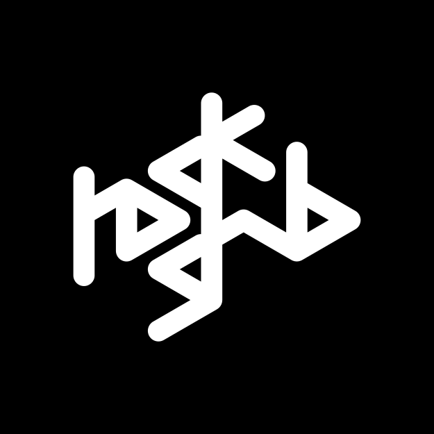

## Hackstub - [Hackstub.netlib.re](https://hackstub.netlib.re/)

Hackstub est un hackerspace associatif strasbourgeois qui sensibilise le public local à la culture et l'informatique Libre, et mène un travail d'éducation populaire dans une perspective critique et émancipatrice des technologies, à travers des animations telles que des ateliers, des conférences, des projections, de l'autoformation, etc. L'association a notamment connu deux temps forts dans l'organisation d'Avenirs d'Internet(s) en 2016 et des Rencontres Mondiales du Logiciel Libre en 2018.

**Le Hackstub**  
42 Rue du Ban-de-la-Roche à la Semencerie  
67000 STRASBOURG  
bureau@hackstub.netlib.re

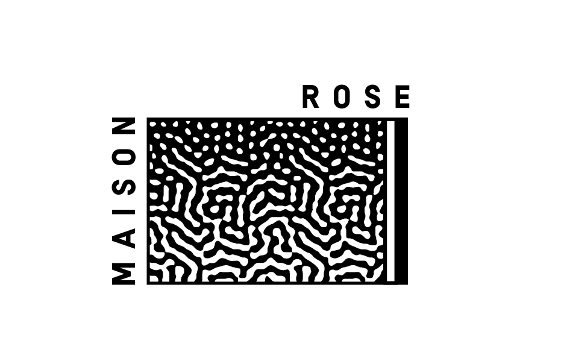

## La Maison Rose - [Lamaisonrosegruber.org](https://www.lamaisonrosegruber.org/)

La Maison Rose veut entretenir un dialogue constructif avec les autres collectifs et désire rester attentive à la vie du quartier, aux besoins des habitant·e·s, des associations et des activités professionnelles du quartier de Koenigshoffen.

**La Maison Rose**  
91 rte des Romains  
67200 STRASBOURG  
bonjour@lamaisonrosegruber.org

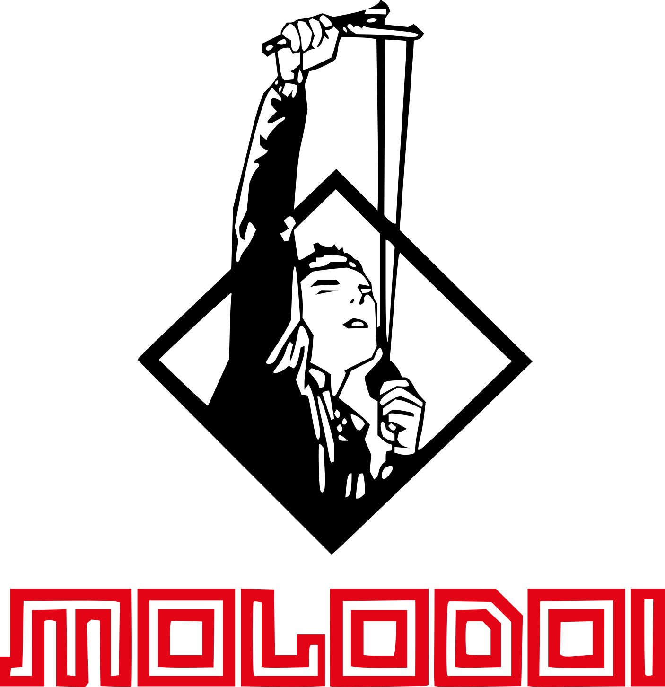

## CAJ Molodoï - [Molodoi.net](https://www.molodoi.net/)

**Espace alternatif auto-géré depuis 1994**  
Un lieu pour toutes les associations du coin et d'ailleurs…

**CAJ Molodoï**  
19 rue du Ban-de-la-Roche  
67000 STRASBOURG

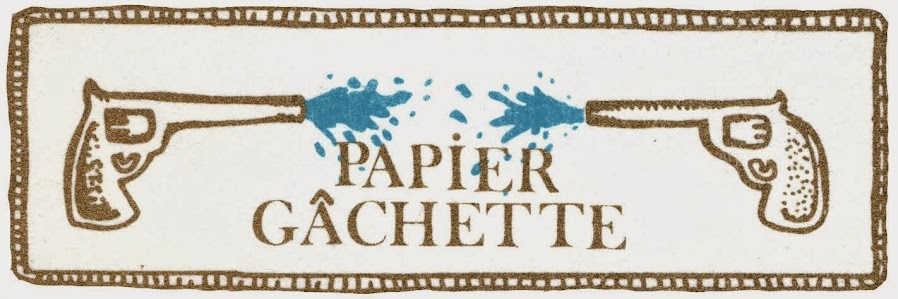

## Papier Gâchette - [Papiergachette.blogspot.com](https://papiergachette.blogspot.com/)

Papier Gâchette est un atelier partagé.  
Notre vocation est l'édition de livres et d'affiches ainsi que le partage de savoir faire à travers les stages et cours du soir que nous proposons.

**Papier Gâchette**  
6 rue du rempart  
67000 STRASBOURG  
papier.gachette@gmail.com

Directrice générale des relations dans l'entreprise :  
06.30.66.85.87

Directrice du marketing:  
06.68.33.78.63

Directrice générale des listes de choses à faire :  
06.68.87.87.74

Directeur général de la production:  
07.78.26.09.63

## La Plage Digitale - [Laplagedigitale.eu](https://www.laplagedigitale.eu/)

**Espace de coworking, tiers-lieu de l'innovation à Strasbourg**

**La Plage Digitale**  
13 rue Jacques PEIROTES  
67000 STRASBOURG  
03 88 41 86 95  
contact@laplagedigitale.eu

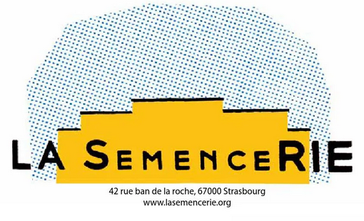

## La Semencerie - [Lasemencerie.org](https://www.lasemencerie.org/)

Les artistes résidant de manière permanente ont engagé leur production dans diverses activités. Leur champ d'action comprenait la création de spectacles ou d'objets spectaculaires, d'installations plasticiennes, de sculptures en verre, bois, métal, matériaux de récupération ou pâte à modeler, de peintures, de textes, de projets architecturaux, de vidéo, de musique électronique, acoustique ou électro-acoustique, de marionnettes ou d'automates, de structures scénographiques ou encore d'objets de récupération réhabilités.:

Ils travaillaient par ailleurs collectivement au développement du lieu qui fonctionne sur un principe d'autogestion. En fonction de la disponibilité, le choix des résidents temporaires se fait en ce sens de manière ouverte et collégiale et donne lieu dans certains cas à des évènements publics selon les capacités des lieux en accord avec les normes de sécurité en vigueur.

**La semencerie**  
42 Rue du Ban-de-la-Roche  
67000 STRASBOURG

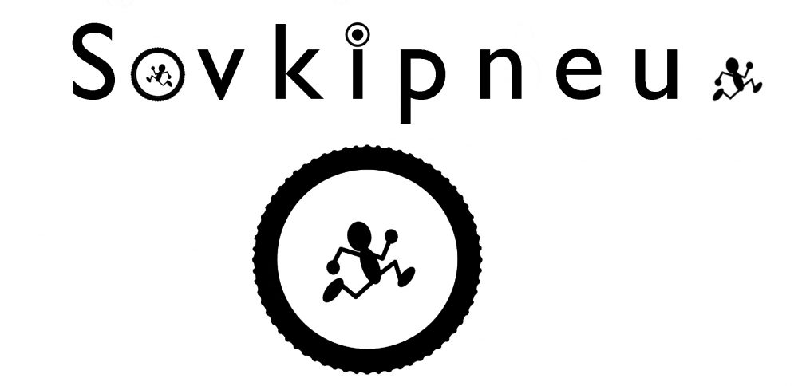

## Sovkipneu - [Azqs.com/sovkipneu](https://azqs.com/sovkipneu/)

Des pneus des ronds des euros des heureux.

sovkipneu@gmail.com  
06 07 88 32 99

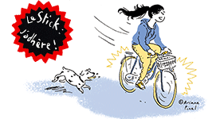

## Le Stick - [Lestick.azqs.com](https://lestick.azqs.com/)

**Le Syndicat technique d'initiative cyclable de Koenigshoffen**, alias Le SticK, est une association d'autoréparation vélo de droit local, implantée dans le quartier ouest de Strasbourg Koenigshoffen.

**Le Stick**  
91 rte des Romains à La Fabrique  
67200 STRASBOURG  
[atelier@lestick.fr](mailto:atelier@lestick.fr)

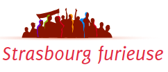

## Strasbourg Furieuse - [Strasbourgfurieuse.demosphère.net](https://strasbourgfurieuse.demosphere.net/)

Strasbourg furieuse est un agenda collaboratif, cela signifie qu'il est **collectivement le nôtre** : toutes personnes, organisation formelle ou informelle peut alimenter l'agenda avec ses évènements.

**Strasbourg Furieuse**  
[contact@strasbourgfurieuse.demosphere.net](mailto:---)

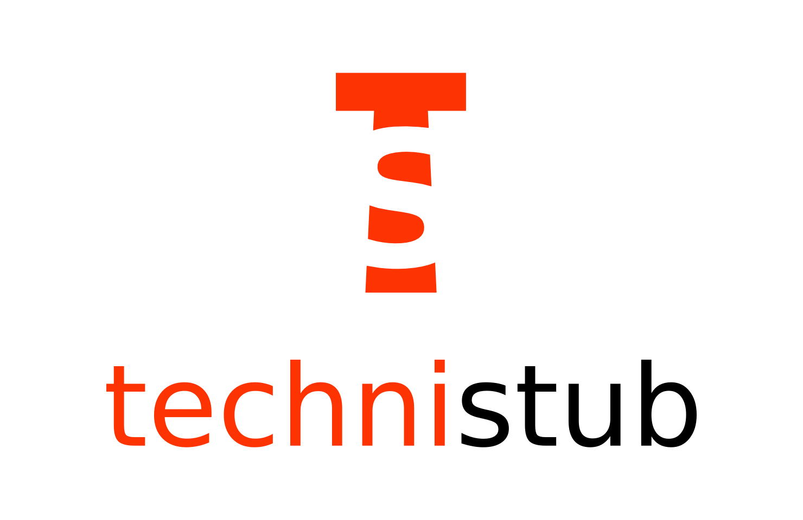

## Technistub - [Technistub.org](https://technistub.org)

Fablab et makerspace à Mulhouse / Alsace

**Technistub**  
2 rue des Flandres  
68100 Mulhouse  
09 84 17 62 91  
[stephane@technistub.org](mailto:stephane@technistub.org)
