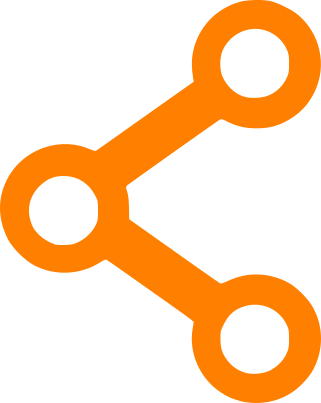
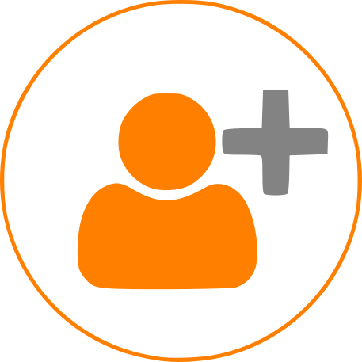
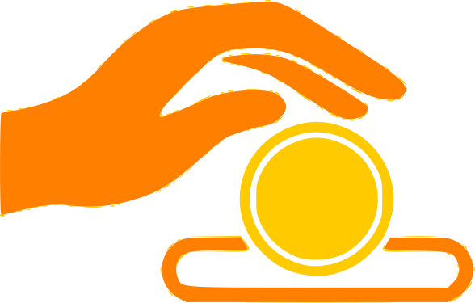
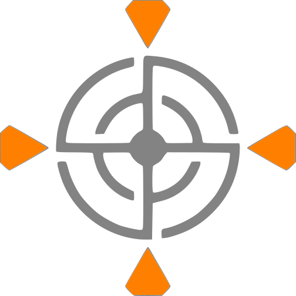
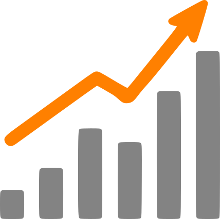

## Pourquoi nous soutenir

La Fabrique est une association **à but non lucratif**, fonctionnant à ce jour **sur la base du bénévolat**. Chez nous, il n’y a pas de clients ou clientes, mais des usagers et des usagères. Tout le monde est invité à participer à cette reprise en mains et mise en commun des outils de fabricatio/home/joris/DEV/lafab/lafab.org/recreation_lafab-org/publicn pour apporter notre brique technologique utopique.

## Comment participer si j'ai peu de temps

### Relayer notre message

- Parlez en autour de vous et dans vos associations.

- Offrez un Bon Cadeau

Lire le guide

### Devenir membre

Devenir membre permet :

- de faire **grandir l'association, renforcer sa légitimité** pour faire entendre ses rêves les plus fous

- de **souscrire aux services** que nous proposons

- de **participer à la vie de l'association**, aux réunions, à l'organisation d'évènements ou à son administration

[Adhérer](/horaires-et-tarifs/)

### Faire un don

- dons en euros

- dons en matériel

Donner

### Missions ponctuelles

- ponctuelle

- bénévole

- réalisable en quelques heures

- sans engagement de régularité

Découvrir les missions

### Acheter un bon de refondation

Vous pouvez exhiber un morceau de La Fabrique dans votre salon pour la modique somme de 100€.

[Acheter un bon](/asp-products/bon-de-refondation/)

## Pour s'engager davantage ?

### Se signaler et demander à faire parti des membres actifs

Nous vous encourageons à nous écrire à contact \[chez\] lafab.org, ainsi nous pourrons vous donner des accès à ce dont vous avez besoin pour participer et nous ne vous oublierons pas lors des prochaines actions susceptibles de vous intéresser.

### Se coordonner

Nous utilisons essentiellement la mailingliste et les chats indiques sur la page contact.

### Venir aux rendez-vous

Ci-dessous, quelques rendez-vous auxquels vous pouvez prendre part :

### Découvrir les ressources

- Le wiki des bénévoles (tout frais)

- Le drive

### Intégrer des groupes de travail

#### Communication

**Touillette :** Maud

- Promotions de nos évènements

- Animation des réseaux sociaux

- Conception de support de communication

- Envoie de newsletter

- Distribution de flyers et affichage

- Réseautage

#### Maintenance et amélioration continue des services

- maintenance du parc machine

- mise-en route de nouvelles

- aménagement des locaux

- gros œuvre

- électricité

- etc.

#### Trésorerie

**Touillette** : Fred

- Répondre aux questions de sous de nos membres

- Tenir le journal des opérations

- S’assurer que nos politiques tarifaires restent viables et les faire évoluer

#### Développement

#### Conseil d'administration

Le conseil d'administration prend toutes les décisions nécessaires à la gestion quotidienne de l’association.

Composition 2022-2023 :

- Mathias (président)

- Maud (vice-présidente)

- Fred (trésorier)

- Nico (vice-trésorier)

- Mathieu (secrétaire)

- Aline
